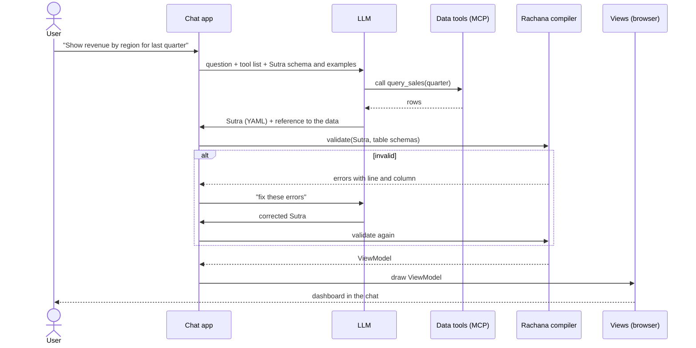
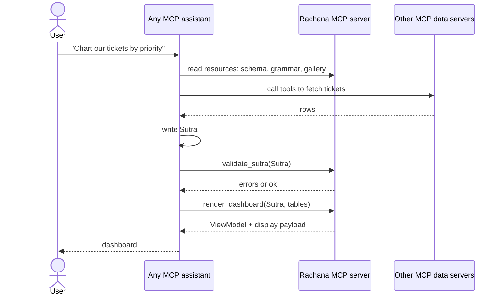

<!-- Copyright (c) 2026 Ashutosh Sinha. Proprietary. All rights reserved. -->
# Rachana for AI: safe generative UI

Status: **planning.** All of this is planned (generation of Sutras by AI is phase R2; see [ROADMAP](ROADMAP.md)).

## The idea

A chat assistant can answer with a real dashboard instead of a wall of text, **without generating code that runs**. The
model writes a **Sutra**, which is declarative data. The compiler validates it. Nothing is executed: a Sutra can only
describe what to show, so a wrong or hostile answer cannot do more than show the wrong thing, and the compiler rejects
anything outside the language.

## Flow 1: a chatbot that draws dashboards

Points that make it safe and reliable:

- **Data comes from tools**, over MCP, with the permissions the user already has. The model never gets a free query channel the host did not offer.
- **The model writes only the Sutra.** The data is bound by the compiler, not pasted into the model's output.
- **Errors are specific** (key, line, column), so the model can correct itself. The number of retries is capped by the chat app.
- **The schema and the grammar are given to the model** as context, so it writes valid Sutras first time more often.

## Flow 2: Rachana as an MCP server

Planned. A Rachana MCP server lets **any MCP-capable assistant** render dashboards, without that assistant's builder
integrating Rachana.

| Kind | Name | What it does |
|---|---|---|
| Tool | `validate_sutra` | Check a Sutra (and optionally table schemas); return errors with locations, or ok |
| Tool | `render_dashboard` | Compile a Sutra against supplied tables; return the ViewModel and a way to display it |
| Tool | `examples` | Return example Sutras for a stated purpose |
| Resource | schema | The Sutra JSON Schema |
| Resource | grammar | The Rachana-EL EBNF grammar |
| Resource | gallery | Reviewed example dashboards |

## The owner's chatbot: a Rachana tool pack for sajhamcpserver

The planned chatbot is built on **sajhamcpserver** (SAJHA), the owner's own MCP server (Python, FastAPI). SAJHA keeps
one governed catalog of tools behind one \`/mcp\` endpoint, with credentials, roles, policy and audit applied to every
call. Rachana would be added to that catalog as a **Rachana tool pack**: a set of tools built on the Python SDK. All
of it is **planned**; the tool names below are subject to change.

| Tool (planned) | What it does |
|---|---|
| \`validate_sutra\` | Lint a Sutra against the schema and grammar; return problems with line and column, in a form the model can act on |
| \`render_dashboard\` | Take a Sutra and tables; return a rendered dashboard as a link or card the chat can show |
| \`sutra_examples\` | Few-shot example Sutras, selected by kind of dashboard (KPI strip, ranking, trend, breakdown, detail grid) |
| \`data_to_table\` | Turn another MCP tool's result into a Rachana Data Protocol table (typed columns, JSON rows or Arrow) |

Because the pack lives in SAJHA's catalog, the dashboard tools are governed like any other tool: the same sign-in, roles,
policy and audit apply, and the data tools the model calls first are the ones the user is already allowed to use.

\`\`\`mermaid
sequenceDiagram
  actor U as User
  participant Chat as Chat app
  participant LLM as LLM
  participant S as sajhamcpserver (tool catalog)
  participant R as Rachana tool pack
  U->>Chat: "Show revenue by region for last quarter"
  Chat->>LLM: question + tool list
  LLM->>S: call data tools (market data, SQL, ...)
  S-->>LLM: results
  LLM->>R: data_to_table(result)
  R-->>LLM: table id + column schema
  LLM->>R: sutra_examples(kind)
  R-->>LLM: example Sutras
  LLM->>LLM: write Sutra
  loop until valid (retries capped)
    LLM->>R: validate_sutra(Sutra, table schemas)
    R-->>LLM: problems with line and column, or ok
    LLM->>LLM: fix the Sutra
  end
  LLM->>R: render_dashboard(Sutra, tables)
  R-->>LLM: dashboard link or card
  LLM-->>Chat: answer + dashboard reference
  Chat-->>U: chat shows the dashboard
\`\`\`

Rachana also ships the **generic Rachana MCP server** described above (Flow 2), for assistants that do not use SAJHA. The
tool pack and the generic server share the same compiler and the same tool contracts; only the host differs.

## Limits to state plainly

- A dashboard is only as good as the data the tools return; Rachana checks the structure of the Sutra, not the truth of the data.
- The model can still choose a misleading chart. The compiler guarantees validity and safety, not judgement.
- How the host application displays a ViewModel (inline, a link, an image) depends on the host; this is not designed yet.
