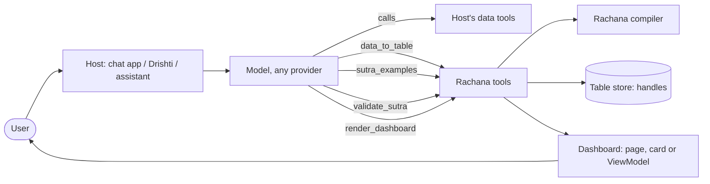
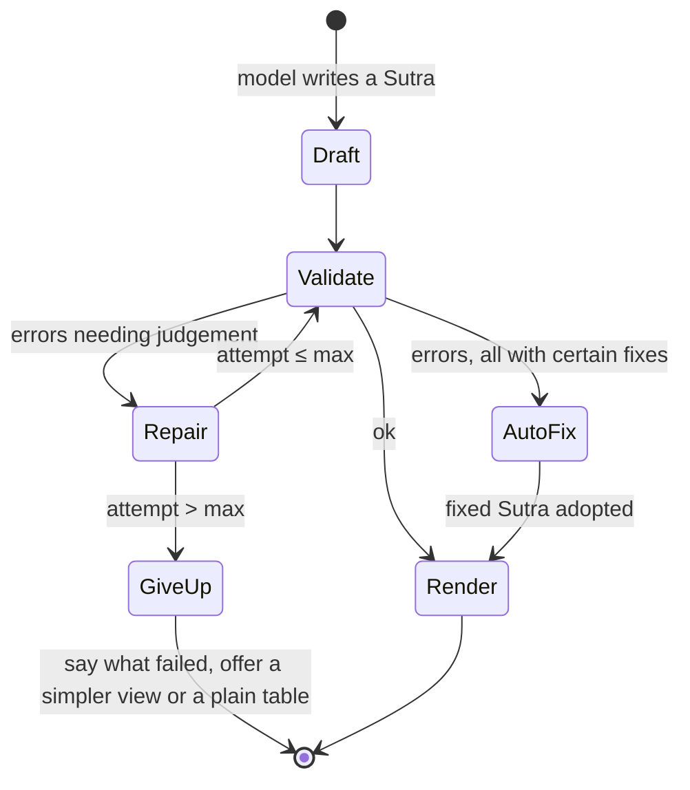

<!-- Copyright (c) 2026 Ashutosh Sinha. Proprietary. All rights reserved. -->
# Generative UI on Rachana: design

Status: **design; built in phase R2** (with Drishti i9). Nothing here is implemented.
Tool names and schemas are the planned contract and may still change before they ship.

The first host is written: the **GenUI kit lite for SAJHA** (`tools/sajha/`, design [GENUI_KIT](GENUI_KIT.md)). It ships four of
these contracts under the names `search_fragments` (in place of `sutra_examples`: a catalogue generated from the fragments' doc
blocks, searched by text and by data shape), `get_fragment`, `check_sutra` (`validate_sutra`) and `publish_ui` (`render_dashboard`
with `output: link`); `data_to_table` and its handles are replaced by table **sources** given to `publish_ui` (a SAJHA data tool
called as the user, or a Data Protocol host), so rows never pass through the model.

## 1. The idea, and the boundary

A model answers with a **Sutra**. A Sutra is data: it cannot run code, fetch an address it invents, or reach data the
host did not offer. The compiler checks it completely and returns problems a model can act on. The painter draws
only what the compiled ViewModel says.

Generative UI is built **on Rachana, not inside it**: the language has no AI key, the compiler calls no model, and
no provider's name appears in this repository's runtime. What Rachana ships is (1) a prompt kit, (2) a
validate-and-fix contract, (3) tools over that contract for the owner's MCP server and for any MCP client, and
(4) an evaluation harness. Drishti, other applications and AI assistants use the same four.



## 2. The prompt kit

A versioned set of files generated from the specification, so it can never describe a language the compiler does not
accept. Published in `spec/1/ai/` and returned by the tools.

| File | Size target | Contents |
|---|---|---|
| `grammar-card.md` | ≤ 1,500 tokens | the whole of Core on one page: top-level keys, the panel kinds with required options, `data:`, controls, the expression operators, the thirty most used functions, formats and tones, five rules ("quote expressions", "`rows` is a list", "`group()` for bars", "`==` not `=`", "names exactly as the table's columns") |
| `kinds/<kind>.md` | ≤ 300 tokens each | one panel kind: options, one minimal example, common mistakes with their codes |
| `functions.md` | ≤ 2,500 tokens | every Core function, one line each, by family |
| `examples/*.sutra.yaml` | 10 to 40 lines each | reviewed examples by intent (section 2.1), each with a sample table schema; every one is a conformance case |
| `system.md` | ≤ 400 tokens | the instruction block for a host to place in its system prompt: role, the loop of section 3, the tools, what not to do |
| `fix-guide.md` | ≤ 800 tokens | how to read a problem (`code`, `range`, `expected`, `fix`) and the usual repair for the twenty most frequent codes |
| `sutra.schema.json` | | the JSON Schema, for providers with structured output |

**Layering.** A host puts `system.md` and `grammar-card.md` in context always (about 2,000 tokens), and lets the
model pull `kinds/*`, `functions.md` and examples through `sutra_examples` when needed. Profiles add their own card
(`drishti` adds its kinds and sources) in the same format.

**Generated, with a gate.** The cards are produced from `rachana.lang.json` and `functions.yaml` by
`rachana-tools`; hand-written prose lives in small templates. A test compiles every snippet in every card.

### 2.1 Example intents

`kpi-strip`, `ranking` (bars), `trend` (line or area over time), `breakdown` (donut or pivot), `detail-grid`
(table with filters), `comparison` (two measures), `distribution` (histogram), `master-detail` (a click fills
another panel), `map`, `status-board`, `live-blotter`. Each intent has two or three examples of rising size.
Selection is by intent and by the shape of the caller's table (has a date column, has a low-cardinality text
column, number of numeric columns), not by embedding search: deterministic and testable.

## 3. The validate-and-fix loop

### 3.1 Contract

`validate(sutra, tables) → result` is a pure function of its inputs (no clock, no network):

```json
{
  "ok": false,
  "language": "1.4",
  "problems": [ { "code": "RCH-2071", "severity": "error",
                  "message": "sales has no column 'reveune'",
                  "range": { "start": { "line": 9, "column": 28 }, "end": { "line": 9, "column": 35 } },
                  "path": "/panels/0/value",
                  "expr": { "source": "sum($.sales, 'reveune')", "start": 14, "end": 21 },
                  "expected": ["revenue", "region", "month"],
                  "fix": { "title": "Use 'revenue'", "edits": [ { "range": { "start": { "line": 9, "column": 28 }, "end": { "line": 9, "column": 35 } }, "text": "revenue" } ] } } ],
  "fixed": "rachana: 1\nsutra: sales-overview\n…",
  "summary": "1 error. Line 9: sales has no column 'reveune'; did you mean 'revenue'?",
  "attempt": { "n": 1, "max": 3, "sutra_hash": "9c1e…" }
}
```

| Field | Rule |
|---|---|
| `problems` | the full list of SPEC section 7, sorted by position, capped at 25 (with `more`) so a reply stays small |
| `fixed` | present when **every** error has a certain `fix`: the Sutra with all fixes applied, already re-validated and clean. The model may adopt it as is |
| `summary` | one short paragraph in plain words for models that read prose better than JSON |
| `attempt` | the tool counts attempts per conversation and per Sutra name; it refuses beyond `max` (default 3) with `stop: true` and the advice to simplify or ask the user |
| warnings | never block: `ok` is true with warnings |
| on `ok: true` | `plan` (tables and columns read), `panels` (id, kind, title) and `preview` (the first values of the strip and each metric), so the model can sanity-check what it made without seeing a picture |

### 3.2 The loop



Rules that make the loop converge:

1. **Deterministic first.** Certain fixes (a misspelt key, column or function; a missing quote; an option on the
   wrong kind with one valid home; an old spelling) are applied by the compiler, not by the model.
2. **Local repairs.** The model is told to change only the lines named, and the tool checks it: a "repair" that
   changes more than the problem ranges plus a small margin is accepted but flagged (`rewrote: true`) for evaluation.
3. **Monotone progress.** If attempt *n* has more errors than attempt *n−1*, the tool says so and returns the better
   of the two as the base.
4. **A floor that always works.** When the loop gives up, `render_dashboard` can render `fallback: "table"`: a plain
   grid of the table, generated without a model. The user always gets something correct.
5. **Bounded.** Sutra ≤ 64 KB, ≤ 60 panels, the expression limits of the language; three attempts; one render per
   accepted Sutra.

## 4. The tools

One contract, one host: the **Rachana tool pack for sajhamcpserver** (the owner's governed tool catalog; Python,
built on the Python SDK); there is no standalone MCP server (owner, 2026-11-28). Schemas below are JSON Schema for `inputSchema` and the shape of the structured result.

### 4.1 `data_to_table`

Turns another tool's result into a Rachana table and returns a **handle**. The model passes handles, not rows, from
then on, so data does not have to travel through the model twice.

```json
{ "name": "data_to_table",
  "description": "Register rows (from another tool's result) as a named table for a dashboard. Returns a handle and the column schema.",
  "inputSchema": { "type": "object", "required": ["name"], "additionalProperties": false, "properties": {
    "name":   { "type": "string", "pattern": "^[a-z][a-z0-9_]{0,63}$", "description": "Table name the Sutra will use in data:" },
    "rows":   { "type": "array", "items": { "type": "object" }, "maxItems": 5000, "description": "Rows as objects" },
    "csv":    { "type": "string", "description": "Or CSV text with a header row" },
    "result_ref": { "type": "string", "description": "Or the id of an earlier tool result held by the host (preferred for large data)" },
    "path":   { "type": "string", "description": "Where the rows are inside a wrapped result, e.g. $.items" },
    "key":    { "type": "array", "items": { "type": "string" }, "description": "Columns that identify a row" },
    "types":  { "type": "object", "additionalProperties": { "enum": ["string","integer","decimal","number","boolean","date","timestamp"] }, "description": "Override inferred column types" } } } }
```

Result: `{ "table": "tbl_7f3a", "name": "sales", "rows": 6, "columns": [ { "name": "region", "type": "string",
"distinct": 3, "examples": ["North","South","West"] }, { "name": "revenue", "type": "decimal", "min": "60", "max": "135" } ],
"warnings": [], "expires": "2026-11-17T12:00:00Z" }`. Exactly one of `rows`, `csv`, `result_ref`. Column profile
(`distinct`, `min`, `max`, three `examples`) is what lets the model choose a chart; `examples` are omitted for a
column the host marks sensitive.

### 4.2 `sutra_examples`

```json
{ "name": "sutra_examples",
  "description": "Get the grammar card and reviewed example Sutras for a kind of dashboard.",
  "inputSchema": { "type": "object", "additionalProperties": false, "properties": {
    "intent": { "enum": ["kpi-strip","ranking","trend","breakdown","detail-grid","comparison","distribution","master-detail","map","status-board","live-blotter"] },
    "tables": { "type": "array", "items": { "type": "string" }, "description": "Table handles; examples are chosen to fit their columns" },
    "kinds":  { "type": "array", "items": { "type": "string" }, "description": "Panel kinds to get reference cards for" },
    "include": { "type": "array", "items": { "enum": ["grammar-card","functions","fix-guide"] } },
    "max":    { "type": "integer", "minimum": 1, "maximum": 5, "default": 2 } } } }
```

Result: `{ "language": "1.4", "cards": [ { "name": "grammar-card", "text": "…" } ], "examples": [ { "intent":
"ranking", "title": "Revenue by region", "sutra": "…", "tables": { "sales": [ { "name": "region", "type": "string" } ] } } ] }`.

### 4.3 `validate_sutra`

```json
{ "name": "validate_sutra",
  "description": "Check a Sutra against the language and the tables it reads. Returns problems with exact positions and fixes, or ok.",
  "inputSchema": { "type": "object", "required": ["sutra"], "additionalProperties": false, "properties": {
    "sutra":   { "type": "string", "maxLength": 65536, "description": "The Sutra as YAML text" },
    "tables":  { "type": "object", "additionalProperties": { "type": "string" }, "description": "Map of the names used in data: to table handles" },
    "schemas": { "type": "object", "description": "Or column schemas by table name, when there is no handle" },
    "profile": { "type": "array", "items": { "type": "string" }, "default": ["core"] },
    "apply_fixes": { "type": "boolean", "default": true } } } }
```

Result: section 3.1.

### 4.4 `render_dashboard`

```json
{ "name": "render_dashboard",
  "description": "Compile a valid Sutra against its tables and return a dashboard the user can see.",
  "inputSchema": { "type": "object", "required": ["sutra"], "additionalProperties": false, "properties": {
    "sutra":    { "type": "string", "maxLength": 65536 },
    "tables":   { "type": "object", "additionalProperties": { "type": "string" } },
    "controls": { "type": "object", "description": "Initial control values" },
    "output":   { "enum": ["link","card","viewmodel","html","image"], "default": "link" },
    "title":    { "type": "string" },
    "fallback": { "enum": ["none","table"], "default": "none" },
    "ttl_minutes": { "type": "integer", "minimum": 1, "maximum": 10080, "default": 1440 } } } }
```

| `output` | Result | For |
|---|---|---|
| `link` | `{ "url": "…/d/9c1e", "expires": … }`: a page with `<rachana-view>`, the Sutra and the tables, served by the host, readable only by the caller | any chat that can show a link |
| `card` | an MCP UI resource (`ui://rachana/dashboard/9c1e`, HTML that loads the painter) plus the link | clients that render embedded UI |
| `viewmodel` | the ViewModel JSON | hosts that paint themselves (Drishti, an app with `<elements-view>`) |
| `html` | one self-contained HTML file (painter, Sutra, data inline) | export, e-mail, offline |
| `image` | a PNG rendered headless | clients that show only images (optional capability; needs a headless browser on the host) |

Every result also has `summary` (title, panels, row counts, the strip's first figures) so the model can describe
what it made. An invalid Sutra is refused with the result of `validate_sutra`; render never guesses.

### 4.5 Other tools and resources (to add to the plugin)

| Kind | Name | Purpose |
|---|---|---|
| tool | `describe_table` | schema and column profile of a handle (after a restart of the conversation) |
| tool | `update_dashboard` | apply an editing operation or a new Sutra to a rendered dashboard, keeping its link |
| resource | `rachana://spec/1/grammar-card`, `…/functions`, `…/schema`, `…/kinds/{kind}`, `…/examples/{intent}` | the prompt kit, for clients that read resources |
| prompt | `dashboard` | the `system.md` block as an MCP prompt, with the user's question as its argument |

### 4.6 The host

One host: the **sajhamcpserver plugin** (`tools/sajha/`, Python, on SAJHA's tool base and the Python SDK's V8 compiler). Identity, roles,
policy and audit are SAJHA's, applied to these tools like any other; the table store is per user in SAJHA's storage with expiry; a
`result_ref` resolves an earlier SAJHA tool result **as that caller**, so data never passes through the model; the page is served by
SAJHA under its sign-in. There is no standalone Rachana MCP server (owner, 2026-11-28). The plugin is thin: argument checking, the table
store, and calls to `compile`, `bind` and the prompt kit.

## 5. Safety

| Threat | Why it does not work | Enforced by |
|---|---|---|
| The model writes code | there is nowhere to put it: no script, HTML, CSS or event-handler text in the language; markdown panels are rendered as text with a fixed safe subset, no raw HTML | the grammar; painter's "strings are text" rule |
| The model reaches data it should not | a Sutra names tables; only handles created for **this caller** resolve; `url:` sources are refused in AI mode (`data_policy: handles-only`) | tool pack; `TableProvider` |
| Prompt injection inside the data ("ignore previous instructions…" in a cell) | cells reach the page as text, never as instructions to the compiler; the tools return column profiles, not free text, unless asked; `examples` values are truncated and marked as data | tools; host guidance in `system.md` |
| Exfiltration through links or images | `link(...)` values resolve through the host's allow-list; a model-written Sutra cannot name a new origin; no remote images | `LinkResolver`; Content-Security-Policy of the dashboard page |
| Resource exhaustion | size, panel, expression, row and attempt limits; compile and bind time limits; rendered dashboards expire | tools; language limits |
| A misleading chart | not preventable by a compiler; reduced by lint rules for AI output (section 5.1) and by showing the Sutra and the data table behind every chart | lint; painter |
| Masked or sensitive columns leaking into the model | profiles of masked columns carry no values; `validate` and `render` summaries never include masked values | `Masker`; tools |
| Dashboard link shared onward | links are bound to the caller's identity in SAJHA; local links are loopback only; `html` export is an explicit choice | hosts |

**Declarative only, data via the host**: the two sentences that carry the whole safety argument. The model is never
trusted; what it writes is checked as strictly as a file from a stranger.

### 5.1 Lint rules for generated Sutras (warnings, profile `ai`)

More than 12 slices in a donut; a `line`
whose `x` is not a date or ordered; a sum of a column whose `unit` differs across rows; a metric with no `fmt`; a
table of more than 20 columns; a panel with no title; a pivot whose cell count exceeds 5,000. Each has a certain fix
where one exists.

## 6. Evaluation

### 6.1 What is measured

| Metric | Definition | Target (to confirm) |
|---|---|---|
| **First-try validity** | share of tasks where the model's first Sutra has no errors | ≥ 85% |
| **Validity after auto-fix** | first Sutra valid after the compiler's certain fixes, no second model call | ≥ 93% |
| **Validity within 3 attempts** | | ≥ 99% |
| **Fulfilment** | share of valid results that satisfy the task's assertions (below) | ≥ 85% |
| Attempts, tokens, time | mean per task; tokens of context spent on the kit | reported |
| Fallback rate | tasks that ended at the plain-table floor | ≤ 1% |
| Rewrite rate | repairs that rewrote more than they were asked | reported |

### 6.2 The task set

`eval/tasks/*.yaml`, about 200 tasks at first: a question in plain words, one to three tables (schema and rows), and
**assertions over the ViewModel**, checked by code, not by a model:

```yaml
id: ranking-007
ask: "Show revenue by region, biggest first, and the total at the top."
tables: { sales: fixtures/sales.csv }
expect:
  - { panel: { kind: metric }, value: 580 }
  - { panel: { kind: hbar }, rows: 3, first: { label: North, value: 255 } }
  - { reads: [sales.region, sales.revenue] }
  - { no_panel: { kind: map } }
```

Tasks cover every intent, every Core panel kind, controls, master-detail, dates, nulls, wide tables, misleading
column names, and requests that should be declined ("email this to …"). A held-out third is never used when
tuning the kit.

### 6.3 The harness

`rachana eval --provider <adapter> --model <id> --kit <version>` runs each task through the real tools
(`data_to_table` → model → `validate_sutra` loop → `render_dashboard` with `output: viewmodel`), records every
attempt and problem, and writes a report. Provider adapters are small plug-ins outside the compiler (the same
provider abstraction SAJHA uses); no provider is a dependency of Rachana.

Uses: (1) a **release gate** for the prompt kit: a kit change that lowers first-try validity on the held-out set by
more than 2 points does not ship; (2) the **problem-code histogram** drives the work: the most frequent codes get
better messages, certain fixes, or a line on the grammar card; (3) comparison of models and of kit sizes
(card only against card plus examples), reported in the docs with the date and model ids; (4) recorded runs replay
offline in CI (no model call) to protect the tools and the loop.

## 7. How the hosts use it

| Host | Uses |
|---|---|
| The owner's chatbot on sajhamcpserver | the tool pack; data tools first, then the four tools; dashboards as links or cards under SAJHA's sign-in |
| Any MCP assistant | through SAJHA, which serves the plugin to any MCP client; data from SAJHA's other tools by `result_ref`, or rows |
| Drishti (i9) | the same loop in process (Java API): the Drishti profile's card and examples; tables are Drishti's, resolved as the viewer; the result opens as an ephemeral Sutra that can be saved through Drishti's normal review |
| Another application | the SDK's `validate` and `bind` plus the kit files; its own model and its own tools |

## 8. Phasing

| Step | Needs |
|---|---|
| G1 prompt kit generator and gate | R0 (definition, catalogue) |
| G2 certain fixes in the compiler (`fix` on the top twenty codes) | R1 Core |
| G3 evaluation harness and first task set | G1, G2, JavaScript or JVM build |
| G5 sajhamcpserver tool pack | Python SDK with WASM (R2) |
| G6 Drishti in-process GenUI | Drishti i9 |
