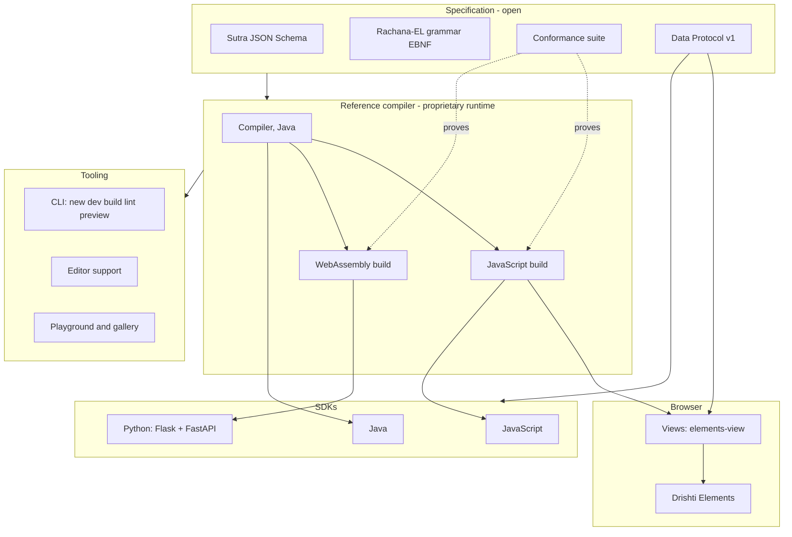
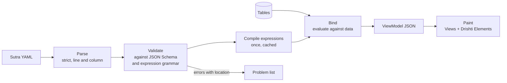
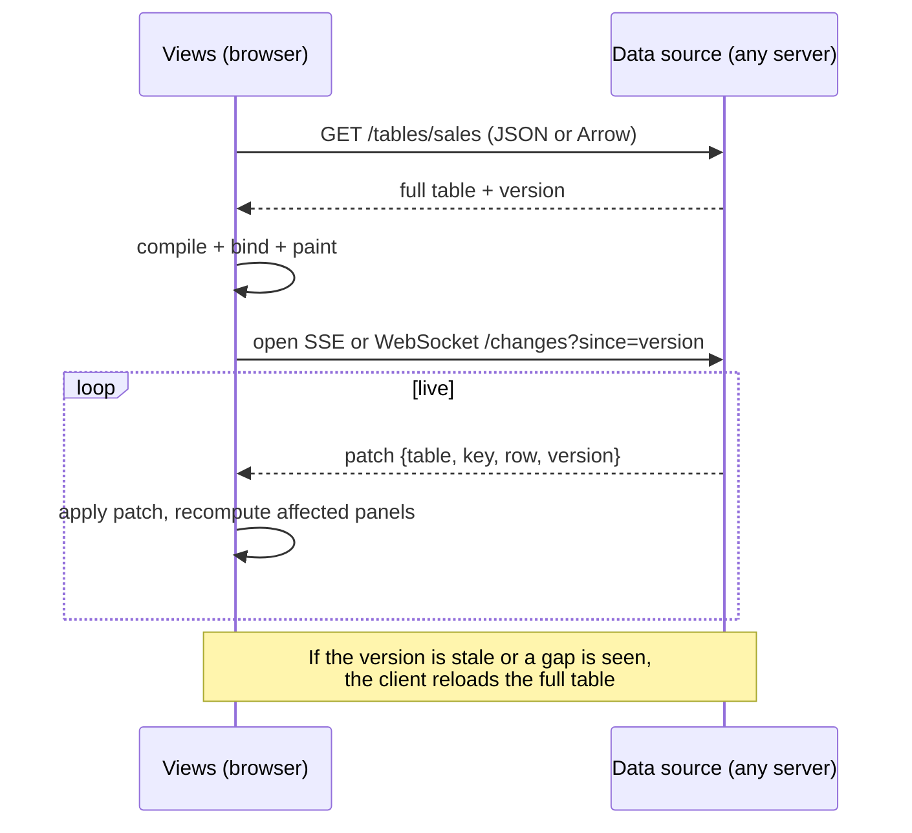
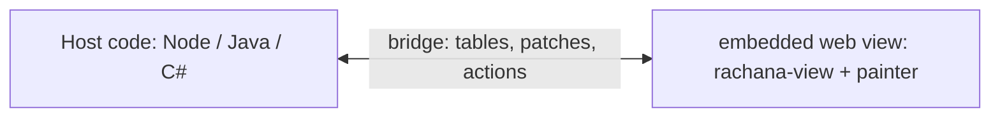
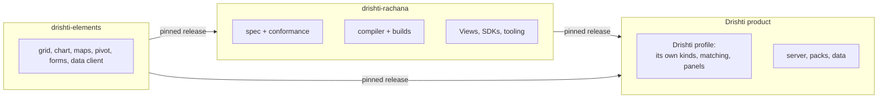

<!-- Copyright (c) 2026 Ashutosh Sinha. Proprietary. All rights reserved. -->
# Architecture

Status: **partly built.** The diagrams show the target design. The compiler is in this repository (`java/rachana-core`,
`v0.9.0`, moved from Drishti with its history; section "Module layout as built"); the binder still lives in Drishti; the
protocol, Views, SDKs and tooling are planned.

## Components

| Component | Responsibility | Status |
|---|---|---|
| Sutra spec | Defines valid Sutras: JSON Schema for structure, EBNF for Rachana-EL | planned (R0); exists today inside Drishti (schema served at `GET /api/v1/rachana/schema`) |
| Conformance suite | Cases of (Sutra, data, expected ViewModel). Any implementation must pass all | planned (R0), harvested from Drishti's Sutra tests |
| Compiler | Parse, validate, bind, produce ViewModel | parse, validate, check, format, edit: **built here** (`java/rachana-core`, `v0.9.0`); bind and ViewModel still in Drishti until A14 |
| Views | `<rachana-view>`: compile, bind, and paint a ViewModel with Drishti Elements' painter | planned (R1) |
| Data Protocol | Move tables and live changes | planned (R0 written, R1 built) |
| SDKs | Embed the compiler and protocol in a host language | planned (R1 Python, JS, Java) |
| Tooling | Author, check, preview, publish | planned (R1 CLI, R2 editor, playground) |

## The compile to paint pipeline

1. **Parse.** The YAML is read keeping the line and column of every node. An unknown key is an error, never ignored.
2. **Validate.** Structure is checked against the JSON Schema, expressions against the EBNF grammar.
3. **Compile expressions** once and cache them by source text.
4. **Bind.** Each panel is evaluated against the tables. One panel that fails shows an empty state; it does not take the screen down.
5. **ViewModel.** Plain JSON, fully worked out: texts, numbers, formats, tones, rows.
6. **Paint.** The Views part maps each panel in the ViewModel to a Drishti Elements component. The painter contains no expression logic.

Because compile and paint are separate, the compile step can run in a browser, in Node, on a server or in CI, and the
paint step can be skipped entirely when you only want to lint or test.

## The data protocol

Planned; written down in phase R0 and built in R1.

- **Tables** travel as JSON rows (simple, readable) or Apache Arrow (large tables, columnar, typed).
- **Live changes** travel as **keyed patches**: each patch names a table, a key, and either the new row or a delete. A client holding the table applies patches in order.

The exact message shapes are not final and will be fixed in the protocol document (R0).

## Languages: JVM, JavaScript, WebAssembly

There is **one compiler source**, written in Java.

| Target | Used by | Why |
|---|---|---|
| JVM | Java SDK, Drishti server, the standalone server, Swing hosts | native home of the reference |
| JavaScript | browsers, Node | compile in the page; no round trip |
| WebAssembly | Python and other hosts | compile and lint without installing a JVM |

The JavaScript build is attempted after a short proof (see ROADMAP R1); the WebAssembly build comes in R2. A native
port in another language is allowed only where needed, and is accepted only when it passes the conformance suite.

## Desktop hosts

Planned. Inside a desktop application the painter runs in the application's embedded browser (Electron's Chromium;
JCEF or JavaFX WebView in Java Swing; WebView2 or CefSharp in .NET), and the Data Protocol travels over an
**in-process bridge** instead of HTTP: the web view's own messaging (`postMessage`, WebView2 `PostWebMessage`, the
JCEF message router). The host pushes tables and patches and receives user actions. One page-side module detects the
channel, so a screen written for the web runs unchanged. Native (non-web) painters are out of scope.

Details: [COMPILER_AND_RUNTIMES](design/COMPILER_AND_RUNTIMES.md) section 9, [DATA_PROTOCOL](design/DATA_PROTOCOL.md) section 9.

## Repository boundaries

- This repository contains **nothing Drishti-specific**. Drishti's extra panel kinds, document matching and domain panels live in Drishti's **profile**, an extension of Sutra Core that Drishti owns.
- The specification is open; the runtime (compiler, Views, SDKs) is proprietary.
- Every release carries UI speed budgets, as with Drishti Elements.
- The painter (`<elements-view>`, the `drishti-views` library) is Drishti Elements code, vendored here at a pin;
  this repository adds `<rachana-view>`, which compiles and binds a Sutra and hands the ViewModel to the painter.

## Module layout as built

| Module | Packages | Depends on |
|---|---|---|
| `rachana-api` | `com.ash.rachana.api` (`Node`, the value interface every reader uses; Rachana's own nodes behind `Node.of`) | the JDK |
| `rachana-core` | `com.ash.rachana` (writer, text, expressions, wiring, schema, editors, problems), `.el`, `.el.check`, `.format`, `.model`, `.parse`, `.design.ops`, `.profile` | `rachana-api`; Jackson as a split exemption ([java/SPLIT_EXEMPTIONS.md](../java/SPLIT_EXEMPTIONS.md)) until A8b |
| `rachana-conformance` | `JvmRuntime`, the conformance runtime program | `rachana-core` |
| `rachana-compat` | the compatibility regime's tests | JUnit |
| `rachana-guards` | the guards over the reactor | JUnit |
| `rachana-tools`, `rachana-data`, `rachana-cli` | skeletons | `rachana-core` |

The editing operations are still in `rachana-core`; they move to `rachana-tools` when the public API is reviewed. `rachana-core`
reads the format table and world regions from the pinned Drishti Elements data (`js/vendor/drishti-elements/2.4.0/data`).

## Design documents

The detailed designs are in [design/](design/): [SPEC](design/SPEC.md), [CORE_AND_PROFILES](design/CORE_AND_PROFILES.md),
[DATA_PROTOCOL](design/DATA_PROTOCOL.md), [COMPILER_AND_RUNTIMES](design/COMPILER_AND_RUNTIMES.md),
[SPLIT_PLAN](design/SPLIT_PLAN.md), [AI_GENUI](design/AI_GENUI.md), [DECISIONS](design/DECISIONS.md). Where a detail
here differs from them, the design documents are newer.

## How Drishti consumes it

Drishti vendors a **pinned release** of Rachana, the same way it vendors Drishti Elements today: the files are copied
in, with a version file, and nothing is fetched at run time. Drishti's profile adds its kinds on top of Sutra Core. When
Rachana ships a change, Drishti runs its own Sutra tests plus the conformance suite before it moves the pin.
