<!-- Copyright (c) 2026 Ashutosh Sinha. Proprietary. All rights reserved. -->
# Modes

Status: **planning.** Nothing on this page is built in this repository yet. All code is illustrative; **planned API,
subject to change.**

```mermaid
flowchart TB
  subgraph Static[1 Static]
    F1[Sutras + CSV/JSON/Arrow] --> B1[rachana build] --> SITE[static site]
  end
  subgraph Emb[2 Embedded]
    APP[any web app] --> EV[elements-view + compiled Sutra] --> API[your data API]
  end
  subgraph Py[3 Python app]
    FL[Flask / FastAPI app] --> MT[mount Sutras, expose tables, stream changes]
  end
  subgraph Srv[4 Small server]
    SV[standalone server] --> SRC[REST / database sources, sign-in]
  end
  subgraph Dr[5 Drishti]
    DP[Drishti product] --> PR[pinned Rachana + Drishti profile]
  end
```



| Mode | Backend needed | Live updates | Best for |
|---|---|---|---|
| Static | none | no | reports, analyst dashboards |
| Embedded | yours | if your API streams | adding screens to an existing app |
| Python app | Flask / FastAPI | yes | Python teams |
| Small server | the standalone server | yes | teams without an app |
| Drishti | the product | yes | enterprises |

## 1. Static

Analysts put Sutras and data files in a folder and build a site. No server, no front-end code.

```text
my-dashboard/
  sales.sutra.yaml
  data/sales.csv
```

```bash
# planned CLI, subject to change
rachana new my-dashboard
cd my-dashboard
rachana dev          # live preview while you edit
rachana lint         # check every Sutra
rachana build        # writes ./site: HTML, the painter, the data
```

## 2. Embedded

A web app you already have draws a compiled Sutra with one element and reads data from its own API.

```html
<!-- planned API, subject to change -->
<elements-view sutra="/sutras/sales.sutra.yaml"
               data="/api/tables"></elements-view>
```

## 3. Python app

`pip install drishti-rachana` (planned). Mount Sutras, expose tables, stream changes, and lint in CI.

**Flask** (planned API, subject to change):

```python
from flask import Flask
from drishti_rachana.flask import RachanaBlueprint

app = Flask(__name__)
rachana = RachanaBlueprint(sutras="sutras/")

@rachana.table("sales")
def sales():
    return load_sales_rows()          # list of dicts, or an Arrow table

app.register_blueprint(rachana, url_prefix="/dash")
```

**FastAPI** (planned API, subject to change):

```python
from fastapi import FastAPI
from drishti_rachana.fastapi import RachanaRouter

app = FastAPI()
rachana = RachanaRouter(sutras="sutras/")

@rachana.table("sales")
async def sales():
    return await load_sales_rows()

@rachana.changes("sales")             # streamed as keyed patches over SSE
async def sales_changes():
    async for key, row in watch_sales():
        yield key, row

app.include_router(rachana, prefix="/dash")
```

**Lint in CI** (planned; uses the WebAssembly compiler, no JVM needed):

```bash
rachana lint sutras/
```

## 4. Small standalone server

One process: a folder of Sutras plus sources (REST endpoints or a database), live updates, and sign-in. For teams
that want dashboards without writing an application. Planned for phase R2; its configuration is not designed yet.

## 5. Drishti

Drishti, the full product, is the first customer. It vendors a pinned release of Rachana and adds its own profile
(its own panel kinds and matching rules). Rachana itself contains nothing Drishti-specific.
