<!-- Copyright (c) 2026 Ashutosh Sinha. Proprietary. All rights reserved. -->
# Modes

Status: **planning.** Nothing on this page is built in this repository yet. All code is illustrative; **planned API,
subject to change.**

```mermaid
flowchart TB
  subgraph Static[1 Static]
    F1[Sutras + CSV/JSON/Arrow] --> B1[rachana build] --> SITE[static site]
  end
  subgraph Emb[2 Embedded]
    APP[any web app] --> EV[elements-view + compiled Sutra] --> API[your data API]
  end
  subgraph Py[3 Python app]
    FL[Flask / FastAPI app] --> MT[mount Sutras, expose tables, stream changes]
  end
  subgraph Srv[4 Small server]
    SV[standalone server] --> SRC[REST / database sources, sign-in]
  end
  subgraph Dr[5 Drishti]
    DP[Drishti product] --> PR[pinned Rachana + Drishti profile]
  end
  subgraph Desk[6 Desktop]
    DA[Electron / Swing / .NET app] --> WVW[embedded web view + in-process bridge]
  end
```



| Mode | Backend needed | Live updates | Best for |
|---|---|---|---|
| Static | none | no | reports, analyst dashboards |
| Embedded | yours | if your API streams | adding screens to an existing app |
| Python app | Flask / FastAPI | yes | Python teams |
| Small server | the standalone server | yes | teams without an app |
| Drishti | the product | yes | enterprises |
| Desktop | none: the application itself, through the bridge | yes | desktop applications (Electron, Java Swing, .NET) |

## 1. Static

Analysts put Sutras and data files in a folder and build a site. No server, no front-end code.

```text
my-dashboard/
  sales.sutra.yaml
  data/sales.csv
```

```bash
# the Node CLI (js/packages/rachana-cli): new, lint, build, preview exist; dev is preview without live reload
rachana new my-dashboard
cd my-dashboard
rachana preview sutras/sales.sutra.yaml   # one screen in the browser (dev: a folder)
rachana lint         # check every Sutra: exit 1 on errors
rachana build        # writes ./site: pages, Sutras, data (the painter is added when <rachana-view> lands from g2/data)
```

## 2. Embedded

A web app you already have draws a compiled Sutra with one element and reads data from its own API.

```html
<!-- planned API, subject to change -->
<rachana-view sutra="/sutras/sales.sutra.yaml"
              data="/api/tables"></rachana-view>
```

## 3. Python app

`pip install 'drishti-rachana[flask]'` (or `[fastapi]`, `[v8]` for lint). Built: the adapters below, serving the Data Protocol's JSON resources; the page that paints needs `<rachana-view>` (g2/data). Mount Sutras, expose tables, stream changes, and lint in CI.

**Flask** (`examples/live-orders/flask_app.py`):

```python
from flask import Flask
from drishti_rachana.adapters.flask import RachanaBlueprint

app = Flask(__name__)
rachana = RachanaBlueprint(sutras="sutras/")

@rachana.table("sales")
def sales():
    return load_sales_rows()          # list of dicts, or an Arrow table

app.register_blueprint(rachana, url_prefix="/dash")
```

**FastAPI** (`examples/live-orders/fastapi_app.py`):

```python
from fastapi import FastAPI
from drishti_rachana.adapters.fastapi import RachanaRouter

app = FastAPI()
rachana = RachanaRouter(sutras="sutras/")

@rachana.table("sales")
async def sales():
    return await load_sales_rows()

@rachana.live("sales")                # streamed as keyed patches over SSE
async def sales_changes():
    async for key, row in watch_sales():
        yield key, row

app.include_router(rachana, prefix="/dash")
```

**Lint in CI** (built; the JavaScript bundle on V8 through `mini-racer`, no JVM):

```bash
pip install 'drishti-rachana[v8]'
python -m drishti_rachana lint sutras/ --format sarif --strict      # exit 1 on problems
```

## 4. Small standalone server

One process: a folder of Sutras plus sources (REST endpoints or a database), live updates, and sign-in. For teams
that want dashboards without writing an application. Planned for phase R2; its configuration is not designed yet.

## 5. Drishti

Drishti, the full product, is the first customer. It vendors a pinned release of Rachana and adds its own profile
(its own panel kinds and matching rules). Rachana itself contains nothing Drishti-specific.

## 6. Desktop applications

Planned (Electron first, then Java Swing, then .NET; see [ROADMAP](ROADMAP.md)). A Rachana screen inside a desktop
application is the same web painter running in the application's **embedded browser**; the application feeds it
through an **in-process bridge**, so there is no HTTP server and no open port. The host pushes tables and live
patches to the view and receives what the reader does (a row selected, a link opened, a control changed, a form
submitted). Design: [COMPILER_AND_RUNTIMES](design/COMPILER_AND_RUNTIMES.md) section 9 and
[DATA_PROTOCOL](design/DATA_PROTOCOL.md) section 9.

| Host | Embedded browser | Host SDK (planned) |
|---|---|---|
| Electron | Chromium (built in) | `drishti-rachana-electron` (npm) |
| Java Swing | JCEF (Chromium embedded, as IntelliJ uses); JavaFX WebView in a `JFXPanel` as a fallback | `rachana-swing` (Maven) |
| .NET WinForms / WPF / MAUI | Microsoft WebView2; CefSharp as an alternative | `Rachana.WebView2` (NuGet) |

**Java Swing** (planned API, subject to change):

```java
RachanaPanel view = RachanaPanel.create();                 // a JPanel hosting JCEF
frame.add(view);
view.open(Path.of("sutras/sales.sutra.yaml"));
view.setTable("sales", schema, rows);                      // push a whole table
view.patch("sales", Patch.update(Map.of("region", "North", "month", "2026-02", "revenue", 140)));
view.onAction(a -> { if (a.name().equals("select")) showDetail(a.payload()); });
```

**.NET** (planned API, subject to change):

```csharp
var view = new RachanaView();                              // a WinForms or WPF control over WebView2
await view.OpenAsync("sutras/sales.sutra.yaml");
await view.SetTableAsync("sales", schema, rows);
view.Action += (s, a) => { if (a.Name == "select") ShowDetail(a.Payload); };
```

**Electron** (planned API, subject to change):

```js
const { RachanaHost } = require('drishti-rachana-electron');   // main process
const host = new RachanaHost(win);                              // win: a BrowserWindow
host.open('sutras/sales.sutra.yaml');
host.setTable('sales', schema, rows);
host.on('action', (a) => { /* select, open, control, submit */ });
```

Native painters (drawing with Swing, WPF or MAUI widgets instead of a web view) are **out of scope**: each would be
a second implementation of the grid, the pivot, the charts and the maps. The ViewModel specification is open for
anyone who needs one.
