<!-- Copyright (c) 2026 Ashutosh Sinha. Proprietary. All rights reserved. -->
# Modes

Status: **planning.** Nothing on this page is built in this repository yet. All code is illustrative; **planned API,
subject to change.**

```mermaid
flowchart TB
  subgraph Static[1 Static]
    F1[Sutras + CSV/JSON/Arrow] --> B1[rachana build] --> SITE[static site]
  end
  subgraph Emb[2 Embedded]
    APP[any web app] --> EV[elements-view + compiled Sutra] --> API[your data API]
  end
  subgraph Py[3 Python app]
    FL[Flask / FastAPI app] --> MT[mount Sutras, expose tables, stream changes]
  end
  subgraph Srv[4 Small server]
    SV[standalone server] --> SRC[REST / database sources, sign-in]
  end
  subgraph Dr[5 Drishti]
    DP[Drishti product] --> PR[pinned Rachana + Drishti profile]
  end
  subgraph Desk[6 Desktop]
    DA[Electron / Swing / .NET app] --> WVW[embedded web view + in-process bridge]
  end
```



| Mode | Backend needed | Live updates | Best for |
|---|---|---|---|
| Static | none | no | reports, analyst dashboards |
| Embedded | yours | if your API streams | adding screens to an existing app |
| Python app | Flask / FastAPI | yes | Python teams |
| Small server | the standalone server | yes | teams without an app |
| Drishti | the product | yes | enterprises |
| Desktop | none: the application itself, through the bridge | yes | desktop applications (Electron, Java Swing, .NET) |

## 1. Static

Analysts put Sutras and data files in a folder and build a site. No server, no front-end code.

```text
my-dashboard/
  sales.sutra.yaml
  data/sales.csv
```

```bash
# the Node CLI (js/packages/rachana-cli): new, lint, build, preview exist; dev is preview without live reload
rachana new my-dashboard   # a starter folder; its Sutra declares the newest built level (rachana: 1.2, SPEC 2.1)
cd my-dashboard
rachana preview sutras/sales.sutra.yaml   # one screen in the browser (dev: a folder)
rachana lint         # check every Sutra: exit 1 on errors
rachana build        # writes ./site: pages, Sutras, data, <rachana-view> with the Elements pack and the runtime; serve it with any static server
```

## 2. Embedded

A web app you already have draws a Sutra with one element and reads its tables from its own Data Protocol host
([spec/1/data-protocol](../spec/1/data-protocol/PROTOCOL.md)). The element compiles and binds the Sutra in the page with the
runtime bundle (`rachana.runtime.js`) and paints it with Drishti Elements' painter (`<elements-view>`, Elements 3.2.0-dev+2f21158, vendored under
`js/vendor/drishti-elements/3.2.0-dev+2f21158`, never from a CDN; the pack has `drishti-chart` and its engine, so chart panels draw):

```html
<link rel="stylesheet" href="/vendor/drishti-elements/3.2.0-dev+2f21158/drishti-elements.css">
<script src="/vendor/drishti-elements/3.2.0-dev+2f21158/drishti-elements.js"></script>
<script type="module" src="/vendor/drishti-rachana/src/rachana_view.js"></script>

<rachana-view src="/sutras/sales.sutra.yaml" data="/dash/data/v1" runtime="/vendor/drishti-rachana/dist/rachana.runtime.js"
              formats="/vendor/drishti-rachana/spec/formats.yaml" live></rachana-view>
```

```yaml
# sales.sutra.yaml (language level 1.1 or later: data:)
rachana: 1.2
sutra: sales
version: 1
data:
  sales: { table: sales, key: [region, month], live: true }     # a table of the host, by name
panels:
  - { id: total, kind: metric, label: Revenue, value: "sum($.sales, 'revenue')", fmt: amount0 }
```

- **What it asks.** The Sutra's plan (`rachana explain`'s document; `DataPlan`) says what each table is asked: a row condition in the
  push-down subset of the protocol travels as a filter tree with the controls' values in it, never as text; anything else is applied
  in the page. The rows are read page by page (`next` cursors).
- **Row forms.** `form="arrow"` asks for Arrow IPC from the tables that declare `arrow` (JSON from the others) and needs the vendored
  Apache Arrow JS loaded first (`<script src="/vendor/apache-arrow/21.1.0/Arrow.es2015.min.js">`, from `js/vendor/apache-arrow`);
  `form="ndjson"` asks for NDJSON. Every form gives the same rows; the default is JSON.
- **Live.** With `live`, each live table follows its change stream (the minimal SSE form, or a host's drishti-events client through
  the `DataClient`'s `subscribe` hook); every keyed patch is applied by Core and only the parts of the view that changed are repainted
  (ViewModel frames). A gap or a new epoch reads the table again.
- **Properties and events.** `sutra` (the text instead of `src`), `record` (the host's own record, beside the `data:` fields of `$`),
  `controls`, `setControls(values)`, `linkResolver` and `fetch` (the host's, so its cookies and headers are used; the element adds
  none). Events `rachana-view:ready`, `rachana-view:change`, `rachana-view:error`.
- **Portable views.** Every address the element is given is resolved once against the page to an absolute one; the data address must
  be on the page's origin or listed in `allow`. A link of the view gets an address only from the host's `linkResolver`, and only an
  absolute one: otherwise it is a button that raises `elements-view:link` for the host to handle.
- **A host to try it.** `java/rachana-data`'s `ReferenceServer` is a small in-memory host (HTTP, the SSE stream, a test adapter);
  `TableClient` is the same client for a JVM host.

## 3. Python app

`pip install 'drishti-rachana[flask]'` (or `[fastapi]`, `[v8]` for lint). Built: the adapters below, serving the Data Protocol (JSON; Arrow IPC for a table whose schema declares `arrow`, with `[arrow]` installed; NDJSON; `GET` or `POST /data/changes` for the SSE stream, filtered by `changes.filter` and conflated by `everyMs`) and the real `<rachana-view>`: the adapter serves the page, the element and its modules (`js/packages/rachana/src`), the vendored Drishti Elements 3.2.0-dev+2f21158 pack and the runtime bundle under its own mount (`/dash/static/...`, shipped as package data of the wheel), so no address is configured. A table offers Arrow with `@rachana.table("t", key=[...], schema={..., "can": ["page", "arrow"]})`; without pyarrow or the declaration the answer is `406`, as on the JVM reference. `python -m drishti_rachana lint` reads each Sutra at the level its `rachana:` key declares (SPEC 2.1). Mount Sutras, expose tables, stream changes, and lint in CI.

**Flask** (`examples/live-orders/flask_app.py`):

```python
from flask import Flask
from drishti_rachana.adapters.flask import RachanaBlueprint

app = Flask(__name__)
rachana = RachanaBlueprint(sutras="sutras/")

@rachana.table("sales")
def sales():
    return load_sales_rows()          # list of dicts, or an Arrow table

app.register_blueprint(rachana, url_prefix="/dash")
```

**FastAPI** (`examples/live-orders/fastapi_app.py`):

```python
from fastapi import FastAPI
from drishti_rachana.adapters.fastapi import RachanaRouter

app = FastAPI()
rachana = RachanaRouter(sutras="sutras/")

@rachana.table("sales")
async def sales():
    return await load_sales_rows()

@rachana.live("sales")                # streamed as keyed patches over SSE
async def sales_changes():
    async for key, row in watch_sales():
        yield key, row

app.include_router(rachana, prefix="/dash")
```

**Lint in CI** (built; the JavaScript bundle on V8 through `mini-racer`, no JVM):

```bash
pip install 'drishti-rachana[v8]'
python -m drishti_rachana lint sutras/ --format sarif --strict      # exit 1 on problems
```

## 4. Small standalone server

One process: a folder of Sutras plus sources (files, REST endpoints or a database), live updates, and sign-in. For teams
that want dashboards without writing an application. Built (G3 step 1): `java/rachana-server`.

```bash
cd java && ./mvnw -pl rachana-server -am package -DskipTests        # rachana-server/target/rachana-server-<version>-all.jar
java -jar rachana-server/target/rachana-server-0.11.0-SNAPSHOT-all.jar hash-password      # a hash for users.yaml
java -jar rachana-server/target/rachana-server-0.11.0-SNAPSHOT-all.jar serve --config rachana-server.yaml
# or, from the Node CLI: RACHANA_SERVER_JAR=<that jar> rachana serve --config rachana-server.yaml
```

```yaml
rachana-server: 1
project: { dir: "${config}/project" }          # sutras/, rachana_libs/, static/
tables:
  sales:  { file: "${project}/data/sales.csv", key: [region, month], refresh: 5s }
  orders: { jdbc: { url: "jdbc:postgresql://db/sales", user: reporter, password-env: ORDERS_DB_PASSWORD },
            query: "select * from orders where region = :region", params: { region: North }, key: order_id, refresh: 30s }
auth:   { mode: users, users: "${config}/users.yaml" }
access: { tables: { orders: { read: [sales] } } }
```

Pages are `/v/<sutra>`; the Data Protocol is at `/data/v1`; every key is in `java/rachana-server/rachana-server.example.yaml`.

## 5. Drishti

Drishti, the full product, is the first customer. It vendors a pinned release of Rachana and adds its own profile
(its own panel kinds and matching rules). Rachana itself contains nothing Drishti-specific.

## 6. Desktop applications

Planned (Electron first, then Java Swing, then .NET; see [ROADMAP](ROADMAP.md)). A Rachana screen inside a desktop
application is the same web painter running in the application's **embedded browser**; the application feeds it
through an **in-process bridge**, so there is no HTTP server and no open port. The host pushes tables and live
patches to the view and receives what the reader does (a row selected, a link opened, a control changed, a form
submitted). Design: [COMPILER_AND_RUNTIMES](design/COMPILER_AND_RUNTIMES.md) section 9 and
[DATA_PROTOCOL](design/DATA_PROTOCOL.md) section 9.

Built today, the protocol's two ends of that bridge: in the page, `DataClient({ bridge: { post, listen } })` (its `BridgeChannel`
sends the requests and `sub`/`unsub`, reads `res`, `res.arrow` and the `msg` of its subscriptions, filtered or conflated); on the
JVM, `MemoryHost.bridge(push)` answers them (`java/rachana-data`). The host SDKs in the table are still planned.

| Host | Embedded browser | Host SDK (planned) |
|---|---|---|
| Electron | Chromium (built in) | `drishti-rachana-electron` (npm) |
| Java Swing | JCEF (Chromium embedded, as IntelliJ uses); JavaFX WebView in a `JFXPanel` as a fallback | `rachana-swing` (Maven) |
| .NET WinForms / WPF / MAUI | Microsoft WebView2; CefSharp as an alternative | `Rachana.WebView2` (NuGet) |

**Java Swing** (planned API, subject to change):

```java
RachanaPanel view = RachanaPanel.create();                 // a JPanel hosting JCEF
frame.add(view);
view.open(Path.of("sutras/sales.sutra.yaml"));
view.setTable("sales", schema, rows);                      // push a whole table
view.patch("sales", Patch.update(Map.of("region", "North", "month", "2026-02", "revenue", 140)));
view.onAction(a -> { if (a.name().equals("select")) showDetail(a.payload()); });
```

**.NET** (planned API, subject to change):

```csharp
var view = new RachanaView();                              // a WinForms or WPF control over WebView2
await view.OpenAsync("sutras/sales.sutra.yaml");
await view.SetTableAsync("sales", schema, rows);
view.Action += (s, a) => { if (a.Name == "select") ShowDetail(a.Payload); };
```

**Electron** (planned API, subject to change):

```js
const { RachanaHost } = require('drishti-rachana-electron');   // main process
const host = new RachanaHost(win);                              // win: a BrowserWindow
host.open('sutras/sales.sutra.yaml');
host.setTable('sales', schema, rows);
host.on('action', (a) => { /* select, open, control, submit */ });
```

Native painters (drawing with Swing, WPF or MAUI widgets instead of a web view) are **out of scope**: each would be
a second implementation of the grid, the pivot, the charts and the maps. The ViewModel specification is open for
anyone who needs one.
