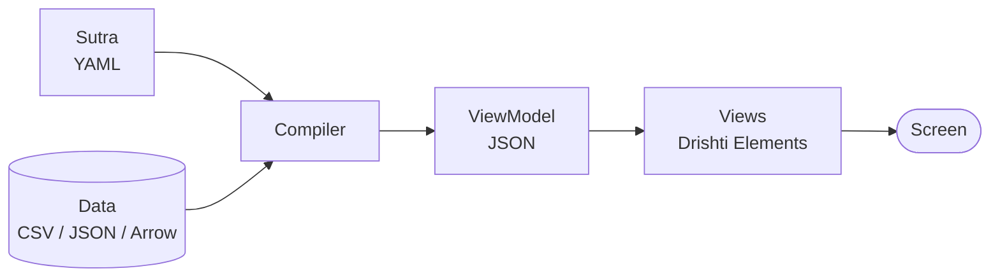

<!-- Copyright (c) 2026 Ashutosh Sinha. Proprietary. All rights reserved. -->
# Overview

Status: **planning.** Everything on this page marked *planned* does not exist in this repository yet. The language and
compiler exist today inside the Drishti product and are being separated out (see [ROADMAP](ROADMAP.md)).

## What it is

Drishti Rachana turns a short text description of a screen into a working, dense, professional screen.

- You write a **Sutra**: a small YAML file that says what the screen shows (a headline figure, a table, a chart) and where each value comes from.
- You supply **data**: tables as CSV, JSON or Apache Arrow, from a file or an endpoint.
- Rachana **compiles** the Sutra against the data into a **ViewModel** (plain JSON: every title, figure, column and row already worked out) and **paints** it with Drishti Elements (grid, charts, maps, pivots).

The Sutra holds no code and no pixels. It cannot run anything. That is what makes it safe to hand to a reviewer, a version
control system, or an AI model.

The name: *Rachana* (Sanskrit, "composition") is the language; a *Sutra* ("thread") is one screen written in it.

## Who it is for

| You are | You get |
|---|---|
| An analyst with CSV or JSON files | A dashboard site, no backend, no front-end code (static mode) |
| An application developer | One element that draws a compiled screen inside your own web app |
| A Python team (Flask, FastAPI) | Mount Sutras in your app, expose tables, stream changes, check Sutras in CI |
| A team that wants a server | A small standalone server: sources, live updates, sign-in |
| Anyone building with an AI assistant | A way for the assistant to produce a real dashboard without generating code ([AI.md](AI.md)) |
| The Drishti product | Its screen language, consumed as pinned releases |

## The parts

All parts are **planned** as separate deliverables of this repository; the language and compiler exist today inside Drishti.

| Part | In one line |
|---|---|
| Sutra spec | The language. Structure: JSON Schema. Expressions (**Rachana-EL**): EBNF grammar. |
| Conformance suite | Sutra + data in, exact expected ViewModel out. Passing it is what "being Rachana" means. |
| Compiler | Sutra + data schema to ViewModel. One Java reference; built for JavaScript and WebAssembly. |
| Views | The painter: draws a ViewModel with Drishti Elements (`<elements-view>`). |
| Rachana Data Protocol | How tables and live changes travel: JSON rows or Arrow; keyed patches over SSE or WebSocket. |
| SDKs | Java, JavaScript, Python (Flask and FastAPI adapters). |
| Tooling | CLI (`rachana new / dev / build / lint / preview`), editor support, playground, gallery. |



## A worked example

The example is illustrative. The keys that belong to **Sutra Core** (the portable part of the language) are fixed in
phase R0; Drishti's own extras are not part of it. Treat the exact key names below as subject to change.

### The data

A table named `sales`, as a CSV file:

```csv
region,month,revenue
North,2026-01,120
North,2026-02,135
South,2026-01,90
South,2026-02,80
West,2026-01,60
West,2026-02,95
```

### The Sutra

```yaml
rachana: 1
sutra: sales-overview
title: Sales overview
sources:
  sales: { table: sales }
panels:
  - id: total
    kind: metric
    label: Revenue
    value: "sum(sales.revenue)"
    fmt: amount0
  - id: by-region
    kind: hbar
    title: Revenue by region
    rows: "sales"
    label: region
    value: "sum(revenue)"
  - id: detail
    kind: table
    title: Detail
    rows: "sales"
    columns:
      - { label: Region,  bind: "@.region" }
      - { label: Month,   bind: "@.month" }
      - { label: Revenue, bind: "@.revenue", fmt: amount0 }
```

### What you get

A page with three parts, top to bottom:

1. **A headline tile** reading *Revenue 580*, the sum of the column.
2. **A horizontal bar chart**, one bar per region: North 255, South 170, West 155, sorted by the painter's default order.
3. **A grid** of the six rows with the three columns, sortable and filterable, with the revenue column right-aligned
   and formatted as a whole number.

The compiler's output is the ViewModel: the same three parts as JSON, with every number already computed (for example
`"value": 580` on the first panel). The painter never evaluates an expression; it only draws what the ViewModel says.
If the table later changes (a new row arrives as a keyed patch, see [ARCHITECTURE](ARCHITECTURE.md#the-data-protocol)),
the affected panels are recomputed and redrawn.

If you mistype a column (`reveune`), the compiler does not guess: it reports the problem with the line and column in the
Sutra. That behaviour, strict parsing with exact locations, exists today in Drishti and is part of the language.

## What Rachana is not

- Not a charting library. It uses Drishti Elements for drawing.
- Not a database or a data pipeline. It reads tables you supply.
- Not a code generator. A Sutra is data, not a program.

## Next

[ARCHITECTURE](ARCHITECTURE.md) · [MODES](MODES.md) · [AI](AI.md) · [ROADMAP](ROADMAP.md)
