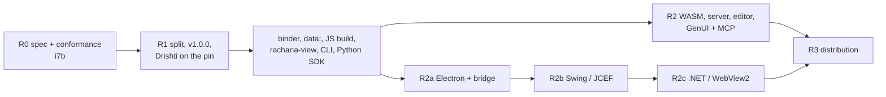

<!-- Copyright (c) 2026 Ashutosh Sinha. Proprietary. All rights reserved. -->
# Drishti Rachana roadmap

Status: **planning.** Nothing below is built in this repository yet.

Rachana is built alongside the Drishti product; each phase lands with a Drishti release, and Drishti is always the
first customer of what ships here. The designs behind each phase are in [design/](design/DECISIONS.md).

| Phase | Lands with Drishti | What |
|---|---|---|
| **R0: the spec, written down** | i7b | The specification ([SPEC](design/SPEC.md)): EBNF for Rachana-EL, the Sutra JSON Schema and the language definition generated from the compiler's tables and published, versioning rules, the error model with machine-readable problems. The complete Core function catalogue. The conformance suite harvested from Drishti's existing Sutra tests, and the ViewModel goldens frozen. The Rachana Data Protocol v1 written down ([DATA_PROTOCOL](design/DATA_PROTOCOL.md)). The line between **Sutra Core** and the **Drishti profile** ([CORE_AND_PROFILES](design/CORE_AND_PROFILES.md)). Split steps 0a to 0e. |
| **R1: the split** | i8 (its first step) | Untangle inside Drishti, then this repository takes the compiler with its git history; first release `v1.0.0`; Drishti consumes the pin, with guards on both sides ([SPLIT_PLAN](design/SPLIT_PLAN.md) steps 1 to 12). Then, each as a Rachana minor: the binder moves into Core (steps 13, 14); `data:` and tables with the Data Protocol client (step 15); the JavaScript build after its one-week proof, and `<rachana-view>` over Drishti Elements' painter (step 16); the CLI and static mode; the **Python SDK with Flask and FastAPI adapters** (serving Sutras and tables, streaming changes). |
| **R2a: desktop, Electron first** | i8.x | The **in-process bridge transport** of the Data Protocol and the page-side bridge module; the **Node/Electron host SDK** (`drishti-rachana-electron`). It needs R1's JavaScript build, `<rachana-view>` and the Data Protocol, which is why it is the first item after R1 and not inside it. |
| **R2b: desktop, Java Swing** | i8.x | `rachana-swing`: a Swing panel over **JCEF** (JavaFX WebView as a fallback, subject to a painter test run). |
| **R2c: desktop, .NET** | i8.x, i9 | `Rachana.WebView2`: WinForms and WPF controls over **Microsoft WebView2** (MAUI on Windows through the same control; CefSharp as an alternative). |
| **R2: the product** | i8.x, i9 | WebAssembly build of the compiler for Python-side compile and lint (no JVM), after its proof; the standalone server; editor support (language service); playground and gallery; **GenAI writes Sutras** ([AI_GENUI](design/AI_GENUI.md)): prompt kit, certain fixes, evaluation harness, the generic Rachana MCP server, the Rachana tool pack for sajhamcpserver, Drishti's in-process GenUI (i9). |
| **R3: distribution** | after i9 | npm, CDN and PyPI publishing; licensing tiers; a specification licence for `spec/` and `conformance/`; native ports only where needed, proven by the conformance suite. |

GenUI (R2, with Drishti i9) is built on Rachana, not on Drishti, so it serves Drishti, other applications and AI
assistants alike; that is why the split comes first in i8.

Desktop order is fixed by the owner: Electron, then Swing through JCEF, then .NET through WebView2. Native (non-web)
painters are out of scope ([COMPILER_AND_RUNTIMES](design/COMPILER_AND_RUNTIMES.md) section 9).

## Gates between phases

| Before | Must be true |
|---|---|
| R1 starts | conformance cases and ViewModel goldens exist and pass on the code as it is in Drishti |
| `v1.0.0` is tagged | Core packages have no product dependency; the "names no host" guard passes; the public API is reviewed against three consumers |
| Drishti moves to the pin | Drishti's full suite, the goldens (byte-identical) and Core conformance with the Drishti profile loaded all pass |
| the JavaScript build is adopted | proof T1 to T10 pass ([COMPILER_AND_RUNTIMES](design/COMPILER_AND_RUNTIMES.md) 4.2); otherwise the stated fallbacks |
| the WebAssembly build is adopted | proof W1 to W6 pass; otherwise the stated fallbacks |
| the GenUI prompt kit ships | the evaluation targets are met on the held-out tasks ([AI_GENUI](design/AI_GENUI.md) section 6) |

## Rules

- Nothing Drishti-specific in this repository; Drishti's extras live in Drishti's profile.
- One compiler source; other languages run it (JavaScript, WebAssembly) or are proven against it (conformance suite).
- Open specification, proprietary runtime.
- UI speed is a feature: every release carries performance budgets.
- The language only grows within a major version; a break needs a new major and a migration tool.
