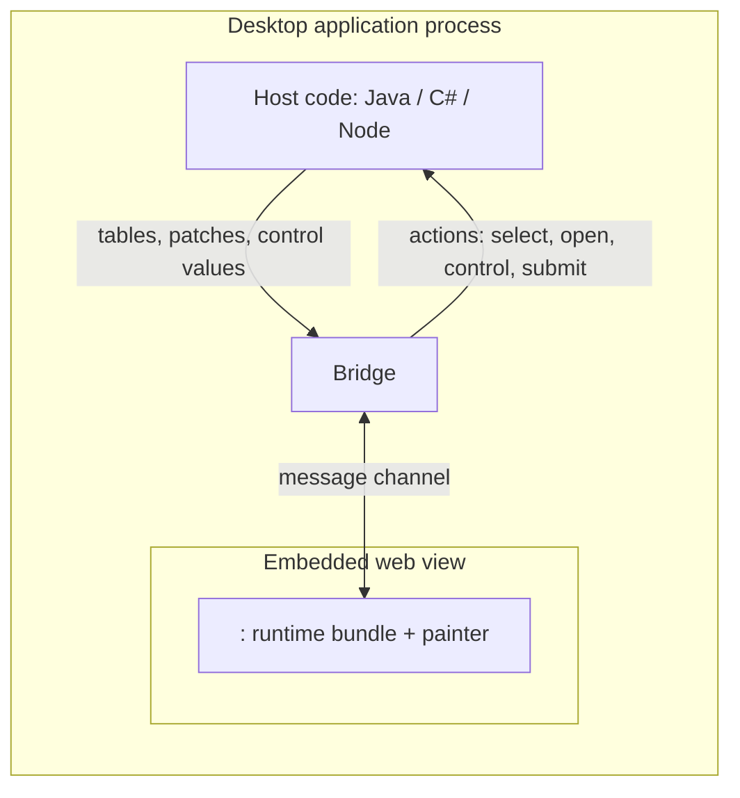

<!-- Copyright (c) 2026 Ashutosh Sinha. Proprietary. All rights reserved. -->
# Compiler and runtimes: design

Status: **design.** Nothing in this document is built in this repository yet. Statements about cross-compilers and
WebAssembly runtimes come from their documentation and general experience, **not from a run**; section 4 and 5 each
begin with a proof that must pass before work is committed.

## 1. Principles

1. **One compiler source**: the Java reference. JavaScript and WebAssembly are builds of it, not ports.
2. **Byte-identical results** in every runtime, proven by the conformance suite on every change.
3. **Core has no framework**: no Spring, no reflection-based libraries, a short list of JDK packages. That is what
   makes the other builds possible, and it keeps the jar small for JVM hosts.
4. **Thin SDKs**: host-language code (JavaScript, Python) holds transport and glue only. A guard fails the build if an
   SDK grows a parser, an operator or a formatter.
5. **Speed is a release gate**, not a hope (section 7).

## 2. Repository layout (planned)

```text
drishti-rachana/
  spec/1/                      generated + written specification (SPEC.md section 1)
  conformance/1/               cases (section 6)
  java/                        Maven reactor, groupId com.ash.rachana, Java 21 source level
    rachana-api/               Node, TableProvider, hooks; zero dependencies
    rachana-core/              YAML reader, model, EL, functions, aggregates, formats, checker, binder, patches, profile registry
    rachana-tools/             editing operations, writer, schema + definition generators, formatter, migrate, language service
    rachana-data/              Data Protocol: client, JSON + Arrow codecs, in-memory provider, CSV/JSON readers
    rachana-server/            the standalone server (section 10)
    rachana-cli/               command-line entry points over tools
    rachana-conformance/       the JVM runner
    rachana-js/                TeaVM build → ../js/packages/rachana/dist (no hand-written logic)
    rachana-wasm/              WebAssembly build → ../python/src/drishti_rachana/_wasm
  js/                          npm workspace
    packages/rachana/          "drishti-rachana": compiled runtime + tools bundles, facade, <rachana-view>, table client, bridge
    packages/rachana-cli/      "drishti-rachana-cli": rachana new / dev / build / lint / preview (Node)
    packages/rachana-electron/ host SDK for Electron (section 9)
    packages/rachana-mcp/      the generic MCP server (AI_GENUI.md)
    vendor/drishti-elements/<version>/   the pinned painter and libraries, copied unchanged
  python/                      "drishti-rachana" on PyPI, import drishti_rachana
    src/drishti_rachana/       compile/lint (WASM), Data Protocol server side, flask.py, fastapi.py, mcp tools
  dotnet/                      Rachana.WebView2 host SDK (section 9)
  desktop/java/                rachana-swing host SDK: JCEF and JavaFX panels (section 9)
  docs/  tools/  gallery/  templates/
```

Dependency rule: `rachana-api` ← `rachana-core` ← `rachana-tools`, `rachana-data` ← `rachana-server`, `rachana-cli`.
`rachana-core` may depend only on `rachana-api` and the JDK.

## 3. The Java reference

### 3.1 Public API (planned; the only surface a host may use)

```java
package com.ash.rachana;

Rachana rachana = Rachana.with(options, Profile.core() /*, more profiles */);

CompileResult c = rachana.compile(String yaml, String fileName);      // never throws for a bad Sutra
c.ok(); c.problems(); c.sutra(); c.plan();                             // plan: tables, columns, push-down per panel

View view = rachana.open(c.sutra(), TableProvider tables, ViewContext ctx);   // ctx: controls, today, locale, hooks
ViewModel vm = view.model();                                           // bind
view.onPatch(frame -> …);                                              // live: ViewModel patch frames
view.setControl("region", "North");  view.fire("trades", "select", payload);

Expression e = rachana.expression("sum($.sales, 'revenue')");         // the expression language on its own
Object v = e.eval(EvalContext.of(node));
```

Packages `com.ash.rachana`, `.api`, `.model`, `.profile`, `.data` are public; everything under `.internal` is not,
and is hidden with the Java module system (`module-info` exports only the public packages) so a host cannot reach in.

### 3.2 What changes in the existing code to become dependency-light

| Today | In Core | Why |
|---|---|---|
| Jackson YAML + databind (`PositionalYamlReader`, writers, schema) | a small positional YAML reader and a JSON reader/writer owned by Core (the YAML subset Sutras use: block and flow collections, plain and quoted scalars, block scalars, anchors and aliases, comments kept for the writer; tags refused) | no reflection; cross-compiles; smaller |
| Spring (`RachanaConfiguration`, `RachanaProperties`) | plain `RachanaOptions` record; Spring wiring stays in the host | no framework |
| Caffeine expression cache | a bounded LRU map in Core, per `Rachana` instance | no dependency |
| product `DataNode`, `DrishtiException`, `ErrorCode`, `BusinessCalendar`, `SafeRegex`, `SharedWatchService` | `Node` (api), `RachanaException` with `RCH-` codes, `Calendars` hook, Core's own linear-time regex, no file watching in Core | no product code |
| static, process-wide `Functions` registry | per-instance registry built from profiles | isolation |
| `String.format`, `Double.toString`, `DecimalFormat`, locale-dependent calls | Core's own number-to-text and date-to-text routines, fully specified | identical text in every runtime |
| `java.time` | kept where the cross-compiler supports it; a small civil-date library in Core otherwise (decided by proof T1) | identical dates |
| SLF4J logging | a `Diagnostics` callback | no dependency |

**Built (A8a, 2026-11-19): Core's YAML and JSON.** `com.ash.rachana.parse.YamlReader` (with `YamlStream`, `YamlScanner`,
`YamlEvents`, `YamlScalars`; about 2,500 lines, no library, no regular expressions) reads YAML 1.1 exactly as the
reference did on Jackson and SnakeYAML: the same tree and types (`yes` and `on` are booleans, `1.0` a number, `0x1F` 31,
dates stay text), the same positions (1-based, columns in code points), the same issues (a repeated key keeps the first,
a second document, a non-core tag) and the same error texts and places, snippet included. One addition: an anchor or
alias is an issue (the reference read an alias silently as its name). `com.ash.rachana.parse.Json` is the JSON reader
(plain values; a whole number beyond a `long` as a `BigInteger`) and the compact writer
(Jackson's escapes, `"NaN"` for a non-finite double). Proof: `tools/yaml-diff` (168,923 inputs: every Drishti and Rachana
YAML file, the case texts, edge inputs and mutations; zero differences but the anchor issue) and `YamlReaderTest` on
1,113 recorded vectors. Comments are skipped, not kept: the Sutra writer keeps its own text edits. Switching the users
(A8b) follows the move; until then the Jackson reader is the one in use.

The JDK surface Core is allowed to use is a written allow-list (`java.lang`, `java.util`, `java.util.function`,
`java.math`, selected `java.time`), enforced by a guard test over the compiled classes.

## 4. The JavaScript build

### 4.1 Approach

`rachana-core` and `rachana-tools` are cross-compiled from Java bytecode to JavaScript with a build-time tool of the
**TeaVM** class (pure Java, runs under Maven on Linux and Windows with only a JDK). Two ES module bundles:

| Bundle | Holds | Loaded by |
|---|---|---|
| `rachana.runtime.js` | read a compiled plan, evaluate, bind, patch | every page |
| `rachana.tools.js` | full YAML parse with positions, checker, problems and fixes, completion, editing operations, formatter | editors, playground, CLI, lint |

A hand-written facade (`js/packages/rachana/src`, plain JavaScript with type declarations) wraps them: loading
Sutras and tables, the worker, hand-over of rows, `<rachana-view>`, the bridge. It contains no language semantics.

**Data hand-over.** The compiled core reads data through `Node`. The facade supplies `Node` implementations backed
directly by JavaScript objects and by Arrow columns (through the vendored Apache Arrow JS of Drishti Elements), so
rows are never copied into Java-shaped structures. Above a row threshold the core runs in a Web Worker and Arrow
buffers are transferred, not copied.

### 4.1a As built (A15, v0.11.0)

`java/rachana-js` builds both bundles with TeaVM 0.16.0 (in every reactor build, before `rachana-guards` runs the Node suite on them, which fails when they are missing; `python3 tools/js/build_js.py` adds the conformance check, or `./mvnw package -pl rachana-js
-am`; JDK 21, nothing installed). Rachana's own classes reach TeaVM unpacked into the module, so three same-named classes of the
JavaScript build replace Core's: `internal.NumberText` (the engine's shortest digits, Java's layout and number grammar)
and `internal.Bits` (the words of a double through a `DataView`, no
`BigInt`). Two TeaVM files are patched (`StatementRenderer`: the right operand of `+` and `*` keeps its parentheses, DECISIONS D15-2;
`PreciseDependencyAnalyzer`: no domain merging, so the analysis keeps every type and the bundles are the same on every build, G1-4).
`tools/js/build_js.py` runs the conformance suite on both bundles after every build and fails on any error or verified failure.

| Bundle | Exports (JSON text in and out; answers are the conformance documents of FORMAT 5) |
|---|---|
| `rachana.runtime.js` | `init(profiles, formats)`, `version`, `evaluate`, `evaluateError`, `format`, `check` (parse, then check: compile and lint), `checked` (checked mode over known types, FORMAT 5.4), `grammar` (FORMAT 5.5), `view` |
| `rachana.tools.js` | the runtime's, plus `edit` (design/ops), `viewModelSchema`, and the conformance harness `hello`, `answer` |

**EXPERIMENTAL at 1.0 (gate 2, O9):** these exports are the conformance adapter (a request is a case's fields; `init` sets one
instance for the page) and may change in a minor release; the frozen contract is the JSON documents they answer (FORMAT 5) and
the ViewModel schemas. `screen(op, request)` and `<rachana-view>` are experimental for the same reason.

Proof (2026-11-21): every conformance case byte-identical to the JVM in Node 22, Chromium 153, Firefox 155, WebKit 26.6 (strict CSP,
Trusted Types, no violation) and in Python on V8 (2,123 cases with the tools bundle, 1,953 with the runtime bundle: all but `edit`);
5,600 random maths probes identical. Runners: `tools/conformance/rachana_conformance.py --node [--bundle ...]`,
`js/packages/rachana/runners/run_browsers.py`, `python -m drishti_rachana.engine` (section 5.3a). Measurements: P1_RESULTS section 11.

### 4.2 The proof (one week, before R1 commits to this path)

A throwaway branch: take `el`, `el/check`, `format`, `model` and `parse` as they are, cut dependencies by hand,
cross-compile.

| # | Measure | Passes when |
|---|---|---|
| T1 | it compiles: every JDK class and language feature Core uses that the tool lacks | each gap has one replacement inside Core, no second code path |
| T2 | size, minified + Brotli | runtime ≤ 385 KB, tools ≤ 407 KB (measured 366.9 and 387.9 KB at the G1 close + ~5%; owner 2026-11-21: bigger bundles are acceptable, the budget only guards against unintended growth) |
| T3 | start: module evaluation to first compiled Sutra | ≤ 30 ms on the reference laptop |
| T4 | evaluation speed against a hand-written JavaScript evaluator of the same twenty expressions | within 3× per evaluation, and the budgets of section 7 met |
| T5 | data hand-over: a live change touches only changed rows | no allocation proportional to table size per change |
| T6 | same output: conformance cases through JVM, Node, Chromium, Firefox, WebKit; numbers, dates, rounding, sorting, regular expressions stressed | byte-identical |
| T7 | strict pages: strict Content-Security-Policy, Trusted Types, `file://`, inside a worker | no `eval`, no dynamic code |
| T8 | errors in the browser are the language's problems with positions | never a generated stack trace |
| T9 | build on Windows and Linux with only a JDK; reproducible | same bytes from the same source |
| T10 | the tool: licence of emitted class-library code, maintenance, a named second tool | compatible notices; alternative exists (J2CL) |

### 4.3 Fallbacks, in order

1. **A second cross-compiler** (J2CL) on the same source, if TeaVM fails on T1, T9 or T10.
2. **Split by weight**: if only the tools bundle is too big, tools run in the worker and are loaded on demand; if
   only evaluation speed fails, hot paths (path access, comparison, arithmetic, the aggregate loop) get intrinsics
   written in JavaScript behind the same Java interfaces, each held by conformance cases. Still one source of
   semantics for everything else.
3. **A hand-written JavaScript evaluator for Core only**, generated tables from `rachana.lang.json`, held by the full
   conformance suite. This is two evaluators and needs the owner's explicit acceptance ([DECISIONS](DECISIONS.md) D3).
   It is not to be chosen to save the week the proof costs.

## 5. The WebAssembly build for Python

### 5.1 What Python needs

Python hosts (Flask, FastAPI, the MCP tool pack) need to **lint, compile and bind without a JVM**: `validate_sutra`,
server-side render of a ViewModel, `rachana lint` in CI. They do not need it to serve a page: in the browser the
JavaScript build compiles. So the Python SDK ships in R1 without the WebAssembly build (it serves Sutras and tables
and streams changes), and gains compile and lint in R2.

### 5.2 Toolchain options

| Option | How | For | Against |
|---|---|---|---|
| **A. TeaVM WebAssembly backend, run with `wasmtime` (PyPI wheels)** | same build tool as JavaScript, second target; Python loads the `.wasm` through `wasmtime-py` | one toolchain; wheels exist for Linux, macOS, Windows; sandboxed by construction | depends on the WebAssembly GC support of the runtime and of the tool's backend, both recent: **must be verified**; strings cross a boundary (acceptable: Python calls are per Sutra, not per cell) |
| B. GraalVM native-image shared library per platform, called through `cffi` | `librachana.so/.dll/.dylib` inside platform wheels | fastest; mature compiler | a native binary per platform to build, sign and ship; reflection configuration; some sites forbid unsigned native code |
| C. the JavaScript bundle on an embedded JavaScript engine (QuickJS wheels) | reuse `rachana.tools.js` | no second build target | a second engine's number and regex behaviour to prove; native wheels again |
| D. a JVM sidecar: `java -jar rachana-cli.jar serve --stdio`, Python talks JSON lines | reference compiler as is | works on day one; exact | needs a JVM, which the owner's decision says Python users must not need |

### 5.3 Decision and proof

**Option A**, with a proof of the same shape as section 4.2 (W1 compiles; W2 `.wasm` ≤ 3 MB; W3 instantiate ≤ 200 ms,
lint of a 50-panel Sutra ≤ 20 ms warm; W4 conformance byte-identical under `wasmtime` on Linux, macOS, Windows; W5
no native code beyond the `wasmtime` wheel; W6 memory ≤ 64 MB for the suite).

**Fallbacks**: B (native-image) for platforms where A fails; D is available from R1 as a development convenience
(`RACHANA_JAVA=1`) and for the conformance runner, never the documented path. The Python API is the same over all of
them:

```python
# planned API, subject to change
from drishti_rachana import Rachana
r = Rachana()                                  # loads the WASM module once per process
res = r.compile(text, file="sales.sutra.yaml")  # res.ok, res.problems (SPEC section 7), res.plan
vm  = r.bind(res.sutra, tables={"sales": rows_or_arrow}, controls={}, today="2026-11-17")
```

### 5.3a As built (A15, decision W-1): the JavaScript bundle on V8

The WebAssembly proof (WASM_RESULTS) chose option C with V8 for now: `drishti_rachana.engine.Rachana` loads `rachana.tools.js`
(or the runtime bundle) into a V8 isolate through `mini-racer` (extra `v8`) and calls the facade: `check(sutra)` compiles and lints,
`evaluate`, `template`, `format`, `view`, `edit`. `python -m drishti_rachana.engine` is a conformance runtime program (RUNNER 5):
2,123 cases byte-identical to the JVM. The wheel carries the bundles built by `tools/js/build_js.py`.

Other languages (.NET, Go, Rust) can load the same `.wasm`; none is planned beyond what the desktop SDK needs
(section 9 compiles inside the web view, so .NET needs no compiler of its own).

## 6. The conformance suite

### 6.1 Format

One YAML file per group under `conformance/1/<area>/`; each case is self-contained. The normative format is
[conformance/FORMAT.md](../../conformance/FORMAT.md) with its JSON Schema; the runner contract is
[conformance/RUNNER.md](../../conformance/RUNNER.md). This section is the outline they were written from.

```yaml
# conformance/1/el/arithmetic.yaml
suite: el/arithmetic
since: "1.0"
profile: core
cases:
  - id: null-in-null-out
    kind: expr
    given: { record: { a: 2 }, ctl: {}, today: "2026-01-15" }
    expr: "$.missing * 2"
    expect: { value: null, text: "", type: "empty" }
  - id: text-join
    kind: expr
    expr: "'Leg ' + 1"
    expect: { value: "Leg 1" }
```

| `kind` | Input | Expected |
|---|---|---|
| `expr` | expression, record, row, controls, today | value (canonical JSON), display text, paths read |
| `expr-error` | expression | problem: code, span, message, `expected`, `fix` |
| `check` | expression, schema, scope | checked-mode type or problems |
| `format` | value, format name, locale | text and tone |
| `sutra` | Sutra text, tables, controls, today | the ViewModel, canonical JSON |
| `problem` | Sutra text | the full ordered problem list (SPEC section 7) |
| `patch` | Sutra, tables, a sequence of table patches | the sequence of ViewModel patch frames |
| `plan` | Sutra, table schemas | the query plan: tables, columns, push-down filters as syntax trees |
| `edit` | Sutra text, an editing operation | the new text (comments and layout kept) |
| `protocol` | a request to a reference table | response shape, paging, filter semantics (run against hosts) |

**Canonical JSON**: UTF-8, keys in written order as the specification defines them, numbers in Core's own shortest
round-trip form, no insignificant white space. Results are compared as bytes.

### 6.2 Where cases come from

1. **Harvest (R0)**: the existing tests of the reference (264 test methods in the compiler module; `ElTest`, the
   function-family tests, `StrictSutraTest`, `SutraParserTest`, `ControlsTest`, `FormTest`, `ScreenLayoutTest`, …) are
   converted into cases; the Java tests then *run the cases*, so they are not kept twice.
2. Every function example in `functions.yaml` and every example in SPEC is a case (generated).
3. Coverage rule, a gate: every key, option, panel kind, function, format, tone and problem code in
   `rachana.lang.json` appears in at least one case.
4. Differential fuzzing (R2): random expressions over random records, JVM against JavaScript; any difference becomes
   a case.

### 6.3 Runners

Each runner reads the same files and writes `results/<runtime>.jsonl` (one canonical line per case); the gate
compares every runtime's file with the JVM's, byte for byte.

| Runtime | Runner | Runs in |
|---|---|---|
| JVM | `rachana-conformance` (JUnit dynamic tests) | every build |
| Node | `js/packages/rachana/test/conformance.mjs` | every build |
| browsers | the same module under Playwright: Chromium, Firefox, WebKit | every build (sharded) |
| Python / WASM | `python/tests/test_conformance.py` under `wasmtime` | every build from R2 |
| a third-party port | `rachana conformance run --cmd "<their binary>"` (cases on stdin, results on stdout) | their CI |

"Is Rachana" means: passes `conformance/<major>/` for the profile claimed. That sentence is the open specification's
test of an implementation.

## 7. Performance budgets

Reference machine: the one Drishti Elements' budgets use. Figures are **targets to be confirmed by the proofs**; once
confirmed they are enforced in the build (a regression above 10% fails the gate). "Typical Sutra": 12 panels, 60
expressions. "Large Sutra": 50 panels, 400 expressions.

| # | Measure | JVM | JavaScript (browser) | Python (WASM) |
|---|---|---|---|---|
| P1 | parse + check, typical Sutra, warm, p95 | ≤ 2 ms | ≤ 8 ms | ≤ 10 ms |
| P2 | parse + check, large Sutra, warm, p95 | ≤ 10 ms | ≤ 30 ms | ≤ 40 ms |
| P3 | cold start to first compile | ≤ 150 ms (class load) | ≤ 30 ms after module load | ≤ 200 ms |
| P4 | bind typical Sutra over 1,000 rows | ≤ 3 ms | ≤ 10 ms | ≤ 15 ms |
| P5 | bind a table panel over 100,000 rows (Arrow, in worker) | ≤ 40 ms | ≤ 120 ms | ≤ 150 ms |
| P6 | one live patch of 100 changed rows → ViewModel patch | ≤ 0.5 ms | ≤ 2 ms | n/a |
| P7 | sustained live: 1,000 row changes per second on a 50,000-row table | n/a | no dropped frame at 60 Hz; main thread ≤ 4 ms per frame | n/a |
| P8 | Sutra text to first paint, 1,000 rows, cold page | n/a | ≤ 300 ms | n/a |
| P9 | lint 500 Sutra files (CLI) | ≤ 2 s | ≤ 5 s (Node) | ≤ 6 s |
| P10 | bundle size (Brotli) | jar ≤ 1.5 MB (core) | runtime ≤ 385 KB, tools ≤ 407 KB (restated at the G1 close from the measured 366.9 and 387.9 KB; earlier 365/385 from 361 and 381 KB; about 10% trimmed in G3 packaging) | wasm ≤ 3 MB |
| P11 | memory per open view, typical | ≤ 2 MB | ≤ 4 MB excluding rows | n/a |

How the budgets are met: expressions compiled once and cached by text; dependency paths per expression, so a change
re-evaluates only cells that read the changed columns; incremental aggregates for functions marked `incremental`
(`sum`, `count`, `min`, `max`, `avg`); patches conflated to one per animation frame; Arrow columns read in place;
push-down for anything above the client threshold.

## 8. The CLI

One command name, `rachana`. Each command is a function of `rachana-tools`; launchers are thin.

| Command | Does |
|---|---|
| `rachana new <dir> [--template <name>]` | a starter folder: a Sutra, sample data, `rachana.yaml` |
| `rachana dev` | local server with live reload: Sutras, tables from `data/`, problems in the terminal and the page |
| `rachana lint [paths] [--format text\|json\|sarif] [--strict]` | every problem, exit status 1 on errors; JSON is the problem list of SPEC section 7 |
| `rachana fix [paths]` | apply every certain `fix` |
| `rachana fmt [paths]` | canonical layout, comments kept |
| `rachana build [--out site]` | a static site: HTML, the painter, the runtime bundle, the data (static mode) |
| `rachana preview <file> --data <dir>` | one screen in the browser |
| `rachana explain <file>` | the plan: tables, columns, what is pushed down, what runs where |
| `rachana schema [--profile …]` / `rachana functions` | print the JSON Schema / the function catalogue |
| `rachana migrate --to 2 [paths]` | rewrite to a newer language major |
| `rachana conformance run\|protocol` | run the suite against a runtime or a Data Protocol host |
| `rachana mcp` | start the generic MCP server on stdio (AI_GENUI.md) |

Launchers: **npm** (`npx drishti-rachana-cli`, Node, the JavaScript build; the primary one: it needs no JVM and
serves `dev` and `build`); **PyPI** (`python -m drishti_rachana`, no console script: `lint`, `fix`, `fmt`, `explain`, `schema`,
`conformance` over WASM; `dev` for Python apps); **jar** (`java -jar rachana-cli.jar …`, every command, for JVM
shops). Output of `lint --format json` is identical across the three and is a conformance case.

## 9. Desktop hosts (planned)

A Rachana screen inside a desktop application is the **same web painter inside the application's embedded browser**,
fed through the in-process bridge of the Data Protocol (DATA_PROTOCOL section 9). No HTTP server, no open port.



| Host | Web view | Host → view | View → host | Assets without HTTP | Fit |
|---|---|---|---|---|---|
| **Electron** | Chromium (built in) | `webContents.postMessage` / a `MessagePort` | `ipcRenderer` through a `contextBridge` preload (context isolation on, no Node in the page) | `protocol.handle('rachana', …)` custom scheme | native fit; first |
| **Java Swing** | **JCEF** (Chromium embedded, as IntelliJ uses) | `CefFrame.executeJavaScript` calling the bridge's receive function, or a `CefMessageRouter` reply | `CefMessageRouter` (`window.cefQuery`) | a `CefSchemeHandlerFactory` serving from the jar | good; second |
| Java Swing / JavaFX | JavaFX `WebView` in a `JFXPanel` | `WebEngine.executeScript` | a Java object exposed with `JSObject.setMember` | `jar:` / `file:` URL | fallback only: its WebKit trails current browsers; supported at "renders and updates", not at the performance budgets; decided by a painter test run |
| **.NET WinForms / WPF / MAUI (Windows)** | **Microsoft WebView2** | `CoreWebView2.PostWebMessageAsJson`; `PostSharedBufferToScript` for Arrow | `chrome.webview.postMessage` → `WebMessageReceived` | `SetVirtualHostNameToFolderMapping` | good; third |
| .NET | CefSharp | `Frame.ExecuteJavaScriptAsync` / `PostMessage` | `CefSharp.PostMessage` → `JavascriptMessageReceived` | a scheme handler | alternative where WebView2's runtime cannot be installed |

**Where compilation happens.** Inside the web view, with the JavaScript build, for every host: one path, and .NET
needs no compiler. A Java host may instead compile and bind in process with `rachana-core` and push ViewModels and
patch frames (`mode: host-binds`); both produce the same ViewModel by conformance.

**The page side** is one module of the npm package: `rachana.bridge.js` detects the channel (`window.chrome.webview`,
`window.cefQuery`, the Electron preload's `window.rachanaHost`, a JavaFX member) and presents it to the table client
as a transport. A screen written for the web runs unchanged.

**Host SDK surface (the same shape on each platform; planned items):**

```text
RachanaView view = RachanaView.create(options)          // a component: JPanel / Control / BrowserWindow helper
view.open(sutraTextOrPath)                              // show a Sutra
view.setTable(name, schema, rows | arrowBytes)          // push a whole table
view.patch(name, {remove, update, add})                 // push a keyed change
view.provide(name, tableProvider)                       // or answer pulls: schema, rows, query, subscribe
view.setControl(id, value)
view.onAction(handler)                                  // select, open, control, key, submit, ready, error
view.problems()                                         // the Sutra's problems, if it did not compile
view.theme(name) ; view.dispose()
```

| SDK | Package | Order |
|---|---|---|
| Node / Electron | `drishti-rachana-electron` (npm): main-process `RachanaHost`, the preload script, the custom scheme | 1 |
| Java | `rachana-swing` (Maven): `RachanaPanel` over JCEF, `RachanaFxPanel` over JavaFX | 2 |
| .NET | `Rachana.WebView2` (NuGet): `RachanaView` for WinForms and WPF; MAUI on Windows through the same control | 3 |

Security rules for all: the page is loaded only from the application's own scheme; navigation away is blocked; the
bridge accepts messages only from that page; no remote content; the strict Content-Security-Policy of the web build
applies.

**Native (non-web) painters are out of scope.** A Swing, WPF or MAUI painter would be a second implementation of the
grid, the pivot, twenty chart kinds, maps, theming and accessibility for each toolkit: the dual machinery the
project's rules forbid, with no chance of holding the speed and fidelity budgets on each. The ViewModel
specification is open, so a native painter *can* be written and tested against the painter conformance cases; none
is planned and none will be maintained here.

## 10. The standalone server (outline; phase R2)

**Status: step 1 built (G3, `java/rachana-server`).** As built, the configuration differs from the outline below: `tables.<t>` takes
`file`, `jdbc: {url, user, password-env | password-file, read-only}` with `query` and named `params`, or `rest: {url, path, headers,
header-env}`, plus `key`, `refresh`, `columns`, `where`, `max-rows`, `timeout`; `auth.mode` is `none`, `users` or `header` (OpenID Connect
is not built); `access` has `tables.<t>: {read, unmask}`, `sutras` and `default`. Every key is in
`java/rachana-server/rachana-server.example.yaml`. Every table is a live table of `rachana-live` (whole-tier source, polling diff);
JDBC push-down, request-time parameters, Parquet, Arrow pages of live tables and OpenID Connect are not built.

One Java process (`rachana-server`, plain JDK 21 with virtual threads and a small HTTP library; no application
framework), configured by one file.

```yaml
# rachana-server.yaml: planned, subject to change
server:  { port: 8080, base: / }
sutras:  { dir: ./sutras, watch: true }
tables:
  sales:   { file: ./data/sales.csv, key: [region, month] }
  orders:  { jdbc: ${ORDERS_DB_URL}, query: "select * from orders", key: order_id, refresh: 30, pushdown: true }
  quotes:  { rest: https://internal/api/quotes, path: "$.items", key: symbol, refresh: 5 }
auth:    { mode: none | users | oidc, oidc: { issuer: …, client-id: … } }
access:  { tables: { orders: [role:sales] } }
limits:  { page-rows: 10000, query-ms: 10000 }
```

| Part | Does |
|---|---|
| Sutra store | folder of Sutras, compiled at start and on change; problems page |
| Table providers | files (CSV, JSON, NDJSON, Arrow, Parquet later), JDBC (push-down by translating the filter syntax tree to SQL with bound parameters), REST polling |
| Data Protocol | sections 3 to 7 of DATA_PROTOCOL, including changes by polling diff (keyed) or by a provider's own feed |
| Pages | `/` index, `/v/<sutra>` a page with `<rachana-view>`; static assets from the jar |
| Sign-in | none, a users file, or OpenID Connect; table access by role |
| Operations | health, metrics, structured logs |

It is the reference host for the Data Protocol's conformance and a third consumer of the public API (after Drishti
and the CLI), which keeps the API honest. Its detailed design is a later document.
