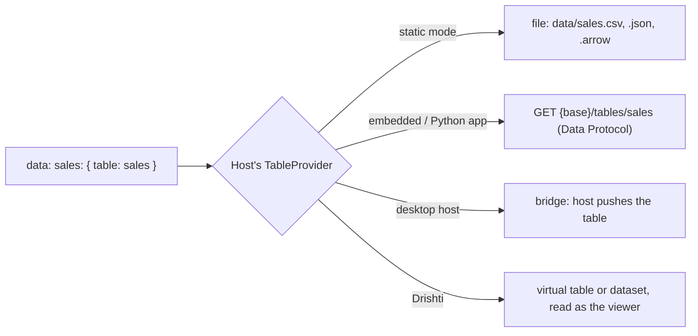

<!-- Copyright (c) 2026 Ashutosh Sinha. Proprietary. All rights reserved. -->
# Sutra Core and profiles: design

Status: **design, phase R0.** Nothing here is built in this repository yet. The code named in the tables exists
today inside the Drishti product (`compute/drishti-rachana`, about 22,300 lines of Java, 264 test methods; plus the
binder in `kernel/drishti-engine`). File names are today's.

## 1. The line

**Sutra Core** is everything about a *screen* and *rows*: what a browser, a Python app or a Java service can do with
a Sutra and tables, with no platform behind it.

A **profile** is a named set of additions a host registers: entity kinds, document matching, extra panel kinds,
functions that need an engine, data sources that need a catalogue, governance. **Drishti's profile** (`drishti`) is the
first. A profile adds; it never changes what Core means.

| Sutra Core (this repository) | Drishti profile (stays in Drishti) |
|---|---|
| identity, prose, docstring | `match` (kind, where, priority), `domain`, matching and its trace |
| title, strip, 20 panel kinds, layout, phone | panel kinds `links`, `provenance` |
| controls, events (`emits`, `waits`, `children`), `on-select`, `keys`, `refresh` | key actions `impact`, `raw`; mnemonics and command codes |
| `data:` and `source: { table }` | `source: { kind, id, where, search, pack, params, as-of }`, linked-entity `source: "link(…)"` |
| forms: fields, rules, hints, steps, drafts | `form.save` (write-back targets, connectors, approvals), `editable-by` roles |
| fragments (`use:`), given a resolver | where fragments come from: the UI kit folder, pack folders, precedence |
| Rachana-EL, Core functions, list aggregates, checked mode | model functions: `measure`, `cell`, `calc`, `share_of`, `parent_of`, `as_of`, `convert`, `fx`, `related`, `related_rows`, `label`, time intelligence and windows over a model |
| formats and tones (the shared tables) | formats added by packs |
| masked values (the value and its propagation) | who is masked: roles, row rules, reading "as the viewer" |
| binding a Sutra to data: the ViewModel and patches | inference from the catalogue, link resolution, badges, provenance, computed (reactive) sources |
| schema generation, editing operations, writer | registry over pack and site directories, hot reload, governance, "under construction", context help (`about.yaml`) |

## 2. The existing code: stays, moves, splits

"Moves" means: to this repository, with history, as Core. "Stays" means: stays in Drishti as part of its profile.
"Splits" means: the file is divided first (inside Drishti, with tests green), then the Core part moves.

### 2.1 `compute/drishti-rachana`: packages

| Package (lines) | Verdict | Notes |
|---|---|---|
| `el` (≈ 8,300) | **moves**, 3 files split | the expression language: lexer, parser, `Expr`, `Values`, function families, `Template`, `Printer`, limits |
| `el/check` (≈ 1,400) | **moves** | checked mode: `Checker`, `ElType`, `Signatures`, `Scope`, `Fields`, `Problem`, `Spelling` |
| `format` (≈ 450) | **moves** | `Formats`, `FormatSpec`, `Tones`, `WorldRegions`; read the shared tables of Drishti Elements |
| `model` (≈ 3,300) | **moves**, 4 files split | the Sutra as records |
| `parse` (≈ 3,100) | **moves**, 3 files split | YAML with positions, builders, blocks |
| `design/ops` (≈ 1,900) | **moves** | editing operations on Sutra text (`AddPanel`, `Bind`, `Move`, `SetOption`, …); `SetMatch` splits out to the profile |
| `about` (≈ 1,500) | **stays** | context help from packs' `about.yaml`; a Drishti feature that uses `Template` through the public API |
| root (≈ 3,000) | mixed, below | |

### 2.2 File by file, where it matters

| File | Verdict | What happens |
|---|---|---|
| `el/Lexer`, `Parser`, `Expr`, `Values`, `Args`, `Printer`, `Template`, `ElCompiler`, `ElLimits`, `ElFunction`, `ElForm`, `GroupForm`, `Token`, `Link`, `MaskedValue`, `RootFinder` | moves | `ElException` stops extending the product's `DrishtiException` and carries an `RCH-` code |
| `el/LogicFunctions`, `InfoFunctions`, `MathFunctions`, `NumberFunctions`, `TextFunctions`, `TextParts`, `ListFunctions`, `ListMore`, `Distributions`, `SpecialFunctions`, `DatePartFunctions`, `DateParts` | moves | `TextFunctions` takes its linear-time regular expressions (`SafeRegex`, from the product's common module) along as a Core class |
| `el/DateFunctions` | **splits** | calendar arithmetic moves; the business calendar becomes the `Calendars` hook (section 3.5), replacing the direct use of the product's `BusinessCalendar` |
| `el/FinanceFunctions` | **splits** | day-count and general finance (`yearfrac`, `days360`) move; `fx` stays as a profile function |
| `el/Aggregates`, `FunctionProvider`, `MeasureFunctions` | **splits** | the provider interface moves and becomes the public function hook; the lists `EXPECTED` and `MEASURE_LEVEL` (names of the product's engine functions) stay with the profile; Core's own list aggregates are registered by Core (section 2.4) |
| `el/Functions` | **splits** | the table and `register(...)` move; static, process-wide registration becomes per-`Rachana` instance (two profiles can live in one JVM, and tests do not leak) |
| `el/EvalContext` | moves | evaluates over the `Node` interface (section 3.6) instead of the product's `DataNode` |
| `el/CheckedMode`, `el/check/*` | moves | scope names `user.x`, `param.x` become context roots a profile declares |
| `resources/rachana/el/signatures.yaml` | **splits** | Core's functions become `spec/1/functions.yaml`; the model functions (runs `E`) stay as the profile's catalogue file in the same format |
| `model/Sutra` | **splits** | `match` and `domain` leave the record; a profile's keys are held in `Sutra.extensions` (a typed map, one entry per profile) |
| `model/Match` | stays | Drishti profile |
| `model/PanelKind` | **splits** | the enum becomes a registry of `PanelKindSpec`; Core registers 20 kinds; `LINKS` and `PROVENANCE` are registered by the profile |
| `model/Wiring` | **splits** | `Source` keeps `table`, `where`, `limit` in Core and an `extension` for a profile's source form (`kind`, `id`, `search`, `pack`, `params`, `as-of`) |
| `model/Form` | **splits** | fields, rules, hints, steps move; `Save` (targets, connectors, approval) is a profile extension |
| `model/Panel`, `Column`, `Control`, `ControlKind`, `ControlRules`, `FormExpr`, `PanelOptions`, `PivotSpec`, `Refresh`, `ScreenLayout`, `ScreenPhone`, `StripItem`, `Title`, `Area`, `SourceLocation` | moves | |
| `parse/PositionalYamlReader`, `PNode` | moves | Jackson's YAML reader is replaced by a small positional YAML reader owned by Core (no reflection; needed for the JavaScript build, see COMPILER_AND_RUNTIMES) |
| `parse/SutraParser`, `SutraBuilder` | **splits** | top-level keys become a table of `KeyReader`s; Core registers its keys; the profile registers `match`, `domain` |
| `parse/WiringReader` | **splits** | reads `source:` and hands a non-Core form to the profile's source reader |
| `parse/SutraBlocks`, `BlockUses` | **splits** | block expansion moves; finding block files (`UiKitDir`, pack folders, "the kit's wins") becomes the host's `FragmentResolver` |
| `parse/ControlsReader`, `LayoutReader`, `PhoneReader`, `SutraDocstring` | moves | a control's `options: { kind: <entity kind> }` form is a profile extension |
| `design/ops/*` | moves | `SetMatch` stays with the profile, registered as an extra op |
| `RachanaSchema` | **splits** | `build(profiles)`; the `kinds` argument and the product's `$id` leave; each profile contributes schema fragments |
| `SutraExpressions`, `SutraText`, `SutraWiring`, `SutraWriter`, `SutraLayoutEditor`, `SutraPivotEditor`, `SutraProblem`, `SutraException` | moves | `SutraProblem` grows into the problem of SPEC section 7 |
| `SutraRegistry` | **splits** | a small in-memory `SutraStore` (name@version → Sutra, latest wins, listeners) moves; directory scanning, pack precedence, the watch service and "last good version" stay in Drishti |
| `SutraMatcher`, `MatchTrace` | stays | Drishti profile |
| `UnderConstruction`, `UiKitDir` | stays | Drishti features |
| `RachanaConfiguration`, `RachanaProperties` | stays | Spring wiring; Core has a plain `RachanaOptions` record |

### 2.3 The binder (today in `kernel/drishti-engine`)

A standalone product must turn (Sutra, data) into a ViewModel, so the binder's Core has to be in this repository.
Today it sits in the product's engine and is entangled with entity links, masks and source routing.

| File (lines) | Verdict | Notes |
|---|---|---|
| `bind/Binder` (829), `ChartBinder` (647), `PivotBinder` (180), `MapBinder`, `MapSupport`, `PanelLimits` | **splits, then moves** | panel binding moves; link badges (`BadgeRenderer`, `ReferenceCatalog`, `Mnemonics`) go behind `LinkResolver` |
| `view/ViewModel` (411), `PanelData` (404), `ViewModelSchema`, `ScreenGrid`, `PhoneView`, `Emptiness` | **splits, then moves** | Core fields move; `Provenance`, `PanelCompute`, mnemonics stay as the profile's `meta` |
| `control/ControlResolver`, `ControlValues`, `ControlDates`, `ControlReads`, `ViewState` | **splits, then moves** | options read from an entity kind stay behind the profile's source hook |
| `wire/ScreenWire` (678), `TableRows`, `FormViews` | **splits** | event and child evaluation moves; fetching by kind (`SourceRouter`) stays |
| `ViewPipeline` (748) | stays | the product's fetch → match → merge → link → bind pipeline; it calls Core's `bind(...)` |
| `compute/drishti-inference` (≈ 1,500) | stays for now | catalogue-driven inference is the product's; a small shape-only inference for Core ("three lines give a screen") is a later Core feature, not part of the split |

### 2.4 Aggregates over a list

Today every aggregate Rachana-EL offers (`sum`, `avg`, `percentile`, `group`, …) is the product's pivot engine's,
registered through `FunctionProvider` by `drishti-bicompute` (`ListAggregates`, `ListAnalytics`, `ListGrouping`,
about 760 lines, resting on the engine's `Builtins` and `AggFunction`). Core cannot depend on that engine, and the
product must not get a second implementation.

Design: the **aggregate kernel** (the accumulators for the list aggregates and grouping, with their one
treatment of empty and masked values) moves into Core as `rachana-core`'s `agg` package. The product's pivot engine
then uses Core's accumulators for those functions, as it uses Core's expression evaluator today. Its engine-only
functions stay registered through the hook. One implementation, in the lower layer. This is the riskiest single move
of the split and has its own step and parity test ([SPLIT_PLAN](SPLIT_PLAN.md) step 9).

## 3. The profile mechanism

### 3.1 Shape

A profile is a value built in code and handed to the compiler. Nothing is discovered by scanning; nothing is global.

```java
// planned API, subject to change
Profile drishti = Profile.named("drishti")
    .key(TopLevelKey.of("match", MatchReader::read))            // a top-level key and its reader
    .panelKind(PanelKindSpec.of("links").readsData(false))      // a panel kind and its option table
    .panelBinder("links", new LinksBinder(catalog))             // how it is bound (JVM only)
    .sourceForm("kind", new KindSourceReader(), new KindSourceResolver(router))
    .functions(engineFunctions)                                  // FunctionProvider: names, signatures, implementations
    .contextRoot("user", ElType.ANY)                             // extra names expressions may read
    .formats(packFormats)
    .op("set-match", SetMatch::new)                              // an extra editing operation
    .schema(fragment)                                            // JSON Schema fragment for the above
    .build();

Rachana rachana = Rachana.with(RachanaOptions.defaults(), Profile.core(), drishti);
CompileResult r = rachana.compile(text, "trade.sutra.yaml");    // problems or a Sutra
ViewModel vm = rachana.bind(r.sutra(), tables, context);        // context: controls, today, locale, hooks
```

The same registrations exist in JavaScript and Python **for the parts that are data** (keys, kinds, option tables,
function signatures, formats, schema fragments): a profile's declarative half is a JSON document
(`<name>.profile.json`, generated from the Java profile) that every runtime loads. That is enough to lint and to give
editor support for profile Sutras anywhere. A profile's **behaviour** (binders, function bodies, source resolvers) is
code in the host's language; a runtime that has the declaration but not the behaviour compiles the Sutra and marks
the affected panels `unsupported here`, never failing the screen.

### 3.2 What a profile can register

| Extension point | Declares | Behaviour (host code) |
|---|---|---|
| top-level key | name, shape, schema fragment, `since` | reader → typed extension on the Sutra; checks |
| panel kind | name, required and accepted options, which are expressions | binder → panel data; painter component (registered with the painter under the same name) |
| panel option on a Core kind | kind, option, shape | read by the profile's bind hook |
| source form | discriminating key (`kind`), shape | resolver → rows or record, as the viewer |
| control option form | shape | options provider |
| function | full catalogue entry (SPEC section 5) | implementation; `pushdown`, `incremental` flags |
| context root | name (`user`, `param`), type | value at evaluation |
| format, tone | name, spec | none (data) |
| key action | name (`impact`) | handled by the host's page |
| editing operation | name, arguments | op implementation |
| problem codes | a range outside `RCH-` | |
| lint rule | code, severity | check over the compiled Sutra |

### 3.3 Rules

1. A profile **cannot** redefine a Core key, kind, option, function, format or code. Registration fails at start-up
   (as `Functions.register` refuses a duplicate name today). One way per job: a host that kept its own copy of a Core
   function (an engine's `sum`, a grouping behind `group(...)`) drops it from its `FunctionProvider`; `Rachana.with`
   refuses the instance with `Rachana-EL function sum is Core's: a profile cannot redefine it (<provider> provides it
   too; ...)`, and Core's is the one every Sutra reads.
2. A profile's names are plain (`match`, `links`), as they are today. Third-party profiles outside the owner's
   products use an `x-<name>-` prefix for keys and kinds so they can never collide with a future Core name.
3. A Sutra states `profiles: [core, drishti]` when it uses a profile's name. Inside a host that has one default
   profile set, the claim may be left out (Drishti's existing Sutras are not edited); the checker infers it.
4. Core's conformance suite must pass with any profile loaded.
5. The ViewModel a profile's binder produces uses Core's panel envelope; profile facts go under the panel's or the
   view's `meta.<profile>`, which painters hand back in events and never interpret.

### 3.4 Hooks a host implements (not profile-specific)

| Hook | Purpose | Default in Core |
|---|---|---|
| `TableProvider` | resolve a `table:` name to schema, rows, pages, changes (the Data Protocol's server side, in process) | none: an unknown table is `RCH-2070` |
| `FragmentResolver` | resolve `use: name@version` to a block | a folder or an in-memory map |
| `LinkResolver` | turn a `link(...)` value into an address or action | links are inert text |
| `Calendars` | business days for date functions | weekends only |
| `Clock` | `today()`, `asof()` | must be given explicitly (determinism) |
| `Masker` | mark fields masked before binding | nothing masked |
| `ExpressionCache` | compiled-expression cache | bounded LRU, per `Rachana` instance |

### 3.5 Authorisation is never in the profile's declaration

Who may see a table, a row or a field is decided where the data lives: in the host's `TableProvider` and `Masker`,
called with the host's own request context. A Sutra cannot widen access; it can only name data the host then
decides about.

### 3.6 The value interface

The expression evaluator reads data through one small interface, `Node` (type, field by name, element by index, size,
scalar value, masked, missing), in a module with no dependencies (`rachana-api`). Core ships implementations over
maps and lists, JSON, and Arrow columns (row cursor, no boxing per cell). The product's `DataNode` implements `Node`,
so Drishti keeps its own record type and nothing is copied at the boundary.

- **Node factory** (one SPI, `NodeFactory` in `rachana-api`): a host's node type returns its factory from
  `Node.nodes()`; every list and record an expression builds over a document of that type (a filter, a function's
  result, a list or record literal) comes back through it, in the host's type, with the host's own elements kept as
  they are. A node that names no factory gets Rachana's own (`NodeFactory.core()`).
- **Reading a host's values**: a scalar node that does not give `value()` is read through `asText`, `asDouble` or
  `asBoolean`; a number that gives no number, and a value of a type Core cannot read handed to an aggregate, are
  `RCH-2102` at every level, never a silent 0 or empty. The conformance runtime proves the corpus answers alike over a
  host's own node type (`JvmRuntime --host-nodes`, `HostNodeConformanceTest`).
- **Formats a host adds at run time**: `Rachana.formats()` is a live table (`Formats.live`): `reload(packFiles)` reads
  the bundled table, the packs' files and the site file again and swaps the whole table; every reader (contexts,
  binders, level views) sees it at its next read; a failed reload changes nothing. `Formats.load` stays immutable.
- **Level**: `Rachana.at(level, options, profiles...)` builds an instance pinned at a language level in one call.
- **Sutra JSON**: the record's components are its JSON in order (`name`, `version`, `domain`, `match`, `title`, ...,
  `extensions`); `extensions` lists only other profiles' keys, so a writer of record components (Jackson) needs no
  mix-in, and the canonical constructor reads it back.

## 4. Plain tables as first-class data sources

This settles what the Overview's example guessed (`sources:`, `rows: "sales"`, `sum(sales.revenue)`).

### 4.1 The keys

| Guess in the first Overview | Settled | Why |
|---|---|---|
| top-level `sources:` | top-level **`data:`** | names the screen's inputs; "source" is already the panel-level key |
| `sales: { table: sales }` | **`sales: { table: sales }`** (kept) | `table` already exists today as a source key (`Wiring.Source.table`) |
| `rows: "sales"` | **`rows: $.sales`** | each `data:` entry is a field of `$`; no new name resolution in the language |
| `value: "sum(sales.revenue)"` | **`value: "sum($.sales, 'revenue')"`** | the list form that exists today; `alias.COLUMN` stays the checked-mode form for models (a profile) |
| `hbar` with `value: "sum(revenue)"` | **`rows: "group($.sales, 'region', 'revenue')"`, `label: label`, `value: value`** | `group` exists today and yields `{label, value, count}` rows |
| column `bind: "@.region"` | kept | |

Full rules for `data:` entries are in SPEC section 2.4.

### 4.2 How a name is resolved



The screen half of the file is byte-identical in every mode. Promoting a prototype from a CSV file to a governed
table changes where one name points, not the Sutra.

### 4.3 What the compiler does with a table

1. **Schema.** At compile time the compiler asks the provider for the table's schema (columns and types). With a
   schema, every expression over `$.sales` is checked: a misspelt column is `RCH-2071` with `expected` names. Without
   one (a bare URL not yet read), field names are unchecked, as for documents today.
2. **Plan.** For each panel the compiler records which tables and columns it reads (the dependency paths expressions
   already report), and whether its row condition, sort and limit can be pushed to the provider (the push-down subset,
   DATA_PROTOCOL section 5). The plan is part of the compile result and can be printed (`rachana explain`).
3. **Bind.** Rows arrive as `Node`s over JSON or Arrow. Small tables are bound in the runtime; a table the provider
   marks `server` is queried with push-down and never summed locally.
4. **Live.** A keyed table with changes produces ViewModel patches: only the panels and cells whose dependency paths
   include the changed columns are re-evaluated.

### 4.4 Tables and documents together

A profile whose screens open on a record (Drishti) keeps `$` as that record and adds `data:` entries as further
fields of `$`; a name that collides with a field of the record is `RCH-2073` at bind time in checked hosts and a lint
warning otherwise. Panel-level `source: { table }` gives `$src` as today. So there is one model: `$` is the screen's
record; tables are fields of it.

## 5. What Drishti's profile looks like after the split

A Drishti module (working name `drishti-rachana-profile`, in Drishti's repository) that contains:

- the profile declaration (keys `match`, `domain`; kinds `links`, `provenance`; source form `kind`; `form.save`;
  functions from the pivot engine; context roots `user`, `param`; pack formats) and its generated
  `drishti.profile.json`;
- `SutraMatcher`, `MatchTrace`, the directory registry with hot reload and pack precedence, `UnderConstruction`,
  `UiKitDir`, the `about` package, the Spring configuration;
- the `TableProvider` over Drishti's virtual tables and datasets, the `Masker`, `LinkResolver`, `Calendars`;
- the `RCH-` → `DRS-` code mapping for its API.

Estimated size: about 4,500 lines of today's module stay (root classes, `about`, `Match`, split-off parts), plus the
adapters. See [SPLIT_PLAN](SPLIT_PLAN.md) for the code-size effect.
