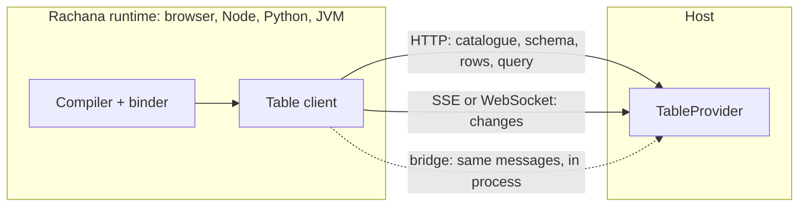
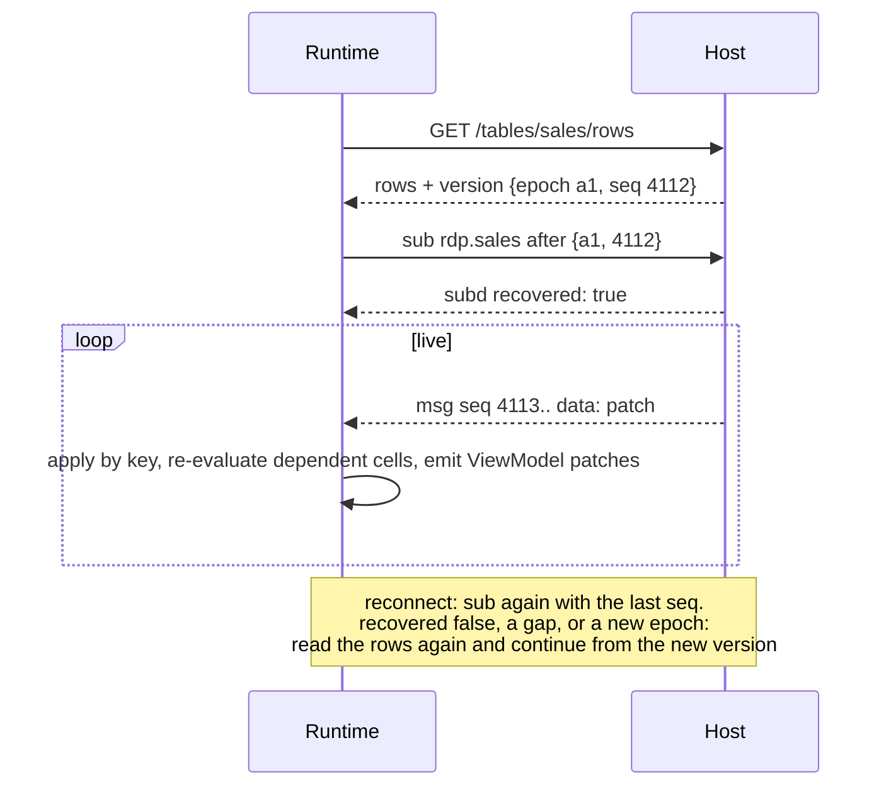

<!-- Copyright (c) 2026 Ashutosh Sinha. Proprietary. All rights reserved. -->
# Rachana Data Protocol v1: design

Status: **design, phase R0; built in G2 (lane C) as v1's JSON forms.** The normative text is
[spec/1/data-protocol/PROTOCOL.md](../../spec/1/data-protocol/PROTOCOL.md). Built: Core's half (`com.ash.rachana.table`: the `data:`
entries, schema decoding, keyed patches, the filter tree both ways, the plan, `LiveScreen`; one implementation, compiled to the
JavaScript bundles), the in-memory host and reference server, the JVM `TableClient` (`java/rachana-data`), the JavaScript client and
`<rachana-view>` (`js/packages/rachana/src`), and `tools/conformance/protocol_check.py` over `conformance/1/protocol`. Built in G2
lane C2: **Arrow IPC and NDJSON** (section 4; the host writes and the JVM client reads Arrow with the official Apache Arrow Java library,
`ArrowRows`; the JavaScript client with the vendored Apache Arrow JS 21.1.0, `arrowPage`; the bridge's `res.arrow`), the **bridge's
subscriptions** (`sub`/`unsub`/`msg`: `MemoryHost.Bridge`, the JavaScript `BridgeChannel`), **conflation** (`conflate: {everyMs}`: a
merged message carries `first` and `seq`) and **filtered subscriptions** (`changes.filter`: patches restated for the matching rows; a
filtered stream resumes only from the table's current position), in `Subscription`; the minimal SSE form takes them by `POST
{base}/changes`. The live part is
aligned with the events wire protocol designed for Drishti Elements (`EVENTING_DESIGN.md` section 8, branch
`design/eventing`) and the row patches of the Views design (`VIEWS_DESIGN.md` section 5); both are designs, not
released code, so this document will be re-checked against them when they ship.

## 1. Purpose and scope

The protocol is how a Rachana runtime gets **tables** from a host and hears about **changes** to them. It is small
on purpose: a host with a list of dictionaries and one HTTP route can implement the minimum in an afternoon; a host
with a hundred million rows implements push-down and never ships them.

It is not a query language, not an authentication scheme and not a transport for ViewModels.



Three transports carry the same messages: **HTTP** (section 3 to 5), a **stream** for changes (section 6), and an
in-process **bridge** for desktop hosts and for runtimes embedded in the host's own process (section 9).

## 2. Tables, schema and types

A table has a **name** (`sales`, `risk.var_by_desk`: letters, digits, `_`, `-`, dots as separators; ≤ 128
characters), a **schema**, an optional **key**, and **capabilities**.

```json
{
  "name": "sales",
  "title": "Sales by region and month",
  "key": ["region", "month"],
  "columns": [
    { "name": "region",  "type": "string",  "label": "Region" },
    { "name": "month",   "type": "date",    "grain": "month" },
    { "name": "revenue", "type": "decimal", "scale": 2, "unit": "USD", "fmt": "amount0" },
    { "name": "tags",    "type": "list",    "items": "string", "nullable": true }
  ],
  "rows": 6,
  "can": ["page", "sort", "filter", "arrow", "changes"],
  "version": { "epoch": "a1", "seq": 4112 },
  "limits": { "pageRows": 10000, "queryMs": 10000 }
}
```

| Type | JSON form | Arrow type | Notes |
|---|---|---|---|
| `string` | string | Utf8 / LargeUtf8 / Dictionary(Utf8) | |
| `integer` | number when within ±2^53, otherwise a string of digits | Int8..Int64, UInt8..UInt64 | readers accept both forms |
| `decimal` | **string** (`"1250.50"`) or number | Decimal128/256 | exact; `scale` in the schema; a server that sends a JSON number accepts double precision |
| `number` | number | Float32/64 | `NaN` and infinities are sent as `null` |
| `boolean` | `true` / `false` | Bool | |
| `date` | `"2026-11-17"` | Date32 | |
| `timestamp` | `"2026-11-17T09:30:00.000Z"` (always with a zone or `Z`) | Timestamp(ms or µs, tz) | |
| `time` | `"09:30:00"` | Time32/64 | |
| `list` | array; `items` names the element type | List | |
| `object` | object | Struct, or Utf8 holding JSON with field metadata `rachana.type=object` | nested records, read with paths |
| any type, masked | `{ "$masked": true }` | validity bit 0 plus field metadata `rachana.masked` as a bitmap column `<name>$masked` | the reader may not see the value; distinct from null |

Column fields: `name` (required), `type` (required), `nullable` (default true), `label`, `fmt` (a Rachana format
name), `unit`, `scale`, `grain` (`day`, `month`, `quarter`, `year` for dates), `items`, `hint` (free text for editors
and AI), `masked: true` (the whole column is masked for this reader).

`can` values: `page` (cursor paging), `sort`, `filter`, `group` (aggregation push-down), `arrow`, `changes`,
`count` (an exact total is cheap). A table with none of them is read whole.

## 3. HTTP resources

All under a base address the host chooses (`{base}`, for example `/dash/data/v1`). Responses carry
`Cache-Control: no-store` unless the host says otherwise.

| Method and path | Returns |
|---|---|
| `GET {base}` | `{ "protocol": "rdp", "v": 1, "tables": "{base}/tables", "changes": "{base}/changes", "limits": {…} }` |
| `GET {base}/tables` | `{ "tables": [ { name, title, key, rows?, can } … ] }`: the tables **this caller** may read |
| `GET {base}/tables/{name}` | the schema document of section 2 |
| `GET {base}/tables/{name}/rows` | rows (section 4); query parameters for the simple cases |
| `POST {base}/tables/{name}/query` | rows for a query document (section 5) |
| `GET` or `POST {base}/changes` | the change stream (section 6) |

The minimum a host must offer: `GET {base}/tables/{name}` and `GET {base}/tables/{name}/rows` returning every row as
JSON. Everything else is declared in `can` and optional.

## 4. Rows

### 4.1 JSON

`GET {base}/tables/sales/rows?limit=500&cursor=…&sort=-revenue,region&columns=region,revenue`

```json
{
  "table": "sales",
  "version": { "epoch": "a1", "seq": 4112 },
  "columns": ["region", "month", "revenue"],
  "values": [ ["North", "2026-01-01", "120.00"], ["North", "2026-02-01", "135.00"] ],
  "total": 6,
  "next": "c-9f3a"
}
```

- Two row forms; the server picks with `?shape=`: **columnar-by-row** (`columns` + `values`, the default: about a
  third fewer bytes) or **objects** (`"rows": [ { "region": "North", … } ]`, for hand-written servers). Readers accept
  both.
- `next` is an opaque cursor; absent on the last page. `total` is present when `count` is cheap, else absent.
- `version` is the position in the table's change stream that this answer is a snapshot of (section 6.3).
- `schema: true` in the request includes the schema document under `"schema"`, saving a round trip.
- **NDJSON**: `Accept: application/x-ndjson` streams one header object, then one row array per line; for long reads
  where the first rows should paint before the last arrive.

### 4.2 Arrow IPC

`Accept: application/vnd.apache.arrow.stream` returns an Arrow IPC **stream** (schema message, then record batches).

- Protocol facts travel as schema metadata: `rachana.table`, `rachana.key` (JSON list), `rachana.epoch`,
  `rachana.seq`, `rachana.total`, `rachana.next`; per-field metadata `rachana.type` (when the Arrow type is not
  enough), `rachana.fmt`, `rachana.label`, `rachana.unit`.
- Batches of at most 65,536 rows, so a reader can paint the first batch early. Dictionary encoding is encouraged for
  low-cardinality text. Compression: none or LZ4 frame (declared in `can` as `arrow.lz4`); zstd is not required of
  browsers.
- Paging in Arrow uses the same `cursor`; `rachana.next` in the metadata of the stream carries the next one.
- Decimals and 64-bit integers are read without loss in every runtime.

### 4.3 When to use which

| Rows | Recommended |
|---|---|
| up to about 5,000 | JSON, whole table |
| up to about 2,000,000 | Arrow, whole table or pages; work in the runtime's worker |
| more | `query` with push-down; the runtime never holds the table |

The thresholds are defaults of the client (`rachana.data.inline-rows`, `rachana.data.client-rows`), not of the
protocol. A panel that would need more rows locally than the threshold shows "this needs a server table: 3,200,000
rows"; it is never silently truncated.

## 5. Query: paging, sorting, filter push-down

`POST {base}/tables/{name}/query`

```json
{
  "columns": ["region", "month", "revenue"],
  "filter": { "op": "&&", "args": [
      { "op": "==", "args": [ { "col": "region" }, { "lit": "North" } ] },
      { "op": ">=", "args": [ { "col": "month" }, { "lit": "2026-01-01", "type": "date" } ] } ] },
  "sort": [ { "col": "revenue", "dir": "desc", "nulls": "last" } ],
  "limit": 500,
  "cursor": null,
  "group": { "by": ["region"], "values": [ { "name": "revenue", "agg": "sum", "col": "revenue" } ], "totals": true },
  "asOf": null,
  "params": { }
}
```

The answer has the shape of section 4 (JSON or Arrow by `Accept`), plus `"totals": { … }` when asked.

### 5.1 The filter is a syntax tree, never text

A Sutra's row condition (`where: "@.region == ctl.region && @.month >= date('2026-01-01')"`) is compiled by the
runtime; controls are replaced by their values; the result travels as the **expression's syntax tree in JSON**. No
server ever receives expression text to interpret.

| Node | Form |
|---|---|
| column | `{ "col": "region" }` (a dotted path for nested objects: `"legs.rate"`) |
| literal | `{ "lit": value, "type"?: "date" \| "timestamp" \| "decimal" }` |
| list | `{ "list": [ node, … ] }` |
| operation | `{ "op": name, "args": [ node, … ] }` |

**Push-down subset, v1** (the `op` names): `==`, `!=`, `<`, `<=`, `>`, `>=`, `&&`, `||`, `!`, `in`, `not-in`, `+`,
`-`, `*`, `/`, `%`, `neg`, `is-null`, and the functions marked `pushdown` in the catalogue: `coalesce`, `lower`,
`upper`, `contains`, `starts_with`, `ends_with`, `len`, `abs`, `round`, `floor`, `ceiling`, `year`, `quarter`,
`month`, `day`, `has`, `any_of`, `all_of`.

Semantics are Rachana-EL's (SPEC section 3.3): the null rule, case-insensitive `contains`, numeric-or-text equality.
A server that cannot honour them for an operation must refuse the query with `rdp.query.unsupported` naming the
operation; the runtime then says so at the panel ("this filter needs `matches`, which `sales` cannot evaluate") or,
when the table is small enough, reads rows and filters locally. An expression outside the subset over a table marked
server-only is an author-time error (`RCH-2074`).

### 5.2 Sorting and paging

- `sort` is a list of `{col, dir: asc|desc, nulls: first|last}`; the server must add the key as the final tie-breaker
  so pages are stable.
- Paging is by **cursor**. The cursor is opaque and bound to the query; a cursor from a different query is
  `rdp.cursor.invalid`. Offset paging is allowed for simple servers (`?offset=`), declared as `can: ["offset"]`.
- A page answer carries the `version` it was read at. A reader paging while the table changes either gets a
  consistent snapshot (server's choice, declared `can: ["snapshot"]`) or accepts that rows may move; live tables are
  reconciled by the change stream.

### 5.3 Grouping

`group` (only when `can` has `group`): `by` columns, `values` with `agg` in `sum`, `count`, `min`, `max`, `avg`,
`distinct`, `median`, `percentile` (with `p`), and `totals`. This is what a pivot or an `hbar` over a server table
sends. Totals of a server table are the server's: a runtime never sums what it was not sent in full.

## 6. Live changes: keyed patches

### 6.1 Model

A live table is a **stream of row patches by key**. The stream has an `epoch` (changes when numbering restarts) and
a `seq` that rises by one per message. A reader holds a snapshot at some `{epoch, seq}` and applies messages after
it, in order.

A patch (the message's `data`; the same shape as the Views design's `rows` patch):

```json
{ "table": "sales",
  "remove": [ ["West", "2026-01-01"] ],
  "update": [ { "region": "North", "month": "2026-02-01", "revenue": "140.00" } ],
  "add":    [ { "region": "East",  "month": "2026-02-01", "revenue": "75.00" } ],
  "reset":  null }
```

Applied in this order within one patch: `reset` (replaces every row), `remove` (by key), `update` (the fields given
are merged into the row with that key; an unknown key is added), `add` (an existing key is updated). A key is the
table's key fields; a compound key is a list in key order. Keys compare as text. A table without a key cannot be
live (`RCH-2072` at compile time; `rdp.table.no-key` at subscribe).

### 6.2 Transport: the events wire protocol

Changes travel as messages of the events wire protocol v1, over WebSocket (`events.v1` sub-protocol) or Server-Sent
Events, exactly as that design specifies (`hello`/`welcome`, `sub`/`subd`, `msg`, `gap`, heartbeats, resume with
`after`). The Data Protocol only fixes these conventions on top:

| Convention | Value |
|---|---|
| topic of a table | `rdp.<table>` (each dot-separated part of the table name is a topic segment) |
| stream | the topic (one numbering per table) |
| message `kind` | `rows` |
| message `key` | absent (a patch is not conflated by the transport; see 6.4) |
| message `data` | the patch of section 6.1 |
| filtered subscription | `sub` carries `meta: { "filter": <syntax tree> }`; the server sends only matching rows and sends `remove` for a row that stops matching (`can: ["changes.filter"]`) |

A host that already runs a drishti-events server adds topics; a host with nothing can implement the **minimal SSE
form**: `GET {base}/changes?table=sales&after=a1:4112` answering `text/event-stream` with `event: msg` frames and a
comment heartbeat, read-only.

### 6.3 Snapshot, resume, gaps



- A message with `seq` not above the last applied is dropped.
- `recovered: false`, an unrecoverable `gap`, or a different `epoch` means **resync**: the runtime reads the rows
  again and resumes from the new `version`. The screen keeps showing the old rows, marked stale, until then.
- A server that cannot replay says so (no `replay` in `can`); every reconnect is then a resync.

### 6.4 Conflation and rate

A runtime applies patches at most once per animation frame; patches arriving faster are merged by key (a later
`remove` cancels an earlier `add`; later fields win). A server may do the same for a slow reader and must send `gap`
if it drops instead. The client may ask for a ceiling in `sub`: `conflate: { "everyMs": 100 }`.

### 6.5 Appending tables

A table that only grows (ticks, logs) may declare `"append": { "window": 5000 }` in its schema: patches carry only
`add`, and readers keep the newest `window` rows. No key is required.

## 7. Errors

HTTP errors use the status and a body of one shape; stream errors use the events protocol's `err` frame with the same
codes.

```json
{ "error": { "code": "rdp.column.unknown", "message": "sales has no column 'reveune'",
             "table": "sales", "column": "reveune", "expected": ["revenue", "region", "month"], "retry": false } }
```

| Code | HTTP | Meaning | Panel state |
|---|---|---|---|
| `rdp.auth.required` | 401 | no or expired credentials | `denied` ("sign in") |
| `rdp.forbidden` | 403 | this caller may not read the table | `denied` |
| `rdp.table.unknown` | 404 | no such table (also used instead of 403 when existence must not leak) | `error` |
| `rdp.column.unknown` | 422 | a column the table does not have | `error` |
| `rdp.query.invalid` | 422 | malformed query document | `error` |
| `rdp.query.unsupported` | 422 | an operation the table cannot evaluate; names it | local fallback or `error` |
| `rdp.cursor.invalid` | 410 | cursor expired or from another query | re-read from the start |
| `rdp.limit.rows`, `rdp.limit.time`, `rdp.limit.rate` | 413, 504, 429 | a limit was hit; `retry` and `retryAfterMs` say whether to try again | `error` or retry |
| `rdp.table.no-key` | 422 | changes asked of a table without a key | not live |
| `rdp.unavailable` | 503 | the source is down; `retry: true` | `stale` if rows are held, else `error` |
| `rdp.internal` | 500 | the server's fault | `error` |

Messages never include row values. A failed table fails only the panels that read it.

## 8. Authentication and authorisation: the host's job

The protocol defines **no** sign-in, token format or role model.

- **HTTP.** The table client uses the host page's own `fetch` (or the HTTP client the host hands it), so cookies and
  `Authorization` headers are the host's. The runtime adds none and stores none.
- **Streams.** The token, if any, is supplied by a host callback and sent in the events protocol's `hello` / `auth`
  frames; never in an address.
- **Authorisation is per call**: `GET {base}/tables` lists only what the caller may read; rows are filtered and
  fields masked by the server for that caller; a filtered subscription is evaluated for that caller.
- **Masking** is expressed in the data (`$masked`, `masked: true` on a column), so the runtime can show `•••` and
  refuse to filter or group on the field, but can never reveal it.
- **Addresses.** A runtime only calls the configured `{base}` and addresses on the host's allow-list. A Sutra cannot
  introduce a new origin; `url:` sources are checked against the allow-list (default: same origin).
- A Sutra is not a credential: knowing a table's name grants nothing.

## 9. The bridge transport (desktop and in-process hosts)

For a Rachana view embedded in a desktop application (Electron, JCEF in Swing, JavaFX WebView, WebView2, CefSharp)
there is no need for an HTTP server. The host and the view exchange the **same messages** over the web view's
message channel. Design of the channel per platform is in COMPILER_AND_RUNTIMES section 9.

Every bridge message is a JSON object with `rdp: 1`:

| Direction | `t` | Fields | Meaning |
|---|---|---|---|
| view → host | `hello` | `client`, `v` | first message; the host answers `welcome` |
| host → view | `welcome` | `v`, `can`, `limits` | |
| view → host | `tables` / `schema` / `rows` / `query` | `id`, `table?`, and the body of the HTTP request | a request; answered by `res` |
| host → view | `res` | `re`, `body` or `error` | the HTTP response body of sections 3 to 5, or the error of section 7 |
| host → view | `res.arrow` | `re`, `buffer` | Arrow IPC bytes as a transferable or shared buffer where the platform has one, else base64 |
| view → host | `sub` / `unsub` | `id`, `table`, `after?`, `filter?` | subscribe to changes |
| host → view | `msg` | `table`, `epoch`, `seq`, `data` | a patch (section 6.1) |
| host → view | `table` | `name`, `schema`, rows as in 4.1, `version` | **push**: the host hands a whole table without being asked (the simplest host: push tables, then push patches) |
| view → host | `action` | `view`, `panel?`, `name`, `payload` | what the reader did: `select`, `open` (a link), `control` (a value changed), `key`, `submit` (a form), `ready`, `error` |
| host → view | `control` | `view`, `set: [{id, value}]` | the host sets control values |
| either | `ping` / `pong` | `ts` | liveness |

Rules: request ids are strings unique per view; the host answers every request exactly once; messages above
`limits.messageBytes` (default 8 MB as JSON) must use Arrow buffers or paging; the bridge has no authentication
because both ends are one application, and the view must only accept bridge messages from its host channel (never
from page content or another frame).

The same message set is used when a runtime is embedded in the host's own process without a web view (the Python
adapters calling the compiler; the JVM host calling `rachana-core`): there it is a plain interface, `TableProvider`,
with methods of the same names.

## 10. Limits (defaults; a host may lower or raise them and reports them in `limits`)

| Limit | Default |
|---|---|
| rows per JSON page | 10,000 |
| rows per Arrow batch | 65,536 |
| whole-table read without paging | 2,000,000 rows or 256 MB, whichever first |
| query document | 64 KB; filter depth 32; `in` list 10,000 values |
| columns per table | 2,000 |
| text cell | 1 MB |
| query time | 10 s (`rdp.limit.time`) |
| patch | 10,000 rows or 1 MB |
| subscriptions per connection | 200 |
| table name | 128 characters |

## 11. Versioning and conformance

- The protocol's major is in the base document (`"v": 1`), in the bridge `hello`, and conventionally in the path.
  Within v1, fields and `can` values may be added; unknown fields are ignored by both sides.
- **Conformance** for a host: `conformance/1/protocol/` holds request/response vectors and a small checker
  (`rachana conformance protocol --base <url>`) that reads a reference table from the host and verifies types, paging
  stability, filter semantics (the null rule, case, numeric text), patch order and resync. The Python and Java SDK
  adapters and the standalone server must pass it; a host's own server may run it in its CI.

## 12. What is deliberately not in v1

Writes (forms submit through the host's own endpoints, signalled by the `submit` action); joins across tables (a
host exposes a joined table under a name); server-side expression text; binary WebSocket frames for Arrow patches
(JSON patches only; reserved); schema evolution during a stream (a schema change is a new `epoch`).
