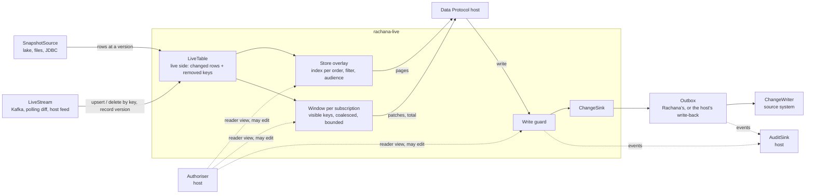

<!-- Copyright (c) 2026 Ashutosh Sinha. Proprietary. All rights reserved. -->
# Live tables: design

Status: **design, 2026-11-21; owner-approved to design and build ("design and do it").** Build in i7b G2 (read side) and G3 (edit
path); Drishti switches over in i8. Decisions LT-1 to LT-19 (section 13) are recommendations for the lead, who decides them under
the owner's delegation; the lead accepted them (DECISIONS, "Live tables").

**Build status** (lane g2/live, read side L1 to L6):

| Step | State |
|---|---|
| L1 | **built**: Core `com.ash.rachana.table.LiveTableSpec` (model, checker with every problem at once, `schema()`), codes `RCH-2080`..`2083` (SPEC 6.2; `2084`..`2089` reserved), conformance kind `live` (FORMAT 5.14, suite `live/declaration`, unverified), PROTOCOL section 16 and the JSON schema additions. Profile keys without their profile: `RCH-2060` at the top (as SPEC 6.2 says), `RCH-2058` inside `edit` (the form's code). The tools bundle's `live(request)` checks a declaration for Studio and `rachana lint` (which lints `*.live.yaml` beside Sutras); the runtime bundle has no checker |
| L2 | **built**: `ProtocolHost` (routes, bridge, query checks) over `TableProvider`s; `RowQuery` (a query document over rows in memory); `MemoryHost` is a provider; no behaviour change (protocol cases as before) |
| L3 | **built**: module `rachana-live` (JVM only; guard `LiveModuleGuardTest`): SPIs `SnapshotSource` (whole, columns, query tiers), `LiveStream`; `LiveTable` (subscribe before the snapshot, merge by key and version with `KeyedRows.versionOrder`, condition, epochs, gap resync, paused state, retention, replay log), `LiveTables` (a `TableProvider`: declarations from code or `*.live.yaml`, lazy open, idle close, upkeep), `PollingDiff` |
| L4 | **built**: `StoreOverlay`: columns-tier indexes (order, filter, audience; kept up to `maxIndexes`, a new source version or `indexTtl` reads again), pages merged with the live side, totals; query tier shadowed in place; `narrow` (`rdp.query.narrow`) and heavy columns (only with a filter fixing the whole key). Pages order by the whole sort list (`dir`, `nulls`), then the key values; a cursor is keyset (the last row sent, found by binary search in the index and the live side), an offset is placed by counting the live side and the shadowed positions: no page reads the rows before it. Not yet: the query tier does not place new live rows; a `rowTest` re-checks rows at index build |
| L5 | **built**: `Subscription` windows (keys, `top` in a newest-first order, `total` per patch, coalesced every `flushMs`, capacity overflow = one `gap` for that reader), bridge `sub.window`, `win`, `gap`; totals read outside the subscription's lock; the minimal SSE form's windowed stream (`window` in the `POST /changes` body, first frame `subd`, `POST /changes/{sub}/window`, only the stream's own caller); `TableClient.follow(…, window, top, …)` and `window`; the JavaScript `DataClient.follow` option `window` and `window()` (HTTP and bridge) |
| L6 | **built**: `Authoriser`, `ReaderView`, `AuditSink` (`read-refused`); row scope pushed down and re-checked, masks before filter/sort, audience-keyed indexes, refusals 403/404, fail closed (no authoriser: reads refused unless `openReads()`, a table with `edit:` refused); readers test (both tiers) |
| L11 (G2 half) | **built**: the live test adapter `LiveReferenceServer` (`/_test/live`, `/_test/as`, `/_test/stream`, `/_test/upkeep`, `/_test/audit`; PROTOCOL 15), run by `protocol_check.py --live`; suites `protocol/window` (12), `protocol/narrow` (6), `live/merge` (9), `live/resync` (5), `live/retention` (5), `live/overlay` (11), `live/readers` (11), all unverified and green on the reference; the mapping table in section 9.1. Other hosts report live-table cases unsupported (the Python host skips them, LT-14) |

A **live table** is a named table of the [Data Protocol](DATA_PROTOCOL.md) that the server keeps current: a snapshot from a durable
source, merged by key and version with the changes of a live stream, read a page at a time, and, when its declaration, the site and
the reader's rights all allow it, edited through a guarded write path. It is Drishti's live result set
(`com.ash.drishti.server.liveset`, about 3,300 lines, one engine behind FORM results, blotters and live tables) made generic.
A FORM result is a live table without edits; a blotter is one with edits.

## 0. Placement verdict

Asked independently: should the engine live (a) in Rachana as "live tables", (b) as its own product, or (c) stay in Drishti?

**Verdict: (a), in Rachana, as a separate JVM module (`rachana-live`), with four conditions.**

| Criterion | (a) Rachana | (b) own product | (c) stay in Drishti |
|---|---|---|---|
| Product fit | The standalone server already promises "changes by polling diff or by a provider's own feed" and tables by role; that **is** this engine. Without it Rachana paints live data but cannot serve it | No identity of its own: its wire is the Data Protocol, its declaration a Sutra-family file, its painter the Elements grid through `<rachana-view>`, its host `rachana-server` | Rachana's server then builds a second, smaller engine for the same job |
| Coupling | Wire, filter tree, keyed patches, conflation, forms and the bridge are already here. Lake, Kafka and RBAC stay outside behind five small interfaces | A third repository, a third pin, a version triangle (engine, protocol, compiler) for about 4K lines | None new, but Drishti keeps its own wire (`/api/v1/live`) beside the Data Protocol it adopts in G4 |
| One way per job | `LiveSet.apply` and `Window` already duplicate `KeyedRows`, `MemoryHost.publish` and `Subscription` (merge by key, filter restating, conflation, replay). One of each survives | Same as (a), at a higher cost | Two implementations of keyed merge, conflation and filtered streams, in two products that ship together |
| Security | Rachana decides nothing: an authoriser the host supplies answers every read and write; no authoriser, no edits (fail closed) | Same | Strongest by default: no seam to get wrong |
| i7b scope and timing | About 70 bd in G2/G3 on top of about 970 bd. Drishti is read-only and does not depend on it before i8, so a slip costs Rachana a feature, not Drishti a release | Adds repository, release and conformance set-up (about 10 bd) for no gain | Zero in i7b; the duplication is paid in i8 and after |

The honest weak points of (a), and the conditions that answer them:

1. **The engine is stateful server code; Core is a stateless compiler.** It goes in its own module, never in `rachana-core`, and is
   not compiled to JavaScript. Core gains only the declaration's model and checker (LT-2).
2. **The edit path's hard parts in Drishti are not in `liveset` at all.** They are the write-back (`server/edit`, about 6,200 lines:
   lanes, approvals, outbox, cluster forwarding, the edit log) which also serves Sutra forms and overlay records. That does **not**
   move. Rachana owns the write message, the guard and a small outbox for hosts that have none; Drishti binds its write-back as
   the sink (LT-8). Moving the write-back would be a different, larger decision and is not recommended for i7b or i8.
3. **Rights must stay the host's.** The authoriser is the only source of "may read", "may edit", row scope and masks; the engine has
   no role model, no user store and no default that allows a write (section 5).
4. **Not a gate dependency.** Read side in G2, edit path in G3; if either is not conformance-green at its gate it ships in the next
   Rachana release and G4 is unaffected. The escape hatch is the same as Drishti Lake's.

(b) is rejected: the parked-products note already folds it into the standalone server, and nothing in the engine is usable without
the protocol and the grid. (c) is the right answer only if i7b had no slack at all; it has, because the switch is in i8.

## 1. The model



### 1.1 Snapshot source (SPI)

`SnapshotSource` gives the durable rows of one table. Three tiers; the engine uses the best a source declares.

| Tier | Methods | Used for |
|---|---|---|
| whole | `read(sink)` | small tables: read into memory once (capped by `max-snapshot-rows`; the table then says `capped`) |
| columns | `version()`, `scan(columns, sink)` (key + named columns in one pass), `fetch(keys)` (rows whole) | the paged table: an index of keys and sort values is built from `scan`, pages `fetch` their rows (Drishti's `StorePages`) |
| query | `page(query document)` answering rows + cursor + total | a source that sorts, filters and pages itself (JDBC, a lake's own reader); the engine builds no index |

`version()` is the source's data version; a new one (a load) drops the indexes. A source that cannot say is re-read after
`index-ttl` (default 60 s). The source never sees a reader: the engine adds the reader's row filter to what it asks.
Drishti Lake supplies snapshots by implementing this interface in the host (LT-16); its design
(`DRISHTI_LAKE_DESIGN.md`, in progress) is not a dependency of this one.

### 1.2 Live stream (SPI)

`LiveStream.subscribe(listener)` returns a handle; the listener receives `upsert(row, position?)`, `delete(key, position?)`,
`gap(reason)` and `state(up | paused, reason)`. Rows arrive **whole** (a record, not a field patch) and carry the declared version
column when there is one. A stream is optional: without one the table is static (a FORM result on a past business date).
A stream whose broker is absent is `paused`: the table serves its snapshot, its schema says `live: { state: paused, reason }`,
and it is never an error. Plug-ins (Kafka, a JDBC change poll, a host callback) implement this interface outside the engine;
`rachana-live` ships only `PollingDiff` (reads the snapshot source every `refresh` seconds and diffs by key).

### 1.3 Merge by key and version

- **Subscribe first, then read.** The engine subscribes, reads the snapshot, then applies what arrived meanwhile; nothing between
  the two is lost and nothing is applied twice (the version rule).
- **Key**: the declared key columns; key text is `KeyedRows.keyOf` (each value's JSON text; a whole number never as `42.0`).
- **Version rule**: with a `version:` column, an arriving row whose version is not above the held one is dropped (no duplicates,
  no going back); a skipped version is counted (rows are whole, so the newest is still right). Without one, the latest arrival wins.
- **Condition**: a row that stops holding the declaration's `where` leaves the table (a removal); a deletion leaves it.
- **Two numberings, never confused**: the *record version* orders changes of one row from the source; the table's *stream position*
  `{epoch, seq}` (PROTOCOL 8.1) orders patches to readers. Every applied change takes the next `seq`.
- **Gap resync**: a stream `gap`, a reconnect that cannot resume, or a paged table whose live side was trimmed starts a **new
  epoch**: the engine re-reads (whole tier) or drops its indexes (other tiers), and every reader resyncs by PROTOCOL 8.3 (LT-15).
  A reader that falls behind its window capacity gets a `gap` with `recoverable: false` for itself only.
- **Paged tables keep the snapshot in the source.** The engine holds the *live side* only: rows changed since the table opened and
  the keys removed. A page merges both by key: a changed row shadows the source's, a removed key hides it, a new row takes its
  place in the order; totals are the index's count with the same corrections.

### 1.4 Retention

`retention: { ttl, on, max-rows }` trims the **live side**: rows older than `ttl` by the column `on` (the arrival time when absent),
and beyond `max-rows` the oldest. In a whole-tier table a trimmed row is a removal; in a paged table it shows the source's row
again, so readers resync. The durable source keeps its own retention. A table nobody has read for `idle-close` (default 10 min) is
closed and reopened on the next read.

### 1.5 The paged window

A reader reads a page (`rows` or `query`), then subscribes with a **window**: the keys its page shows.

- It is sent patches for those keys only, plus the new `total` when rows outside its page changed (an empty patch with `total`).
- `top: true` says its page starts at the first row of the table's own order; when that order is newest-first (descending by
  `changed-at` or `version`), a new or changed row is sent to it to insert on top and listed in the patch's `top`. Any other
  reader gets the total and offers "N new".
- Changes are coalesced per key between flushes (`flush-ms`, default 50) with `Subscription.merge`; a window holding more than
  `window-capacity` (default 5,000) pending keys drops them and resyncs. A burst never queues without bound.
- A reader without a window (a small table held whole) gets every patch, as PROTOCOL 8 already says.
- Sort and filter of a window are the **query's** (the filter tree, PROTOCOL 7); they are evaluated on the row as the reader sees
  it, so a masked value never picks, orders or filters a row.

### 1.6 The guarded edit path (optional)

A write is accepted only when **all four** hold, checked on the server for every request: the declaration has `edit:` naming the
column; the site switch for the table is on; a write binding exists (a `ChangeSink`); the authoriser allows this reader to edit
this row and column. Then:

1. **Shape**: the change names the row's key, the version it was made on (`basedOn`), the columns set, an optional reason, and a
   client-made **change id** (ULID). The declaration's form rules (type, `required`, `pattern`, `min`, `max`, `options`) are run by
   Core's form checker, the same code the page ran.
2. **Authorise** (section 5). A refusal is audited and answered `403`; a row outside the reader's scope is `404`, as if absent.
3. **Version guard**: `basedOn` must equal the held version, else `409` naming the current version, who made it and when
   (`changed-by`, `changed-at`). The sink runs the same guard again when the change is applied at the source.
4. **Sink**: `ChangeSink.accept(change)` answers `applied`, `queued`, `held` (waiting for a decision the host owns: four eyes) or
   `refused`. The engine does not change its rows: the edit shows when the source's own change arrives on the stream.

**Exactly-once.** `rachana-live` ships one sink, `Outbox`: the change is journalled (`OutboxStore`: a file journal by default, a
host's database by interface) before it is acknowledged; sent by a `ChangeWriter` once per key in order; resent after a crash with
the **same change id**, which the source treats as already applied; a repeat of a change id from a client answers the first
answer again. `held` changes wait in the journal until the host calls `release(id, by)` or `reject(id, by, reason)`. A host with
its own write path (Drishti) supplies its own `ChangeSink` instead and Rachana's outbox is not installed (LT-8).

## 2. The declaration

One file per table, `<name>.live.yaml`, a Sutra-family document (`rachana: 1`, read by Core's YAML reader, checked with every
problem reported at once, same profile rules as a Sutra). Keys in **bold** are Core; the rest are a profile's.

```yaml
rachana: 1
live-table: trade                       # the table's name in the Data Protocol
title: Trade blotter
snapshot: trades                        # a SnapshotSource the host resolves by name
stream: trades.live                     # a LiveStream the host resolves by name; absent: static
where: "@.TRADE_STATUS != 'CANCELLED'"  # Rachana-EL over each row; compiled to a filter tree, pushed to the source
key: TRADE_ID                           # a column or a list
version: TRADE_VERSION
changed-by: UPDATED_BY
changed-at: SOURCE_UPDATE_TIME
columns:                                # the Data Protocol's column fields, plus width
  - { name: TRADE_ID, label: Trade, type: string, width: 120 }
  - { name: QUANTITY, label: Quantity, type: decimal, fmt: amount0 }
  - { name: SCENARIO_PVS, type: list, items: decimal, heavy: true }   # never in a list page
sort: { col: SOURCE_UPDATE_TIME, dir: desc }
group-by: []
subtotals: [QUANTITY]
narrow: { any-of: [PORTFOLIO, TRADE_ID] }      # a list must filter on one of these (section 2.1)
retention: { ttl: 1d, on: SOURCE_UPDATE_TIME, max-rows: 50000 }
tray: true                              # serve the reader's own pending changes as trade.changes
edit:                                   # a Core form; absent: read-only (a FORM result)
  edit: cells
  fields:
    - { id: price, bind: PRICE, type: number, min: 0 }
    - { id: status, bind: TRADE_STATUS, type: enum, options: [NEW, VALIDATED, AMENDED, CANCELLED] }
  reason: optional
# profile keys (Drishti's): kind, query (the search grammar, compiled by the host to `where`), links, edit.roles,
# edit.fields[].editable-by, edit.save { target, command, approval }
```

Checked at load (a declaration with problems is set aside and listed, never half-loaded): every named column exists in `columns`;
`edit` needs `version` and a key; an editable column is not the key, the version, `changed-by` or `changed-at`; `where` is within
the push-down subset or the source is whole-tier; `fmt` names exist; profile keys without their profile are `RCH-2058`. New
`RCH` codes are allocated from the reserved list in step L1.

**FORM and blotter.** No `edit:` is a FORM result (or any read-only live table); with `edit:` it is a blotter. There is one
key (`live-table:`) and one file suffix; `blotter:` is not kept as a second spelling (LT-11). A host may make **default
declarations** in code (Drishti: one per kind from its data contract) through `LiveTables.declare(spec)`.

### 2.1 Vector-heavy tables

`narrow:` makes a list refuse to run bare: `rows` or `query` without a filter that fixes one of the named columns answers `422
rdp.query.narrow` naming them, and reads nothing. Columns marked `heavy: true` are left out of list pages and patches; they are
read by fetching one row by key. The schema document carries both, so a page opens the search form instead of a grid.

### 2.2 How a Sutra uses a live table

A live table is a table the host resolves by name; a Sutra needs **no new syntax** (SPEC 2.4):

```yaml
data:
  trades: { table: trade, mode: server, where: "@.PORTFOLIO == ctl.book" }
panels:
  - { use: core/live-table@1, with: { rows: $.trades }, as: blotter }
```

- `mode: server` (the default once the schema says `can: [changes.window]`) makes the table panel a paged grid: it reads pages by
  `query`, subscribes with its window, and re-reads on resync. The plan (`DataPlan`) already carries the filter tree.
- Editing is the panel's `form:` with `edit: cells`; the fields offered are those the schema lists under `write` for this
  reader (none when read-only). Submit is a protocol write (section 4), not a host endpoint.
- **The blotter screen is a library fragment**, `core/live-table@1` (L-21: a function of a table parameter): grid, record panel,
  the tray (a table panel over `<name>.changes`), "N new", the stale and paused banners. `LiveTables.screen(name)` answers the Sutra
  that calls it with the declaration's columns, sort and grouping, so a declaration alone gives a screen. No screen is hand-built.

## 3. One shared table, per-reader views

The table's rows are held **as the source holds them** and shared by every reader. Nothing in the shared state belongs to a person.
Per reader exist only: a `ReaderView` (made by the authoriser for each request, never kept beyond the request and the reader's
own subscription), a `Window` per subscription, and index entries keyed by the view's **audience** text (everything that decides
what the reader sees). Two readers with equal audiences share an index; no one else reads it.

An ad-hoc result (a FORM search) is **not a separate object**: it is `query` with a filter, then a filtered, windowed subscription
on the declared table with the same filter (LT-5). Drishti's per-search sets and their ids go away.

## 4. On the Data Protocol

Any client that speaks the protocol paints a live table; the engine implements `TableProvider`. Everything below is an **addition
to PROTOCOL v1** under new `can` values (section 14 allows it; both sides ignore what they do not know). The one sentence that
changes is section 14's "not in v1: writes", which becomes "writes only under `can: write`".

| Addition | Where | Form |
|---|---|---|
| `can`: `changes.window`, `write`, `narrow` | schema | capability flags |
| schema fields | 2 | `rowVersion`, `changedBy`, `changedAt` (column names); `live: { state, reason? }`; `capped`; `narrow`; column `heavy`; `view: { sort, groupBy, subtotals, widths }`; for a reader who may edit, `write: { columns: { <name>: <field rules> }, reason }` |
| windowed subscription | 8.2, 12 | `sub` carries `meta.window: { keys: [[…]], top?: bool }`; changed later by a `win` frame `{ sub, keys, top }` (events and bridge), or `POST {base}/changes/{sub}/window` in the minimal SSE form, whose first frame is `subd` with the `sub` id. Only the stream's own caller may set it; anyone else gets `rdp.table.unknown` |
| patch fields | 8.1 | `total` (the reader's count after the patch), `top` (keys to insert first). A patch with neither rows nor these is still sent when the numbering needs it |
| write | 4, 12 | `POST {base}/tables/{name}/write`, bridge `t: write`: `{ id, op: update \| add \| remove, key, basedOn, set: { col: value }, from?: { col: value }, reason? }` answered `{ change, state: applied \| queued \| held \| refused, message, version? }`; the same `id` again answers the same |
| pending changes | 3 | the table `<name>.changes` (key `change`; columns state, key, set, by, at, message), listed and filtered for the caller by the authoriser, live like any table |
| errors | 10 | `rdp.write.unsupported` 405 (the table has no `write`), `rdp.write.forbidden` 403 (switch off, no right, a column not editable; audited), `rdp.write.conflict` 409 with `current: { version, by, at }`, `rdp.write.invalid` 422 with `fields: [{ column, rule, message }]`, `rdp.query.narrow` 422 with `anyOf` |

Arrow and NDJSON pages work unchanged (the engine answers the JSON page; `rachana-data` encodes it). Filtered subscriptions and
conflation are the existing 8.2 and 8.4. The JVM `TableClient`, the JavaScript `DataClient` and the bridge each gain `write`,
`window` and the two patch fields; nothing else.

## 5. The access hook

**Rachana never decides rights.** The host supplies one `Authoriser`; the engine calls it and obeys.

```java
public interface Authoriser {
    ReaderView view(Caller caller, String table);                 // throws Refusal: forbidden, or unknown (do not leak)
    Decision mayEdit(Caller caller, String table, Change change, Map<String, Object> row);
}
record ReaderView(String audience, Object rowFilter /* filter tree or null */, Set<String> maskedColumns,
                  Predicate<Map<String, Object>> rowTest /* optional, in-process */, UnaryOperator<Map<String, Object>> redact /* optional */,
                  Set<String> editableColumns /* empty: read-only */, String readOnlyReason) {}
sealed interface Decision { record Allow() …; record Refuse(String reason) …; }
```

- `Caller` is an opaque object the host's transport attaches to the request; the engine never looks inside it.
- **Rows**: the reader's `rowFilter` is and-ed with every query and subscription and pushed to the source; `rowTest` is for hosts
  whose rule is code (not pushed down; it names the columns it reads). **Masks**: masked columns are sent as `{ "$masked": true }`;
  filter, sort, group and the text search run on the masked row.
- **Fail closed**: no authoriser installed means every read is allowed for a single-application bridge host only (PROTOCOL 12)
  and **every write is refused**; the HTTP host refuses to start a table with `edit:` without one.
- **Refusal semantics**

| Case | Answer | Audit event |
|---|---|---|
| may not read the table | `403 rdp.forbidden`, or `404 rdp.table.unknown` when the host says not to leak | `read-refused` |
| row outside the reader's scope (read, write or window key) | as if absent: `404`, or silently not sent | none for reads; `write-refused` for a write |
| write to a read-only table, column or by a reader without the right (a forged request included) | `403 rdp.write.forbidden` with the reason in words | `write-refused` |
| write on an old version | `409 rdp.write.conflict` | `write-conflicted` |
| write accepted | `200`, state | `write-submitted`, then `write-held`, `write-released`, `write-rejected`, `write-sent`, `write-applied` or `write-failed` |

- `AuditSink.record(event)` receives `{ at, caller, table, key, change id, event, reason, columns, from, to }`. The host stores it;
  the engine keeps counters only. Values of columns masked for the caller are never in an event sent back to that caller.
- **Four eyes** is the host's: its `ChangeSink` (or its `mayEdit`) answers `held`; approvals, approver roles and "never your own"
  live in the host. The engine knows only `held`, `release` and `reject` (LT-9).

## 6. One implementation

| Job | Survives | Retired |
|---|---|---|
| keyed rows, key text, patch order | `com.ash.rachana.table.KeyedRows` (gains the version rule) | `LiveSet.apply`, `LiveSet.keyText` |
| filter restating, conflation merge, replay | `com.ash.rachana.data.Subscription` (the window is a filter by key set on it) | `LiveSet.Window` |
| the protocol's routes and bridge | a `ProtocolHost` over `TableProvider`, extracted from `MemoryHost`; `MemoryHost` and `LiveTables` are two providers | `LiveSetController`, `LivePages`, Drishti's `/api/v1/live/*` |
| row conditions | `FilterTree` evaluated as Rachana-EL | `LiveSet`'s text filter and `compareValues` (the query's sort rules of PROTOCOL 6.1 apply) |
| paging from a store | `rachana-live` `StoreOverlay` | `StorePages` |
| the declaration | Core `LiveTableSpec` | `LiveSetSpec` |
| client-side page shaping | `<rachana-view>` and the Elements grid's live mode | `drishti-console/core/live_results.py`, the grid's own SSE reader |

**Drishti keeps** (an adapter of roughly 800 lines in place of 3,300, plus what was never in `liveset`):

- the declarations' profile parts (`kind`, `query` in the search grammar and its compilation to a filter tree, `links`, `save`,
  roles) and the default declaration per kind from the data contracts;
- `SnapshotSource` over its bindings (later Drishti Lake), including as-of dates, the cluster's fan-out and the "answered from an
  earlier date" notices; `LiveStream` over a kind's `live:` binding (the Kafka plug-in is untouched);
- the `Authoriser` (entitlements, row rules, masks, the edition's allow-list, the site switch `edits-off`), the `AuditSink` (its
  audit log) and the `ChangeSink` (its write-back: lanes, approvals, outbox, cluster ownership, connector writes);
- the raw source record (the panel's Raw JSON) and the "excludes ENDUR" banner, as schema `live` notes.

## 7. Scale

- **Virtualised snapshot**: a paged table never holds the snapshot. Per index: keys, entity ids and one sort column (about 80
  bytes a row; 1.3 million positions is about 100 MB per kept index); at most `max-indexes` (default 4) per table, the least
  recently asked dropped first, all dropped on a new source version. A query-tier source needs none.
- **Deltas for the visible window only**; other readers get a count. The flush thread never reads the source.
- **Back-pressure**: coalescing per key, a bounded window, resync instead of queueing, PROTOCOL 13's patch limit (10,000 rows,
  1 MB), conflation `everyMs` on request.
- **Fan-out**: one `LiveTable` per declaration however many readers; a patch is built once per audience and masked per window.
- **Cluster**: each node runs its own table from the same stream; a reader that reconnects to another node sees a new epoch and
  resyncs. Write ownership across nodes is the sink's.
- **Targets** (checked in L11): 1.3 million rows paged with first page under 1 s after the index, 10,000 changes a second ingested,
  200 windows flushed inside 50 ms, memory flat under a burst.

## 8. Modules and packages

| Where | What |
|---|---|
| `rachana-core` `com.ash.rachana.table` | `LiveTableSpec` (model, checker, schema generation), `KeyedRows` version rule. Compiled to JavaScript with the rest of Core, so Studio and `rachana lint` check declarations |
| `rachana-data` `com.ash.rachana.data` | `ProtocolHost` (routes, bridge, encodings over any `TableProvider`), `Subscription` window, `TableClient.write` and `window`, the reference server serving both providers |
| **`rachana-live`** (new) `com.ash.rachana.live` | `LiveTables` (registry, flush, upkeep), `LiveTable`, `StoreOverlay`, `WriteGuard`, `Outbox`, `PollingDiff`; `…live.spi`: `SnapshotSource`, `LiveStream`, `Authoriser`, `AuditSink`, `ChangeSink`, `OutboxStore`, `ChangeWriter`. JDK 21, depends on `rachana-data` only; no Kafka, no lake, no database driver, no web framework |
| `rachana-server` | `live:` in `rachana-server.yaml`: file and JDBC snapshot sources, polling diff, a JDBC `ChangeWriter`, the file journal, an authoriser over its users and roles |
| `js/packages/rachana` | `DataClient.write`, windowed `subscribe`, `<rachana-view>` server-mode table panels |
| Drishti Elements (its repository) | the grid's live mode takes pages and window patches from a data client (no fetch of its own) |
| libraries (companion repository) | `core/live-table@1` |
| `spec/1/data-protocol`, `conformance/1` | PROTOCOL additions and schemas; cases (section 9) |

Dependency rule stays: `rachana-api` ← `rachana-core` ← `rachana-data` ← `rachana-live` ← `rachana-server`. The engine is JVM only;
Python and Node hosts implement the protocol over their own data or run `rachana-server` beside the application (LT-14).

## 9. Conformance and tests

Protocol cases run against any host through the test adapter (PROTOCOL 15), which gains `/_test/stream` (push a source change),
`/_test/as` (act as a named reader with a given view) and `/_test/audit` (read the events).

| Suite | Cases (each is one file entry; about 70 in all) |
|---|---|
| `protocol/window` | window by keys; total-only patch; `top` insert in a newest-first order and not otherwise; window changed by `win`; another caller's window refused; overflow gives an unrecoverable gap; resume |
| `protocol/write` | applied, queued, held; repeat of a change id; conflict names version, who, when; invalid names the rule; unsupported; forbidden for switch off, no right, column not editable, row out of scope (404); every refusal audited; `<name>.changes` shows only the caller's |
| `protocol/narrow` | bare list refused naming the columns; narrowed list pages without heavy columns; one row by key has them |
| `live/merge` | subscribe before snapshot; older and equal versions dropped; skipped version; no version column; delete; row leaves by condition; compound and numeric keys |
| `live/resync` | stream gap gives a new epoch; paused stream serves the snapshot; reconnect; trimmed paged table resyncs |
| `live/retention` | ttl by column and by arrival; `max-rows`; idle close and reopen |
| `live/overlay` | changed row shadows, removed key hides, new row placed in order; totals; new source version rebuilds; sort by a column the source does not keep; query tier |
| `live/readers` | two readers, different row filters and masks, concurrently: neither sees the other's rows in pages, patches, totals or changes; a masked value never orders or filters; equal audiences share an index |
| `live/declaration` | every checker problem; profile keys without the profile; default declaration |

### 9.1 Ported Drishti cases (G2 half)

Each case of Drishti's `liveset` tests (read side; the engine half of `KafkaBlotterTest`) and where it now lives. "Unit" is a JVM test
of `rachana-live` (`LiveTablesTest`, `StoreOverlayTest`, `LiveReferenceServerTest`); the rest are conformance cases.

| Drishti case | Rachana |
|---|---|
| LiveSetTest `changesMergeByKeyAndVersionWithoutDuplicatesOrGoingBack` | `live/merge#older-and-equal-versions-are-dropped`, `#a-newer-version-replaces-the-row`, `#versions-compare-as-numbers`, `#a-skipped-version-is-applied`; unit |
| LiveSetTest `whatArrivesWhileTheSnapshotIsReadIsAppliedAfterItByVersion` | unit `whatArrivesWhileTheSnapshotIsReadIsAppliedAfterItByVersion` (a race inside the engine: no adapter can drive it) |
| LiveSetTest `aBurstOfTenThousandUpdatesReachesAViewerCoalescedOrAsOneResync` | `protocol/window#overflow-gives-an-unrecoverable-gap`; unit `aBurstReachesAWindowedReaderCoalescedOrAsOneGap` |
| LiveSetTest `aPagedViewerIsSentChangesOfItsRowsAndOnlyTheCountOfOthers` | `protocol/window#window-by-keys`, `#a-change-outside-the-window-sends-the-total-only`, `#win-changes-the-window` |
| LiveSetTest `inANewestFirstOrderANewOrChangedRowIsInsertedOnTopOfAPageAtTheTopAndOnlyCountedElsewhere` | `protocol/window#top-insert-in-a-newest-first-order`, `#no-top-insert-for-a-page-below-the-top`, `#no-top-insert-when-the-order-is-not-newest-first` |
| LiveSetTest `retentionDropsRowsPastTheirAgeAndBeyondTheCapOldestFirst` | `live/retention#ttl-by-a-column`, `#ttl-by-arrival`, `#max-rows-drops-the-oldest` |
| LiveSetTest `anEditPassesOnlyWhenTheConfigurationAndTheRightsAllowItAndTheVersionIsCurrent` | G3: `protocol/write` (L7) |
| LiveSetTest `aDeclarationWithProblemsSaysThemAll` | `live/declaration` (L1) |
| StorePagesTest `pagesAndTotalsEqualTheMergedOrderWithTheLiveSide` | `live/overlay#a-changed-row-shadows-the-sources-and-moves-in-the-order`, `#a-removed-key-hides-the-sources-row`, `#a-new-row-takes-its-place-in-the-order`, `#a-filtered-page-and-its-total`; unit `pagesFollowTheWholeSortListByCursorAndByOffsetThroughTheLiveSide` |
| StorePagesTest `aMillionRecordsPageWithinTheBudget` | the scale run (G3 half); unit `aPageFarDownReadsOnlyItsOwnRows` (a far page reads only its own rows) |
| StorePagesTest `aBlotterHoldsTheLakesTradesAndTheStreamedOnesMergedByKeyAndVersionNewestFirst` | `live/overlay` and `protocol/window#top-insert-in-a-newest-first-order`; unit `pagedPagesAndTotalsEqualTheMergedOrderWithTheLiveSide` |
| LiveIsolationTest `theSameSearchGivesEachAudienceItsOwnSetAndNeitherReadsTheOthers` | `live/readers#the-same-paged-table-for-two-readers` (a search is a filtered query, LT-5) |
| LiveIsolationTest `whichNodeAnsweredIsKeptFromPeopleWhoAreNotAdministrators` | the host's (Drishti adapter, i8 step 3): not the engine's |
| LiveIsolationTest `aDeclaredSetIsSharedButEveryReadKeepsToTheReadersScope` | `live/readers#two-readers-see-their-own-rows-and-totals`, `#patches-reach-only-the-readers-whose-rows-they-are`, `#a-row-that-leaves-a-readers-scope-is-removed-for-them`, `#a-windowed-readers-total-counts-their-rows-only` |
| LiveQueryTest `aFormOverALiveKindKeepsTheSearchsRowsAndOrderThenTicks` | `live/overlay#a-filtered-page-and-its-total`, `protocol/window#window-by-keys` |
| LiveQueryTest `aPastBusinessDateOrAKindWithoutALiveBindingIsStaticAndReadAfreshWhenRunAgain` | a declaration without `stream:` is static; `live/retention#idle-close-and-reopen` (read afresh); as-of dates are the host's (i8 step 2) |
| LiveQueryTest `maskedPeopleGetTheirOwnSetAndAMaskedValueNeverPicksSortsOrFiltersRows` | `live/readers#masked-values-are-sent-masked`, `#a-masked-value-never-orders-or-filters` |
| LiveQueryTest `aBareMnemonicOpensItsKindsDefaultSetPagedTickingAndCapped` | `protocol/narrow` (a bare list refused); default declarations are the host's (i8 step 4); `capped` has no case yet |
| LiveQueryTest `aClosedSearchSetIsNotReopenedAsSomethingElse` | no sets (LT-5); a cursor of another query is `rdp.cursor.invalid` (unit `aCursorContinuesAfterItsLastRowWhenRowsBeforeItChangeNeitherRepeatingNorSkipping`) |
| LiveSetValidationTest `theShippedTradeBlotterPassesAndDescribesReadonlyAndPattern` | `live/declaration#blotter-reads-and-gives-its-schema` |
| LiveSetValidationTest `aBadDeclarationIsSetAsideWithItsCodeAndRefused` | `live/declaration` (problem cases); `LiveTables.load` sets a file aside |
| LiveSetValidationTest `aKindWithoutAContractIsCheckedForFormatsOnly` | the host's (data contracts, i8 step 4) |
| KafkaBlotterTest `everyChangeOfTheKindIsPushedAndTheStateIsReadInOnePass` (engine half) | `live/merge#a-deletion-removes-the-row-and-is-sent`, `live/resync#a-reconnected-stream-is-up-again` |
| KafkaBlotterTest `aCommandIsSentOnceKeyedByItsChangeIdAndAStaleOneIsRefusedSayingWhoChangedIt` | G3: `protocol/write` (change id, conflict) |
| KafkaBlotterTest `aDocumentCommandWritesTheAmendedRecordBackWithTheNextVersion` | G3 and the host's write-back (LT-8) |

Beyond conformance: unit tests per class; the ports of Drishti's `LiveSetTest`, `StorePagesTest`, `LiveIsolationTest`,
`LiveQueryTest`, `LiveSetValidationTest` and the engine half of `KafkaBlotterTest` (each case mapped to a suite above; the mapping
table is a deliverable of L11); an outbox crash test (kill between journal and send; the source sees one change); a concurrency
test (writers, readers and trims together under a thread sanitiser run); browser tests of `core/live-table` in the three engines;
the scale run of section 7. Guards: no class of `rachana-live` reads a role or a user; no write path without `Authoriser`.

## 10. Build steps, estimates, lanes

| Step | Work | bd | Gate | Model |
|---|---|---|---|---|
| L1 | `LiveTableSpec`, checker, schema, codes, SPEC and PROTOCOL text and JSON schemas for section 4 | 5 | G2 | opus |
| L2 | `ProtocolHost` extracted from `MemoryHost` over `TableProvider`; no behaviour change (existing cases stay green) | 4 | G2 | opus |
| L3 | `LiveTable`: SPIs, merge, epochs, resync, retention, `PollingDiff`, `LiveTables` lifecycle | 8 | G2 | opus |
| L4 | `StoreOverlay`: three tiers, indexes, merged pages and totals, narrowing, heavy columns | 7 | G2 | opus |
| L5 | Windows: `Subscription` key window, `top`, totals, flush, back-pressure; server, bridge and `TableClient` | 5 | G2 | opus |
| L6 | `Authoriser`, `ReaderView`, masking, audience-keyed indexes, read refusals, the readers suite | 5 | G2 | opus |
| L7 | `WriteGuard`, write message, `ChangeSink`, `Outbox` with journal, hold and release, `<name>.changes`, audit events | 9 | G3 | opus |
| L8 | JavaScript `DataClient`, `<rachana-view>` server-mode panels; Elements grid live mode (4 of the 9, in Elements) | 9 | G3 | opus |
| L9 | `core/live-table@1`, `LiveTables.screen`, the live-orders example on it, the guide page | 4 | G3 | sonnet |
| L10 | `rachana-server` `live:` (file and JDBC sources, JDBC writer, users authoriser) | 6 | G3 | sonnet |
| L11 | Conformance suites and adapter, the ported Drishti cases with their mapping table, crash and scale runs | 8 | G2 half, G3 half | sonnet; haiku for the mechanical ports |
| | **Rachana total** | **70** | | |

Two lanes: **engine** (L1 to L7, one opus builder in sequence, L11 alongside on sonnet) and **client** (L8 to L10, after L5).
L2 touches `rachana-data`, owned by lane C2; it lands first and alone.

## 11. The Drishti switch-over (i8)

Drishti stays read-only until then. In one change set, old code deleted in the same release:

| # | Step | bd |
|---|---|---|
| 1 | Pin the Rachana release that has `rachana-live`; mount `ProtocolHost` with `LiveTables` at the Data Protocol base | 1 |
| 2 | `DrishtiSnapshotSource` (bindings or Lake, as-of, fan-out, notices) and `DrishtiLiveStream` (the `live:` binding) | 5 |
| 3 | `DrishtiAuthoriser` (entitlements, row rules as filter trees where they are expressible and `rowTest` where not, masks, edition, site switch), `AuditSink`, `ChangeSink` over `EditService` | 5 |
| 4 | Declarations: `*.blotter.yaml` rewritten as `*.live.yaml` (the trading module's and the site examples'); search grammar to filter tree; default declarations from contracts | 3 |
| 5 | Console: result tables, the search page, kind pages and the blotter drawn by `core/live-table` through `<rachana-view>`; `live_results.py` and the grid's own stream reader deleted | 5 |
| 6 | Delete `liveset/*` except the adapter; `/api/v1/live/*` removed (API reference, CLI and tutorials move to the Data Protocol routes); tests replaced by the conformance run plus adapter tests; guards | 3 |
| 7 | Evidence: the ported cases green on Drishti's adapter; `KafkaBlotterTest` unchanged; the two-user isolation test; the 1.3 million position page; guide, tutorial and screenshots | 3 |
| | **Drishti total** | **25** |

Lanes: steps 2, 3 and 6 opus; 4 and 7 sonnet; 5 opus with the Elements owner.

## 12. Risks

| Risk | Answer |
|---|---|
| Drishti's row rules or masks are not expressible as a filter tree and a column set | `rowTest` and `redact` exist for in-process hosts; measured in i8 step 3 before deleting anything |
| The events wire protocol (D23) is still a design | Windows and writes are specified on the bridge and the minimal SSE form first, which are built |
| A second outbox beside Drishti's | Each host installs exactly one sink; Rachana's is for hosts without a write path (LT-8) |
| Index memory on very large tables | The query tier (no index) for sources that page themselves; `max-indexes`; targets measured in L11 |
| G2 load on lane C2 | L2 is the only shared-file step; the rest is a new module |

## 13. Decisions

| # | Question | Recommendation |
|---|---|---|
| LT-1 | Where does the engine live? | **In Rachana** (section 0), not a product of its own, not left in Drishti |
| LT-2 | Which module? | A new JVM module `rachana-live`; Core gets the declaration only; the engine is not compiled to JavaScript |
| LT-3 | How are changes merged? | Source side by key and record version, whole rows; reader side by `{epoch, seq}` patches. Field-level patches from a source are not taken |
| LT-4 | What is a window? | The keys the reader shows plus `top` (as Drishti built and tested). A server-ordered row range with move events is not built |
| LT-5 | Are ad-hoc results separate sets? | No: a query plus a filtered, windowed subscription on the declared table |
| LT-6 | How does a host express what a reader sees? | A filter tree and masked columns (pushed down); an in-process predicate and redactor where a rule is code |
| LT-7 | Where do writes travel? | In the Data Protocol v1 as additions under `can: write`; no second edit protocol and no host-specific endpoint |
| LT-8 | Who owns the outbox? | `rachana-live` ships one behind `ChangeSink` for hosts without a write path. **Drishti keeps its write-back and binds it as the sink.** Folding Drishti's lanes and outbox onto Rachana's is not planned; revisit only if a second host needs approvals |
| LT-9 | Four eyes? | The host's. The engine knows `held`, `release`, `reject` and nothing about approvers |
| LT-10 | The tray of pending changes? | A live table `<name>.changes` filtered for the caller; no special route |
| LT-11 | File and key names? | `<name>.live.yaml`, `live-table:`; Drishti's `.blotter.yaml` and `blotter:` are rewritten in i8, no alias |
| LT-12 | The screen? | The library fragment `core/live-table@1`; `LiveTables.screen` generates the Sutra that calls it |
| LT-13 | Vector-heavy tables? | `narrow:` and `heavy:` in the declaration; `rdp.query.narrow` |
| LT-14 | Engine in Python or Node? | No. One implementation on the JVM; other hosts implement the protocol or run `rachana-server` |
| LT-15 | Resync after a source gap? | A new epoch; readers re-read their page. No server-side diff of old against new |
| LT-16 | Where is the Lake's snapshot adapter? | In the host (Drishti), implementing `SnapshotSource`; neither product depends on the other. Re-check against `DRISHTI_LAKE_DESIGN.md` when it lands |
| LT-17 | Drishti's `/api/v1/live/*`? | Removed in i8 for the Data Protocol routes; no second wire |
| LT-18 | Timing? | Read side G2, edit path G3, Drishti in i8; never a G4 dependency; a step not green at its gate ships in the next Rachana release |
| LT-19 | No authoriser installed? | Fail closed: writes refused everywhere; an HTTP host will not start a table that has `edit:` |
