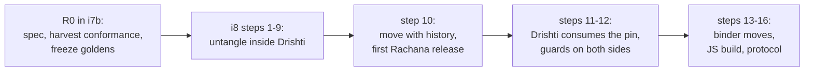

<!-- Copyright (c) 2026 Ashutosh Sinha. Proprietary. All rights reserved. -->
# The split: plan for Drishti i8

Status: **in progress** (M1 of the i7b plan). Phase A (R0) is done; the move (step 10) is done and tagged `v0.9.0`; the
untangling steps now run **inside this repository** (section 0). Sections 1 to 9 are the plan as written; section 0 says what
changed and where each step stands.

## 0. Status, and the re-order of 2026-11-19

**Why the order changed.** The owner's rule for M1 (2026-11-19): Drishti is not modified. Steps 1 to 9 untangle inside Drishti
before the move, so they cannot run there. The order is now **move first, untangle here**:

1. **Step 10 (A10) first**: `git filter-repo` on a fresh clone of Drishti `main` (`c6bc1d1bc`), keeping only the reviewed path
   allow-list, into `java/rachana-core` with its history (138 commits); the package rename in one commit; this repository's
   headers. The host types the moved code still names are held in `com.ash.rachana.hostcompat` and the libraries it still uses
   are allowed, each listed with the step that removes it in [java/SPLIT_EXEMPTIONS.md](../../java/SPLIT_EXEMPTIONS.md) (the guards
   read that file; it only shrinks).
2. **Steps 2 to 7 (A1 to A7b) and 13, 14 (A13, A14) inside this repository**, on the moved code, each proven by the conformance
   suite over the moved code being byte-identical to the reference bridge over Drishti's jars (0 verified failing).
3. **Drishti's half waits** for the migration: deleting its copy, consuming the pin (step 11), its guards (steps 1 and 12), its
   tag and drill. Each is written down in [DRISHTI_MIGRATION_TODO](../plans/DRISHTI_MIGRATION_TODO.md) section 8.

The proof of every step: `rachana_conformance.py --jvm` (this code) and `--classpath-file` (the reference bridge over the jars
built from the same Drishti commit) write byte-identical results files over all 2,112 cases (1,908 pass, 74 unverified failing as
recorded, 130 unsupported kinds, **0 verified failing**). `tools/split/compare_results.py` compares the two files; the few cases
whose line may differ are listed with the step and the reason in `tools/split/known-differences.txt` (each still passes). Drishti's ViewModel goldens cannot run here; they are part of the
migration's proof (step 11).

| Step | Plan id | Where | State | Proof |
|---|---|---|---|---|
| 0a to 0e | H1 to H6 | here (Drishti halves held) | done in R0 | cases verified against the reference |
| 10 move with history | A10 | here | **done, `v0.9.0`** | 2,112 cases byte-identical; 783 unit tests; guards |
| 2 errors | A1 | here | **done** | 2,110 of 2,112 identical, 2 known differences (`tools/split/known-differences.txt`); 0 verified failing |
| 3 value interface | A2 | here | **done** | 2,110 identical, the 2 known; `ForeignNodeTest` (a host's own `Node` gives the same answers); `HotPathBenchmark` held for the migration (it runs in Drishti) |
| 4 small dependencies | A3 | here | **done** | 2,110 identical, the 2 known; `CalendarsTest`, `ElCompilerCacheTest`; Caffeine gone; no host type left |
| 5 Spring out | A4 | here | **done** (Spring never moved: `Formats` lost its reload hook at A10, the configuration classes stayed in Drishti; `RachanaOptions` added; Core reads no system property) | 2,110 identical, the 2 known; `RachanaOptionsTest` |
| 6 registries per instance | A6 | here | **done** (`Rachana.with`, `Profile`, `FunctionTable` per instance; `regexLimits` and `Calendars` per instance; no `ServiceLoader`, no static registration). The block library and UI kit stayed static in `SutraBlocks` until the G1 gate found it (F4): now `BlockLibrary`, one per instance through the profile; `SutraBlocksTest` proves two libraries apart | 2,110 identical, the 2 known; results byte-identical to A4/A8b; `RachanaInstanceTest` (two instances, Core names refused, start-stop-restart as rebuild and swap), `CalendarsTest` |
| 7 model and parser split | A7 | here | **done** (`Grammar` per instance; `SutraKey`, profile kinds `links`/`provenance`, `kind` sources, `form.save`, `FragmentResolver` registered by a profile; `Sutra.extensions`; `Entities` holds the entity additions until Drishti's profile module takes them; Core `SutraStore`. Still Core-owned until the binder moves (A13/A14): the `PanelKind` enum, which keeps `LINKS`/`PROVENANCE` as values the grammar gates; the `Source.kind` and `Form.Save` record fields; the static module contributions and UI kit of `SutraBlocks`) | 2,110 identical, the 2 known; `GrammarTest` (Core alone refuses the additions, the schema follows the grammar, `setMatch`, resolvers, store) |
| 7b FormExpr into Rachana-EL | A7b | here | **done** (PY1 in the parser; the `form` profile `el/FormRules` evaluates form expressions read by Rachana-EL's parser; `FormExpr` keeps its API; changed answers A7b-1 to A7b-4 in DECISIONS) | `FormRulesTest` (every answer equal to the old evaluator's); conformance 2,095 of 2,123 identical, the 22 known and 6 new PY1 cases (known); 0 verified failing |
| 8 own YAML and JSON | A8a, A8b | here, the other Opus lane | **done** | `tools/yaml-diff`: 168,923 inputs identical to the reference's reader (but the new anchor issue); conformance results byte-identical before and after A8b; Jackson and SnakeYAML gone |
| 9 aggregate kernel | A9 | here | **done** (moved with history from Drishti `c6bc1d1bc` under `tools/split/a9-paths.txt`; `com.ash.rachana.agg`: `Aggregate`, `Batch`, `Kind`, `Catalogue`, `CoreAggregates` first in every function table; the `_once` family, `measure`, `cell`, the sketches and the `AggFunction` shells stay in the host, N7) | 1,924 pass, 56 known differences, 0 verified failing; the moved tests; the encode/decode cross test runs in Drishti at A11, where both classes exist |
| 13 binder behind hooks | A13 | here | **done** (moved with history from Drishti `c6bc1d1bc` under `tools/split/a13-paths.txt`, 84 commits; `com.ash.rachana.{bind,view,control,wire}`; hooks `LinkResolver`, `TableProvider`, `Masker`, `PanelBinder` (profile kinds `links`, `provenance`), `PivotEngine`, `BusinessDays`, labels; `BindHooks`; Core `@Include` and `ViewJson` replace Jackson; `TtlCache` replaces Caffeine. Not done: C17 `meta.<profile>`, the ViewModel keeps contract 1.x's shape) | 2,110 identical, the 2 known; `BindHooksTest`; the moved unit tests; Drishti's goldens wait for the migration (DRISHTI_MIGRATION_TODO 8.3e) |
| 14 binder API, writer, cases | A14 | here | **done** (`Rachana.binder(hooks, pivots)`, `Rachana.views(...)`: Core's `ViewBuilder`, the view pipeline's Core steps; `ViewJson` answers as the reference's Jackson did; `sutra` cases harvested from the host's panel tests, run by `JvmRuntime` and the bridge; `patch` cases wait for `data:` (B1); `v0.10.0` ready, untagged) | 2,112 of 2,117 identical to the reference, the 5 known (the 2 of A1, 3 Core-only Sutras the reference cannot read); the 5 binder cases byte-identical ViewModels (writer and binder); 0 verified failing |
| 1, 11, 12 guards and the pin in Drishti | H3, A11, A12 | Drishti | **held** (DRISHTI_MIGRATION_TODO 8) | |

Sizes are from the Drishti i7a tree: `compute/drishti-rachana` has about 22,300 lines of Java (main) and about 7,000
of tests (264 test methods); the binder and its neighbours in `kernel/drishti-engine` about 4,700; the list
aggregates in `compute/drishti-bicompute/.../rachana` about 760.

## 1. Method

1. **Untangle in place first.** Every separation (a hook, a split file, a removed dependency) is made inside
   Drishti, on Drishti's own test suite, in small commits that each stay green. The code is moved only when it
   already compiles with no product dependency.
2. **Then move with history.** The Core paths are extracted with `git filter-repo` from a fresh clone and merged into
   this repository's `main` with `--allow-unrelated-histories` (this repository already has commits; nothing is
   force-pushed). File history and blame survive.
3. **Then consume a pinned release.** Drishti deletes the moved code and depends on a tagged Rachana release, the way
   it holds Drishti Elements.
4. **Behaviour is frozen during the split.** No language change rides along. The proof is the conformance suite
   harvested in R0 plus Drishti's golden ViewModels: the same before and after every step.

## 2. What moves, what Drishti keeps

The file-level table is in [CORE_AND_PROFILES](CORE_AND_PROFILES.md) section 2. In summary:

| Moves to this repository | Stays in Drishti (its profile and product) |
|---|---|
| `el`, `el/check`, `format`, `model`, `parse`, `design/ops` (minus the split-off parts) | `about` (context help), `SutraMatcher`, `MatchTrace`, `Match`, `UnderConstruction`, `UiKitDir` |
| `RachanaSchema`, `SutraWriter`, `SutraText`, `SutraExpressions`, `SutraWiring`, the layout and pivot editors, an in-memory `SutraStore` | the directory registry: pack and site folders, precedence, hot reload, last good version, governance |
| the Core part of the binder, the ViewModel, controls, events and children | `ViewPipeline`, source routing by kind, links and badges, masks, provenance, computed sources, catalogue inference |
| the aggregate kernel for list aggregates | the pivot engine and its model functions (`measure`, `calc`, …), registered through the function hook |
| `signatures.yaml` entries of Core functions | entries of model functions; Spring configuration; `DRS-` codes and the API envelopes |
| tests of everything that moves (as conformance cases plus unit tests) | tests of what stays; pack Sutra tests; integration and browser tests |

## 3. The steps

Each step is one or a few commits, ends green on the listed check, and can be paused after. Grade: **Opus** for
steps where semantics could drift or the design is still open in the code; **Sonnet** for mechanical ones.
Sizes: S ≤ 1 day, M 2 to 3 days, L about a week (builder time).

### Phase A: prepare (R0, during Drishti i7b; in Drishti's tree, no behaviour change)

| # | Step | Check that must stay green | Grade | Size |
|---|---|---|---|---|
| 0a | **Harvest conformance**: a test harness in `drishti-rachana` that reads case files; convert `ElTest` and the function-family tests into `expr` cases; `StrictSutraTest`, `SutraParserTest`, `ControlsTest`, `FormTest`, `ScreenLayoutTest`, `PivotOptionTest` into `problem` and `sutra` cases; the Java tests now run the cases | module tests | Sonnet (Opus reviews the case format once) | L |
| 0b | **Freeze goldens**: ViewModel JSON of every reference and pack Sutra on the demo data, and the problem list of every documented bad Sutra, recorded as files | new golden test | Sonnet | S |
| 0c | **Dump the language definition**: `rachana.lang.json` and the Core JSON Schema generated from the tables, with a stale check | new test | Sonnet | S |
| 0d | **Complete `functions.yaml`** for every Core function (signature, types, nulls, examples as cases) | coverage gate over the definition | Sonnet, Opus for null and error semantics | M |
| 0e | **Write the EBNF and SPEC** into `spec/1/`; a test parses every expression of every shipped Sutra with a grammar-driven recogniser to prove the EBNF matches the parser | new test | Opus | M |

### Phase B: untangle inside Drishti (first work of i8)

| # | Step | Check | Grade | Size |
|---|---|---|---|---|
| 1 | **Guards first, in report mode**: a test lists every use of a product class from the Core-to-be packages and every use of a Rachana internal from outside; the lists are the work queue and may only shrink | the guard itself | Sonnet | S |
| 2 | **Errors**: `RachanaException` and `RCH-` codes inside the module; one mapper to `DRS-` at the module's edge (`ApiExceptionHandler`); `ElException`, `SutraException` stop extending the product's exception | all tests; API error-shape tests unchanged | Sonnet | S |
| 3 | **Value interface**: introduce `Node` (new zero-dependency module `rachana-api` inside Drishti for now); `DataNode implements Node`; the evaluator, formats and checker read `Node` | conformance + goldens; `HotPathBenchmark` within 3% | **Opus** (hot path, masked values) | M |
| 4 | **Small product dependencies out**: `SafeRegex` copied in as Core's own (the product's copy then delegates to it, one implementation); `BusinessCalendar` behind `Calendars`; `SharedWatchService` use moves out with the registry (step 7); Caffeine replaced by Core's LRU; logging behind `Diagnostics` | conformance; date function cases | Sonnet | M |
| 5 | **Spring out**: `RachanaConfiguration`, `RachanaProperties` move to the server module; `RachanaOptions` record in Core; settings renamed `rachana.*` with the old `drishti.rachana.*` names still read by the product's wiring | context-load tests; configuration document check | Sonnet | S |
| 6 | **Function registry per instance** and **profile registry**: `Rachana.with(options, profiles…)`; `Functions.register` becomes a profile's function hook; `Profile.core()` registers what is built in; a `drishti` profile object appears in the product and registers the engine's functions | conformance; `RachanaAggregatesTest`, `SutraAggregateParityTest`, `OneGrammarRulesTest` | **Opus** | L |
| 7 | **Split the model and parser along the line**: `match`/`domain` as a profile key; `PanelKind` as a registry with `links`, `provenance` registered by the profile; `Wiring.Source` extension for `kind` sources; `Form.Save` extension; `SetMatch` as a profile op; `SutraRegistry` divided into Core `SutraStore` and the product's directory registry; `SutraBlocks` behind `FragmentResolver` | goldens byte-identical; `PackSutrasTest`, `SutraRegistryTest`, `SutraBlocksTest`, schema snapshot identical when both profiles are loaded | **Opus** | L |
| 8 | **YAML and JSON without Jackson**: Core's positional YAML reader and JSON writer; every shipped Sutra parsed by both readers and compared node for node (positions included) before Jackson is removed from the module | new differential test, then `StrictSutraTest` cases | **Opus** | L |
| 9 | **Aggregate kernel down**: the list aggregate accumulators and grouping move from the pivot engine into Core's `agg` package; the engine uses Core's for those functions | `RachanaAggregatesTest`, `RachanaStatisticsTest`, `RachanaListAnalyticsTest`, `DifferentialTest`, VaR goldens untouched | **Opus** | M |

After step 9 the guard of step 1 reports zero product imports in the Core packages; it switches from report to
**fail** mode.

### Phase C: move and consume

| # | Step | Check | Grade | Size |
|---|---|---|---|---|
| 10 | **Move with history**: fresh clone of Drishti; `git filter-repo` keeping the Core paths (main, tests, resources, `rachana-api`); rename packages `com.ash.drishti.rachana` → `com.ash.rachana` in one commit; replace file headers with this repository's; merge into `drishti-rachana` `main`; Maven reactor of COMPILER_AND_RUNTIMES section 2; CI runs conformance; tag **`v1.0.0`** (language 1.0) | Rachana's own build: unit tests + conformance + the "names no host" guard | Sonnet for the mechanics, Opus reviews the public API surface (`module-info`) before the tag | M |
| 11 | **Drishti consumes the pin**: delete the moved sources; add the dependency on the released jars (held in Drishti as its other pinned jars are, version in one Maven property `drishti.rachana.version`); `compute/drishti-rachana` becomes the profile module (`about`, matcher, registry, wiring); imports across the product are rewritten to `com.ash.rachana` (about 170 files outside the module import the old package today) | Drishti full test suite; goldens byte-identical; conformance run inside Drishti **with the Drishti profile loaded** | Sonnet (mechanical, wide), one full drill at the end | M |
| 12 | **Guards on both sides** (section 5) switched on and failing | the guards | Sonnet | S |

### Phase D: finish Core (still i8; each independently shippable as a Rachana minor)

| # | Step | Check | Grade | Size |
|---|---|---|---|---|
| 13 | **Binder, part 1**: inside Drishti, put links, badges, mnemonics, masks and source routing behind the hooks (`LinkResolver`, `Masker`, `TableProvider`, profile panel binders) so `Binder`, `ChartBinder`, `PivotBinder`, `MapBinder`, controls and the event wiring compile against Rachana's public API only | ViewModel goldens byte-identical; `ChartPanelsTest`, `DeepTradeViewTest`, `DrillPanelTest`, `MetricPanelTest`, `MapPanelTest`, `SutraNextEquivalenceTest` | **Opus** | L |
| 14 | **Binder, part 2**: move it with history into `rachana-core` (`bind`, `view`); Rachana minor release; Drishti moves the pin; `ViewPipeline` calls `rachana.bind(...)` | goldens; `sutra` and `patch` conformance cases harvested from the goldens | Opus for the API, Sonnet for the move | M |
| 15 | **`data:` and tables**: the `data:` block, `TableProvider`, schema-checked expressions over tables, the plan; Data Protocol client and in-memory provider (`rachana-data`) | new conformance areas `data/`, `plan/`, `protocol/`; Drishti's `SutraTableSourceTest` | **Opus** | L |
| 16 | **JavaScript build**: the proof of COMPILER_AND_RUNTIMES 4.2, then the build, the facade, `<rachana-view>`, runners in Node and browsers | conformance byte-identical across runtimes; budgets | **Opus** for the proof and the hand-over design, Sonnet for runners and packaging | L |

Steps 15 and 16 do not block Drishti: after step 12 Drishti is already on a pinned Rachana.

## 4. How Drishti consumes pinned versions

| Artefact | Held in Drishti as | Pin |
|---|---|---|
| Java jars (`rachana-api`, `rachana-core`, `rachana-tools`, `rachana-data`) | released jars resolved from the owner's release location; nothing fetched at run time | `drishti.rachana.version` in the parent POM |
| JavaScript bundles and `<rachana-view>` (from step 16) | a copied release tree under the console's `static/vendor/drishti-rachana/<version>/` with its manifest of SHA-384 hashes, exactly as Drishti Elements is held | the name of that single folder |
| the specification and conformance cases | inside the jar (`rachana-conformance` test-jar) | same version |

**Moving the pin** (the checklist Drishti follows): read Rachana's changelog; set the version; run Core conformance
inside Drishti with the Drishti profile loaded; run the ViewModel goldens; run the affected browser tests. A pin
moves only between tagged releases, never to a branch or a snapshot.

**Compatibility promise to Drishti**: the public Java API follows semantic versioning; a minor never breaks source
compatibility of the public packages; a breaking change needs a major and a migration note. The language promise is
SPEC section 6.

## 5. Guards

### In this repository

| Guard | Fails when |
|---|---|
| **Names no host** | any file contains `com.ash.drishti`, a `DRS-` code, a `drishti.` setting prefix, or one of a written list of product words (pack, mnemonic and module names, product entity kinds, product paths). The product *name* in "Drishti Rachana" and "Drishti Elements" is allowed by exact phrase |
| **Dependency allow-list** | `rachana-core` has a dependency other than `rachana-api` and the JDK; or uses a JDK package outside the allow-list |
| **Public surface** | a public type appears outside the exported packages, or the exported API changes without a recorded API-diff approval |
| **SDKs hold no semantics** | the JavaScript facade or the Python package contains an expression parser, operator table or number formatter (pattern scan, as Elements' guards do) |
| **Spec not stale** | generated `spec/1/*` differs from what the build generates |
| **Coverage** | a key, option, kind, function, format or code in the definition has no conformance case |
| **Additive only** | the conformance cases of the previous minor do not pass unchanged |
| **Licence header** | a file lacks the copyright header |

### In Drishti

| Guard | Fails when |
|---|---|
| **Public API only** | any Drishti source imports `com.ash.rachana.internal..` or uses reflection into it (an ArchUnit-style rule, plus the Java module boundary at run time) |
| **No second copy** | a Drishti source defines an expression parser, a Sutra YAML reader, or a class named like a moved one |
| **Pin is one fact** | the Maven property, the vendored folder name and the manifest disagree; or a vendored file's hash differs from the manifest (nobody edits the copy) |
| **Profile only adds** | Core conformance fails with the Drishti profile loaded; or the profile registers a name Core has |
| **Profile declaration fresh** | `drishti.profile.json` differs from what the profile generates |

## 6. Tests that move

| Tests today | Become |
|---|---|
| `el/*Test` (ElTest, function families, limits, masks, printer, checked mode) | conformance `expr`, `expr-error`, `check` cases; a thin JUnit runner; a few unit tests for internals |
| `StrictSutraTest`, `SutraParserTest`, `ControlsTest`, `FormTest`, `ScreenLayoutTest`, `NestedTabsTest`, `PivotOptionTest`, `DrillLevelsTest`, `PanelSourceTest`, `SutraWiringTest`, `parse/*` | conformance `problem` and `sutra` cases; block tests keep a unit form with an in-memory resolver |
| `design/ops/*`, `SutraLayoutEditorTest`, `SutraPivotEditorTest` | conformance `edit` cases |
| `FormatsTest`, `WorldRegionsTest` | conformance `format` cases |
| `MatchTraceTest`, `SutraRegistryTest`, `PackSutrasTest`, `ReferenceSutrasTest`, `DocumentedSutrasTest`, `UnderConstructionTest`, `UiKitDirTest`, `about/*` | **stay in Drishti** (profile) |
| engine binder tests and ViewModel goldens (steps 13, 14) | `sutra` and `patch` cases built from the goldens, with product-only fields removed; the goldens stay in Drishti as its regression |
| pivot-engine parity tests | stay in Drishti; they now prove the engine against Core's aggregate kernel |

Rule: a test is moved or converted, never duplicated. Where Drishti still needs the assurance, it runs Rachana's
conformance jar.

## 7. Code-size effect (estimates)

| | Before | After |
|---|---|---|
| Drishti `compute/drishti-rachana` main | ≈ 22,300 | ≈ 4,500 (profile: `about`, matcher, registry, wiring, split-off parts) + ≈ 1,200 new adapter code (hooks, code mapping, profile declaration) |
| Drishti `compute/drishti-rachana` tests | ≈ 7,000 | ≈ 2,000 |
| Drishti engine binder, view, controls, wiring | ≈ 4,700 | ≈ 1,700 (pipeline, product binders for `links`/`provenance`, hooks) |
| Drishti pivot engine list aggregates | ≈ 760 | ≈ 300 (registration of engine-only functions) |
| **Drishti net** | | **about 25,000 lines fewer** (main + tests) |
| Rachana Java (Core, tools, data) | 0 | ≈ 24,000 moved + ≈ 4,000 new (YAML reader, profile registry, `Node` implementations, `data:` and plan, protocol client) |
| Rachana conformance cases | 0 | ≈ 3,000 cases as YAML |

Removing Jackson, Spring and Caffeine from the module also removes them from the expression path's class loading.

## 8. Risks

| Risk | Effect | Mitigation |
|---|---|---|
| Behaviour drifts while files are split | a screen or figure changes silently | freeze goldens and conformance in R0 before any change; every step compares bytes; no language change during the split |
| The own YAML reader differs from Jackson on an edge case | a shipped Sutra fails to load or loads differently | differential test over every shipped and test Sutra (node for node, with positions) before Jackson is removed; keep the reader's subset explicit and refuse the rest loudly |
| The aggregate kernel move changes pivot results | wrong numbers | parity tests on the engine before and after; VaR and BI goldens untouched; Opus-graded step on its own |
| Binder entanglement is deeper than read | steps 13 and 14 slip | they come after Drishti is already on a pin, so they cannot block the release; hooks added one concern at a time |
| The import rewrite (about 170 files) collides with parallel i8 work | merge pain | do step 11 in one sitting with other builders paused on those modules; a mechanical, scripted rewrite that can be re-run |
| The public API is cut too narrow or too wide | churn at every pin move | the API is reviewed against three consumers before `v1.0.0`: Drishti, the CLI, the standalone server outline; `internal` is truly closed from day one |
| Performance loss from `Node` indirection | slower views | `HotPathBenchmark` gate at step 3 (within 3%); `DataNode` implements `Node` directly, no wrapping |
| Two repositories slow small fixes | a one-line language fix needs a release and a pin move | a scripted release (`tools/release`) that tags, builds and publishes in minutes; Drishti's pin move is one property and one checklist |
| The JavaScript proof fails | no browser compile in R1 | Drishti is unaffected (JVM); the fallbacks of COMPILER_AND_RUNTIMES 4.3; R1's embedded mode then compiles on a server until resolved |
| History move drags large or private files | repository bloat or a leak | `filter-repo` path allow-list reviewed before the merge; scan the result for product names (the guard) and for file size before the first push |

## 9. Order of work at a glance

`0a 0b 0c 0d 0e` (i7b, R0) → `1 2 3 4 5` → `6 7` → `8 9` → **`10` tag v1.0.0** → `11 12` → **Drishti drill** → `13 14`
→ `15` and `16` in parallel.

At most three builders at once: steps 4, 5 and 8 can run in parallel after step 3; steps 6 and 7 are sequential and
single-builder; step 9 waits for 6. One full Drishti drill after step 12, a second after step 14.
