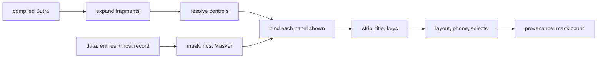

<!-- Copyright (c) 2026 Ashutosh Sinha. Specification licence: ../../LICENSE-SPEC.md (draft, not yet in force). -->
# Translation: Sutra + data → ViewModel, `rachana: 1`

**Status: draft 1 (2026-11-17).** Normative together with [SPEC.md](SPEC.md). Derived from the reference binder and
pipeline (Drishti `kernel/drishti-engine`: `bind/Binder`, `ChartBinder`, `PivotBinder`, `MapBinder`,
`view/ViewModel`, `PanelData`, `Emptiness`, `ScreenGrid`, `PhoneView`, `control/ControlResolver`, `wire/ScreenWire`,
`FormViews`, `ViewPipeline`), the Sutra model and builder (`compute/drishti-rachana`: `model/`, `parse/SutraBuilder`,
`format/`), the ViewModel reference (Drishti `docs/architecture/VIEWMODEL.md`, contract 1.0) and the renderer's
expectations (`drishti-console/web/static/elements/drishti-renderer/src`).

**The conformance suite is the executable form of these rules.** Its `sutra` cases (a Sutra, its data, control values,
as-of date → the expected ViewModel) live in `conformance/1/`. Where this prose and a case differ, **the case wins**
and the difference is a defect to fix in one of them.

## 0. The ViewModel schema

The ViewModel is specified here (decision D6) as `spec/1/viewmodel.schema.json` (JSON Schema draft 2020-12). It is
**in this repository as a draft transcribed by reading (see [VIEWMODEL.md](VIEWMODEL.md)); to be replaced in R0 step H4 by the schema generated** from the reference's generated schema (`ViewModelSchema`,
served by Drishti at `GET /api/v1/viewmodel/schema`, 55 definitions, every record closed). Until then the shapes the
rules produce are listed in this document (sections 2 to 4); field names and types here are those of contract `1.0`.
The ViewModel versions independently of the language (`contract: "1.0"`; a renderer refuses a major it does not know,
Drishti Render's `DRS-9105`, and ignores what a newer minor adds).

Principles every rule obeys:

1. **Data, no logic.** The output holds no expression, no format name to apply, nothing to evaluate. A painter walks it.
2. **Formatted text plus a tone.** Every value a person reads is already text (`text`) with an optional tone word;
   numbers travel beside their text only where a chart must draw them (`value`, `x`, `from`, …).
3. **Masks applied before.** A masked value arrives as `•••`; nothing in the output lets a client recover it.
4. **Failures stay local.** A panel that cannot bind carries `error` and no `data`; a strip value that fails is blank.
5. **Absent means default.** Fields are left out when null (and, where marked, when empty or `false`); a reader MUST
   treat a missing field as its default. Conformance compares after dropping `timings`, `provenance.fetchedAt` and
   `provenance.updatedAt`.

## 1. The translation in order



Inputs: the compiled Sutra; the record `$` (the host's record, with each `data:` entry added as a field, SPEC 2.4);
the request's control values (`ctl.<id>=…`); the as-of date (`asof()`); the events fired so far (`@panel`); the host
hooks (`Masker`, `LinkResolver`, `Calendars`, `Clock`, `TableProvider`, formats).

| Step | Rule |
|---|---|
| T1 fragments | every `{use: name@version}` is replaced by the fragment's panels before anything else; the output never shows that a panel came from a fragment, except `phone.panels.<id>.from: fragment` |
| T2 controls | each control's value is resolved (section 5) and bound as `ctl.<id>` for every later step |
| T3 masking | the host's `Masker` replaces values the reader may not see with the mask before any expression reads them (section 9) |
| T4 panels | top-level panels in Sutra order; a panel whose `when` is falsy, masked or fails is **left out of `panels`** (a `when` that reads an event is kept: it waits). Each shown panel is bound independently (section 3); the order of `panels` is the Sutra order |
| T5 strip, title, keys | section 2 |
| T6 layout, phone | copied and resolved (section 2.6) |
| T7 provenance | `masked` counts the cells shown as `•••` across title, strip and every panel; `maskedPanels` the ids holding one |

Evaluation errors never stop the translation: a strip or title part that fails is blank (or the identifier), a panel
that fails carries `error`.

### 1.1 Common rules used below

**R-CELL (a value becomes a Cell).** Given a value `v`, a label, a format `fmt`, a tone `tone`, `emphasis` and a path:
- `v` a link → `{label, text: link label or id, link: LinkView}` (no tone);
- otherwise `text` = `v` formatted by `fmt` (R-FMT), `tone` = R-TONE(`tone`, `v`), `emphasis` if set, `path` if known.

```text
bind: "$.mtm", fmt: signed0, tone: sign, emphasis: true, with $.mtm = 1209000
→ {"label": "MTM", "text": "+1,209,000", "tone": "pos", "emphasis": true, "path": "$.mtm"}
```

**R-FMT.** No format: the value's text form (SPEC 4.2; empty → `""`). A known format: that format's rendering (the
[formats.yaml](formats.yaml)), a masked value → `•••`, a link → its label, empty → `""` [CS]. An unknown name: the text form.

**R-TONE.** SPEC 2.6. No tone word → no tone. A masked value never gets `pos`/`neg`.

**R-LINK.** A `link(id, kind?, label?)` value becomes `LinkView {kind, id, mnemonic?}` through the host's
`LinkResolver`; without a kind the resolver may recognise the id; when it cannot, the cell has no `link`. A link the
reader may not follow is removed by the host before the view is sent.

**R-PATH.** A cell's `path` is the first document path its expression reads (`$.legs[0].rate`), when the expression is
rooted at `$`; table rows carry `<rows path>[<index in the data>]`. Paths are diagnostic and address live patches.

**R-ROWS.** A list option (`rows`, `each`, `nodes`) is an expression that MUST give a list; anything else is treated
as no rows. Then the panel's `where` (an expression over each row `@`) keeps the rows for which it is truthy; a row
whose condition is masked or fails is dropped. `#index` inside a row is its index **in the data**, not among the kept.

**R-FIELD (chart field options).** Options naming a field of each row (`label`, `value`, `x`, `y`, `open`, `date`, …)
are read as: an **expression over the row** when the text starts with `@` or `$` or contains `(` or a space; else a
**dotted path** when it contains `.`; else the **field**, falling back to the same name in upper case when the row has
no such field (`close` reads `CLOSE`). [today; the heuristic is pinned by CS and is a candidate for an explicit form in
a later minor.]

## 2. Top level

### 2.1 The envelope

```json
{"contract": "1.0", "title": {"pill": null, "id": "Regional sales", "with": null}, "strip": [], "panels": [ … ],
 "keys": [], "provenance": { … }, "timings": { … }}
```

| Field | Rule |
|---|---|
| `contract` | always `"1.0"` for this specification |
| `ref`, `mnemonic` | the host's entity address and command code when the screen is opened on a host record (profile); a Core screen without one: to be settled with the schema import (R0) |
| `title` | 2.2 |
| `strip` | 2.3, always present |
| `panels` | T4 and section 3, always present |
| `keys` | 2.5, always present (may be empty) |
| `controls`, `selects` | section 5; left out when empty |
| `layout` | 2.6; left out when the Sutra has none |
| `phone` | 2.6; left out when the Sutra says nothing |
| `provenance` | T7; the rest of its fields (`layout`, `fingerprint`, `source`, `generation`, `businessDate`, `live`, `stale`, …) are the host's |
| `timings` | the host's diagnostics; excluded from conformance |

### 2.2 `title` → `TitleView {pill, id, with}`

| Sutra | ViewModel |
|---|---|
| `title.id` (expression) | `id` = its text form; when it fails or is blank, the host's id for the screen |
| `title.pill` (template) | `pill` rendered; `null` when absent or failing |
| `title.with` (expression) | `with` = R-CELL of the value with no label, format or tone (a link keeps its link); `null` when absent, empty or failing |
| `title: "text"` [planned, 1.1] | `id` = the text, `pill` and `with` null |
| no `title` | `id` = the host's id or the Sutra name |

```yaml
title: { pill: "Trade · ${$.product}", id: "$.trade_id", with: "link($.cpty, 'counterparty', $.cpty_name)" }
```
```json
{"pill": "Trade · Swap", "id": "MX-1", "with": {"text": "Northbridge", "link": {"kind": "counterparty", "id": "CP-N"}}}
```

### 2.3 `strip` → `Cell[]`

One cell per item, in order: R-CELL(`label`, value of `bind`, `fmt`, `tone`, `emphasis`, path of `bind`). A `bind`
that fails gives the value empty (its text `""`). No item is ever left out (live patches address strip cells by index).

```yaml
strip: [ { label: Notional, bind: "$.notional", fmt: amount0 }, { label: MTM, bind: "$.mtm", fmt: signed0, tone: sign, emphasis: true } ]
```
```json
[{"label": "Notional", "text": "25,000,000", "path": "$.notional"},
 {"label": "MTM", "text": "+1,209,000", "tone": "pos", "emphasis": true, "path": "$.mtm"}]
```

### 2.4 `description`, `notes`, `doc`

Never in the ViewModel.

### 2.5 `keys` → `KeyView[]`

1. Every bound panel with `key: Fn` gives `{key, label, action: "panel", panel: id}`; `label` is the panel's title cut at
   the first ` · ` or ` (`.
2. Each `keys:` entry: `raw` → `{action: "raw", label: "Raw JSON"}` and `impact` → `{action: "impact"}` are profile
   actions; a value starting `link(` is evaluated: a link → `{action: "link", link, label: the kind in words}`, anything
   else → no key; any other text is a panel id → `{action: "panel", panel: text, label: text}`.
3. Sorted by key number (`F2` before `F10`).

### 2.6 `layout`, `phone`, `refresh`

- `layout:` is copied as an object (`areas`, `columns`, `split`, `tabs`, `sections`, `sticky`, `arrange`, `phone`,
  `tablet`) with `place: {panelId: {area, order?, section?, collapsible?}}` for each top-level panel. A panel's `area:
  main | right` maps to the first or last named area. Without `layout:` the field is left out and each panel's `area`
  (`main` by default) says its column.
- `phone:` becomes `phone: {panels: {id: {tier, from, rows, columns, sort, series, figures, tab}}, order, default,
  summary}`; `summary` is a template rendered against `$`.
- A panel's `refresh` (or the top-level one for a top-level panel without its own) becomes
  `refresh: {every, userCanPause}`.

## 3. Panels

### 3.0 The panel envelope → `PanelView`

| Field | From | Sent |
|---|---|---|
| `id`, `kind` | the panel | always |
| `title` | the `title` template rendered against the panel's context; when rendering fails, the template as written | when set |
| `code`, `key` | as written | when set |
| `area` | `main` or `right` | always |
| `span`, `height` | as written | when set |
| `inferred`, `explanation` | `false` and absent for a Core Sutra (inference is not Core) | `inferred` always |
| `data` | the kind's record (3.1 to 3.20) | unless `error` or `denied` |
| `empty` | section 4 | always |
| `error`, `denied` | section 4 | when set |
| `wire`, `refresh`, `form`, `provenance`, `compute` | sections 6, 2.6, 7; `provenance` and `compute` are host states | when set |

The **panel's context**: `$` the record; with a `source: { table }` [today], `$src` is that table's rows and list
options read them; inside `tabs`, `@` is the tab's element.

### 3.1 `kv` → `Fields {fields: Cell[]}`

Without `rows`: one R-CELL per `columns` entry (`label`, `bind`, `fmt`, `tone`, `link`), path from `bind`. With `rows`
(an expression giving one record): the columns are evaluated with `@` that record, no paths. With `rows` and no
`columns`: one cell per plain field of the record (no lists, no objects, names starting `_` skipped), labelled by the
field name in words. A column with `link: true`, or whose `bind` is a path ending in an id-like name (`_ID`, `_REF`,
`Id`, `Ref`, `_id`) [today; profile-flavoured, see section 11], links its value through R-LINK.

```yaml
- { id: terms, kind: kv, columns: [ { label: Coupon, bind: "$.coupon", fmt: pct2 } ] }
```
```json
{"fields": [{"label": "Coupon", "text": "4.25%", "path": "$.coupon"}]}
```

### 3.2 `table` and 3.3 `ladder` → `Table`

| Output | Rule |
|---|---|
| `columns` | the columns' labels |
| `numeric` | per column: `true` when it has a `fmt` other than `date` and `text` |
| `rows` | R-ROWS, then for each kept row up to `limit`: `{cells, highlight, path}`; each cell R-CELL with `@` the row; `highlight` = truthiness of `highlight` for the row; `pick` = the row's `on-select.field` (else the control id) as text, omitted when empty or masked; `ev` = the row's index in the data when the panel emits on `row-click` |
| `total` | when any column has `total: true`: one cell per column, the sum over **all kept rows** (not only those shown) of the column's numbers (non-numbers count 0; a masked value makes that column's total `•••`), formatted and toned as the column; other columns `{}`; the label `totalLabel` (default `Total`) is put in the first blank cell before the first total column |
| `more` | when kept rows exceed `limit`: `moreLabel` evaluated, else `"<n> more"` |
| `search` | `false` only when `search` is `false` or `no` |
| `limit` | a number, or an expression (`ctl.top`); below 1, empty or failing → no limit |
| `expand`, `levels`, `root`, `crumb` | trees (`children`: rows nest, `expand` levels open, depth ≤ 12, ≤ 10,000 rows) and drill tables (`levels`) [CS] |
| `emptyLabel` | the `empty` option |
| `pivot` | the profile's pivot screen; absent in Core |

```yaml
- { id: legs, kind: table, rows: "$.legs", limit: 1,
    columns: [ { label: Leg, bind: "@.id" }, { label: Notional, bind: "@.notional", fmt: amount0, total: true } ] }
```
```json
{"columns": ["Leg", "Notional"], "numeric": [false, true],
 "rows": [{"cells": [{"label": "Leg", "text": "1"}, {"label": "Notional", "text": "242,000,000"}], "highlight": false, "path": "$.legs[0]"}],
 "total": {"cells": [{"text": "Total"}, {"text": "484,000,000"}], "highlight": false},
 "more": "1 more", "search": true}
```

A ladder is the same translation without `limit`, `moreLabel` and `link`; `highlight` marks the current row.

### 3.4 `tabs` → `Tabs {layout, tabs: [{title, fields, panels?}]}`

For each element of `each` (index `i`): `@` = the element; `title` = `tabTitle` evaluated (default `'#' + (#index +
1)`); `fields` = the `body` columns as R-CELL; `panels` = each panel of `panels:` whose `when` holds, bound as in 3.0
with `@` the element (not part of `layout.place`). `layout` = the option, default `tabs` (or `columns`).

### 3.5 `line` → `Chart`

`rows` (default the field `points`) by R-ROWS; `x` = the text of field `x` (default `tenor`) of each row; one series
`{label: the panel's title as written, values: field y (default value) of each row as numbers (null where not a
number), tone: "link"}`; `mark` = the `mark` expression's text when non-empty, and when it is one of the `x` labels,
`markText` = `"<mark> point <value in fmt><unit>"`; `unit`; `step: true` when `step` is `true`. A `source` naming a
linked entity (profile) adds `source: LinkView` and reads the rows from it.

### 3.6 `area` → `Chart`

`x` as for `line`; one series per `series` entry `{label, value (field), tone}` with that field's numbers; `limit` =
the `limit` expression as a number when finite, with `limitLabel`; `unit`.

### 3.7 `hbar` → `Bars {bars, shape?, total?}`

For each kept row whose `value` field (default `value`) is a finite number: `{label: field label (default label),
value, text: value in fmt, tone: R-TONE(tone, value) or, without tone, neg below 0 else pos, ev?}`. Rows without a
number are not bars. `shape: donut` adds `shape` and `total` = the sum in `fmt`.

```yaml
- { id: by-region, kind: hbar, rows: "group($.sales, 'region', 'revenue')", fmt: amount0 }
```
```json
{"bars": [{"label": "North", "value": 1200.0, "text": "1,200", "tone": "pos"}, {"label": "South", "value": -80.0, "text": "−80", "tone": "neg"}]}
```

### 3.8 `metric` → `Metric {value, delta, unit, caption}`

`value` = R-CELL(`label`, value of `value` (a failure reads as empty), `fmt`, `tone`, emphasis `true`, path); `delta`
= R-CELL(no label, value of `delta`, `deltaFmt` or `fmt`, `deltaTone` or `sign`) when `delta` is set and its value is
not empty (masked counts as a value); `unit` as written; `caption` = the template rendered (as written on failure).

### 3.9 `gauge` → `Gauge {value, max, text, label}`

`max` = the `max` expression as a finite number, else `1`. When `value` is a finite number: `text` = `value / max`
(max 0 read as 1) in `fmt` (default `pct0`). Otherwise `value` = null and `text` = `•••` if masked, else `—`. `label`
as written.

### 3.10 `status` → `Fields`

One R-CELL per `fields` entry `{label, bind, fmt?, tone?}`, path from `bind`; usually `tone: status`.

### 3.11 `markdown` → `Text {text}`

The `text` template rendered. Treated as plain text by painters (never as HTML).

### 3.12 `surface` → `Surface {x, y, z, min, max, fmt, unit, view}`

`x` = the columns' labels; for each kept row: `y` label = the row's `y` (expression when it starts `@` or `$`, else the
field) as text; `z` row = each column's `bind` as a number, null where not finite; `min`/`max` over finite values
(null when none); `view` default `heatmap`.

### 3.13 `waterfall` → `Waterfall {steps, unit}`

Rows (at most 5,000) in order; a row whose `value` (default `value`) is not finite is skipped. A row whose `total`
field (default `total`) is truthy is a total step `{from 0, to v, tone muted, total true}` and resets the running total
to `v`; any other is `{from run, to run + v, tone: rise/fall}` with rise/fall `ok`/`bad` (`colors: gain-loss`, the
default) or `pos`/`neg` (`colors: theme`). `sum: <label>` appends a total step with the running total (`•••` if any
value was masked). `text` = the value in `fmt`.

### 3.14 `histogram` → `Histogram {bins, markers, count, dropped, fmt, unit}`

Values: each row itself, or its `value` field; at most 100,000; non-finite values counted in `dropped`. `k` = `bins`
when given, else `round(sqrt(count))` held to 5..40; one bin when all values are equal. Equal-width bins from the
smallest to the largest value, `[from, to)` except the last (closed); `label` = `"<from> to <to>"` in `fmt`.
`markers`: each `{label, value (expression), tone}` with a finite value, `text` in `fmt`, tone default `accent`.

### 3.15 `scatter` → `Scatter {points, groups, xLabel, yLabel, sized, more}`

For each kept row with finite `x` and `y`: a point `{x, y, size? (absolute value), xText (in xFmt or fmt), yText (in
fmt), label?, group?, link?}`; at most 5,000 points, the rest counted in `more`. `groups` = distinct non-empty groups
in first-seen order. `xLabel`/`yLabel` default to the `x`/`y` options as written; `sized` = `size` given.

### 3.16 `candlestick` → `Candles`

The last 5,000 rows; a row needs four finite prices (`open`, `high`, `low`, `close`, default those names). `high` and
`low` are widened to include open and close. Each candle carries its prices and their texts in `fmt`, and volume (with
`volumeText` in `amount0`) when the `volume` field is finite. `last` = the last close in `fmt`; `change` = sign + the
absolute change against the previous close (or the bar's own open) in `fmt` and, when that is not 0, `(±pct2)`; the
sign is `+` or the minus sign `−` (U+2212); `tone` = `sign` of the change.

### 3.17 `graph` → `Graph {nodes, edges, layout, more}`

Nodes from `nodes` (R-ROWS): `id` = field `id` (or `ID`), required and unique; `label` (default field `label`, the id
when empty); `group` (default field `type`); `link` via R-LINK using field `kind`; `focus` when the id equals the
host's record id (profile; always `false` in a Core screen without one). At most 300 nodes (`more` counts the rest).
Edges from `edges`: `{from, to, label?}` (fields lower or upper case), kept only when both ends are nodes; at most 600.
`layout` default `tree`.

### 3.18 `timeline` → `Timeline {events, more}`

For each kept row: `date` (default field `date`), `label` (default `event`), `detail` (default `description`), `status`
(default `status`) as text, `tone` = R-TONE(`tone` (default `status`), status); a row with neither date nor label is
skipped. Sorted by `date` as text (stable); at most 500, keeping the **latest**, with `more` the number dropped.

### 3.19 `pivot` → `Pivot`

Rows (at most 100,000) grouped by `by` (one field or a list, outermost first) and `across`; the cell value is: `count`
of rows when `value` is absent; an aggregate call over `@` when `value` is one (`sum(@.mtm)`, `percentile(@.pnl,
0.99)`); else the `value` field aggregated with `agg` (default `sum`). `fmt` (ignored for `count`), `tone`, `heat`,
`totals` (default on: column totals then the grand total). Row keys first-seen order, at most 200 (`more`); column
keys first-seen order, at most 40 (values under further keys count in totals only). Nested `by` adds `levels`,
`expand`, `across`, and per row `path` and `group` [CS for the full shape; aggregation by the list-aggregate kernel].

### 3.20 `map` → `GeoMap {mode, highlight, region, link, shade, unit}`

`mode` `world` or `region`; `highlight` and `region` evaluated as text; `link` (`{kind, template, codes, note}`) and
`shade` (`{label, unit, items: [{code, value, text}], note}`) need entity lookups and are filled by the host (profile
behaviour; a Core host without them leaves them out). Shapes are the painter's vendored files.

### 3.21 Profile kinds

`links` (`Links`) and `provenance` (`Fields`) are produced by the `drishti` profile's binders; a Core host that has the
declaration but not the binder marks them `unsupported here` (CORE_AND_PROFILES 3.1).

## 4. Panel states

Exactly one of these explains a panel without drawable data, decided in this order:

| State | Set when | Output |
|---|---|---|
| waits | a `when` or list reads an event not yet fired | `wire.waits` = the `waits` text; data per kind may be empty |
| denied | the panel's `source` names data the host refuses for this reader | `denied: "<words>"`, no `data`, `empty: true` |
| error | binding raised (an `RCH-2102`, data that does not fit the kind, a missing required list) | `error: "<code and words>"`, no `data`, `empty: true` |
| computing, failed (host) | the host's `compute` state | `compute: {state, …}` |
| empty | the bound data has nothing to draw | `empty: true`, `data` present |

`empty` per kind: `kv`/`status` every cell blank; `table`/`ladder` no rows; `tabs` no tab, or every tab blank with every
inner panel empty; `line`/`area` no `x` or no finite value in any series; `hbar` no bar; `markdown` blank text;
`metric` blank value; `gauge` value not finite; `surface` no finite value; `waterfall`, `scatter`, `candlestick`,
`graph`, `timeline`, `pivot` nothing listed; `histogram` count 0; `map` empty only in `region` mode without a region.
A painter shows the table's `emptyLabel`, else "No data available".

## 5. Controls → `controls`, `selects`

Each control gives `ControlView {id, kind, label (default the id), placement (default strip), panel?, parent?,
options: [{value, label}], value, values?, required, remember, min?, max?, step?, range, reads, truncated}`:

1. **Options**: the written `options` as `{value, label}`; else `from` evaluated against `$` (with `ctl.<parent>` known
   for a cascading control): the scalar values of the list (or the value), in first-seen order, empty and masked
   values left out, records offering their `id` (or `ID`); a `from` that fails gives no options. A date-range control's
   options are its presets resolved on the calendar. Options are cut at the maximum (`truncated: true`). A masked value
   is never an option.
2. **Value** (single-valued kinds): the request's value when it is an option; `""` when the request cleared it and the
   control may be empty; else `default` when it is an option; else, when the control must have a value (`required`,
   `default: first`, `toggle`, `segmented`, `top-n`), the first option; else `""`.
3. **Values** (`multi-select`): the request's comma-separated values that are options; else `default: all` → every
   option, `default: first` → the first, a written default → those of its values that are options.
4. `reads` = the ids of the panels (and `strip`, `title`) whose expressions read `ctl.<id>`: only they change when it
   does.

Each panel's `on-select: {by, field?, filter?}` adds `SelectView {panel, by, filter}`, and its rows carry `pick`
(3.2).

## 6. Events and children → `wire`

`wire: {emits: [{name, on}], waits?, children: [{place, show}], source?, parent?}` for a panel with events, children
or its own source. A child panel is bound with `@parent` the parent's events; a group with `show: always` is bound at
once, any other only after the parent fired; a child's `when` decides as in T4. A row-click or bar-click payload
refers to the row by its data index (`ev`). The full event round trip (what a host sends back and which panels it
rebuilds) is pinned by [CS].

## 7. Forms → `form`

A panel's `form:` becomes `form: {fields: [{id, label, bind, type, required, readonly, options?, value, …}], rules,
hints, steps, …}`, with each field's current value evaluated against the panel's row or record, choices of lookups
resolved, and for a table each row's values. Fields the reader may not edit come `readonly` or `locked` with a
`reason`; masked fields come `masked`. The keys `save`, `target`, `approval`, `editableBy`, `roles` are the profile's
(`form.save`, decision D2) and are absent in Core. Core raises a `submit` action with the field values; the host
saves. The exact field list is pinned by [CS].

## 8. Formats, tones, determinism

- Every `fmt` resolves through the shared format table at translation time; the output carries text, never a format
  to apply, except `fmt` echoed on `histogram`, `surface` and `candlestick` for axis labels a painter draws.
- Order is deterministic: panels in Sutra order (fragments expanded in place), cells in column order, keys by number,
  options and groups in first-seen order, timeline by date, pivot keys first-seen.
- Numbers that a chart draws are doubles; NaN and the infinities are written `null`.

## 9. Masking

The host's `Masker` decides which values are masked, with the reader's context; Core only carries the mask
(SPEC 4.9). In the output: any cell whose value is masked has `text: "•••"` and no tone from `sign`; totals, sums,
gauges and waterfall sums computed from a masked value are `•••`; a chart point or bar whose number is masked is left
out (it has no finite value); a control never offers a masked value; `provenance.masked` and `maskedPanels` count
them (T7).

## 10. `data:` entries [planned]

Before T4, each `data:` entry is read through its source (SPEC 2.4) and set as the field of `$` of the same name: a
table as a list of row objects (columns in schema order), a record as an object. `where` and `limit` of the entry apply
first. A table the host marks server-side is never summed locally: panels over it bind from the host's push-down
answer (Data Protocol). A failed or denied entry makes the panels that read it `error` or `denied` (section 4); the
others bind. Live changes to a keyed table produce ViewModel patches for the panels and cells whose paths read the
changed columns.

## 11. Differences found in the reference

To settle with the conformance suite (each is a defect in the reference or a rule to change here):

1. `line`'s series label is the panel's title **as written**, not rendered (a `${…}` would show raw).
2. R-FIELD's heuristic (an option is an expression if it contains a space or `(`) means a field name with a space is
   read as an expression.
3. The id-like column rule in 3.1 (`_ID`, `Ref` … link automatically) is a data-platform convention; Core should keep
   linking only with `link: true` or a `link(...)` value, the convention moving to the `drishti` profile.
4. VIEWMODEL.md says a missing value's text is "missing or `—`"; the reference formats empty as `""` (only `gauge`
   writes `—`).
5. `graph.focus` and `line.source` need a host record; for a Core screen they are always `false` / absent.
6. `ref`, `mnemonic` and most of `provenance` describe a platform entity; their Core values for a screen over `data:`
   are to be settled with the schema import (R0).
